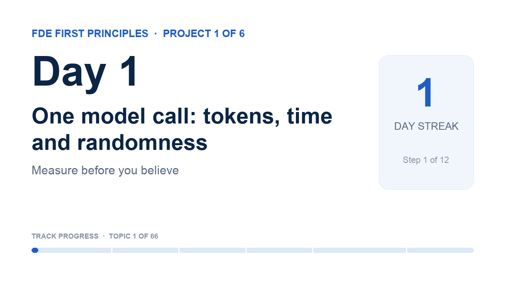

# YouTube details · Day 1

The coach sets these on your video when you ship with `fde-coach learn done --video <link>` (YouTube connected with `fde-coach youtube-auth`). Not connected? Paste them in YouTube Studio.

## Title

```
Day 1 · One model call: tokens, time and randomness | FDE First Principles
```

## Description

```
What does one model call really cost in tokens and seconds, and why does the same prompt give different answers?

Day 1 of 66 in FDE First Principles · Project 1 of 6: Measure before you believe
A public learning log: a software architect learning AI from first principles for the Forward Deployed Engineer role. One topic at a time, built from scratch and explained in plain words.

In this video
▸ For a beginner: Calling an LLM is just sending a JSON message over the internet to a server and getting JSON back — same as any website form.
▸ For an engineer: One POST to `/api/chat` returns the reply text plus the real numbers: tokens in, tokens out, nanoseconds. No SDK needed to debug at this level.
▸ For a customer: Same question ≠ same answer. Temperature 0.8 gave different replies every time; temperature 0 with a seed gave the identical one. Determinism is a setting, not a promise.

What surprised me
The reply text included the model's private "thinking" ("Okay, the user wants me to reply ") even though I only asked for an answer — the JSON shows exactly what the model said, nothing more.

Learn it yourself (free)
• Ollama API: generate a chat message: https://docs.ollama.com/api/chat
• Deep Dive into LLMs like ChatGPT (Andrej Karpathy): chapter 'inference': https://www.youtube.com/watch?v=7xTGNNLPyMI&t=1561s

My notebook and journal for this topic
https://github.com/rajchampaneriya/continuous-learning/tree/main/fde-first-principles/1-measure-before-you-believe/01-an-llm-call-is-http
The whole learning log: https://github.com/rajchampaneriya/continuous-learning/tree/main/fde-first-principles

How this series runs
Every topic drops on a schedule with a deadline, a calendar event and this video as its finish line; each project ends with an article. The coach that runs it is open source: FDE Impromptu Coach, https://github.com/rajchampaneriya/fde-impromptu-coach
Articles: https://rajc.work

#FirstPrinciples #AIEngineering #ForwardDeployedEngineer
```

## Tags

```
FDE First Principles, first principles, AI engineering, forward deployed engineer, machine learning, LLM, learning in public
```

## Thumbnail



Upload `thumbnail.png` as the custom thumbnail (YouTube Studio → Details → Thumbnail).
