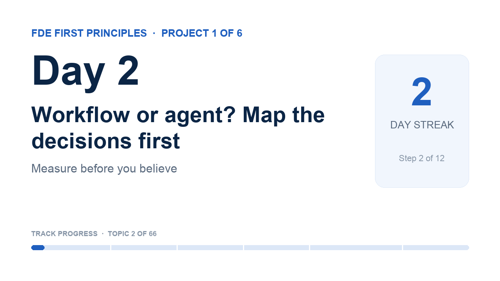

# YouTube details · Day 2

The coach sets these on your video when you ship with `fde-coach learn done --video <link>` (YouTube connected with `fde-coach youtube-auth`). Not connected? Paste them in YouTube Studio.

## Title

```
Day 2 · Workflow or agent? Map the decisions first | FDE First Principles
```

## Description

```
Which steps in this process truly need a model, and what does a wrong answer cost?

Day 2 of 66 in FDE First Principles · Project 1 of 6: Measure before you believe
A public learning log: a software architect learning AI from first principles for the Forward Deployed Engineer role. One topic at a time, built from scratch and explained in plain words.

In this video
▸ For a beginner: Not every task needs AI. We should first understand the problem, identify which steps require judgment, and use AI only where traditional software is not sufficient.
▸ For an engineer: I would start with a deterministic workflow and introduce LLM calls only for tasks involving language ambiguity or contextual generation. I would evaluate their accuracy, cost, and failure modes before considering more autonomous execution.
▸ For a customer: My goal is not to introduce AI everywhere. I want to understand your existing process, identify the most valuable improvement opportunities, and work with your team to choose a reliable and measurable solution.

What surprised me
A customer-support process may involve many steps, but only a few might benefit significantly from an LLM. The difficult part is identifying where model intelligence adds enough value to justify its risks.

Learn it yourself (free)
• Building effective agents (Anthropic): https://www.anthropic.com/engineering/building-effective-agents

My diagram and journal for this topic
https://github.com/rajchampaneriya/continuous-learning/tree/main/fde-first-principles/1-measure-before-you-believe/02-workflow-or-agent
The whole learning log: https://github.com/rajchampaneriya/continuous-learning/tree/main/fde-first-principles

Previous: Day 1 · One model call: tokens, time and randomness: https://youtu.be/vc5h1lX4Rwo

How this series runs
Every topic drops on a schedule with a deadline, a calendar event and this video as its finish line; each project ends with an article. The coach that runs it is open source: FDE Impromptu Coach, https://github.com/rajchampaneriya/fde-impromptu-coach
Articles: https://rajc.work

#FirstPrinciples #AIEngineering #ForwardDeployedEngineer
```

## Tags

```
FDE First Principles, first principles, AI engineering, forward deployed engineer, machine learning, LLM, learning in public
```

## Thumbnail



Upload `thumbnail.png` as the custom thumbnail (YouTube Studio → Details → Thumbnail).
