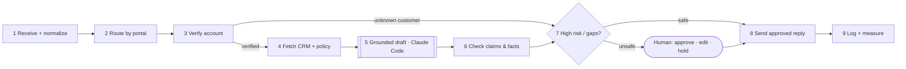

# Acme Review Studio

Your Acme Fibre draft workflow as a LangGraph graph, plus a Shiny app where the Principal Domain Expert
reviews one case at a time instead of working in Excel. The eval workbook stays the system of record:
the app reads it and writes reviews back to it.



Only step 5 calls a model. Steps 6 and 7 are plain Python you can read and test:
**step 6** checks every claim in the draft against the data fetched in step 4 (ticket IDs, ₹ amounts,
fix-time promises, refunds over ₹500, other customers' data, requests for OTPs or passwords), and
**step 7** escalates if the model asked for a human, a check found a blocking problem, or an
escalation guard (legal threat, injected instructions, refund over ₹500, …) matches the email.
The human step is a real LangGraph `interrupt`: the run pauses and resumes when you decide.

## Set up (once)

1. Python 3.10 or newer.
2. Install the dependencies:
   ```bash
   python -m venv .venv
   source .venv/bin/activate        # Windows: .venv\Scripts\activate
   pip install -r requirements.txt
   ```
3. Install [Claude Code](https://code.claude.com/docs/en/overview) and run `claude` once to log in.
   Check with `claude auth status`. The app calls `claude -p` with your login, so there is no API key to manage.

## Run it

```bash
shiny run app.py --launch-browser
```

The app starts with the **offline stand-in** drafter so you can click around without using Claude.
Open **⚙ Model** (top right) and switch to **Claude Code** when you're ready.
The stand-in is rule-based and wrong on purpose (it promises fix times and offers 50% to everyone),
so you can watch the checks catch it.

## The expert's loop (Critique Shadowing)

| Step | Where | What you do |
|---|---|---|
| 3 · Review data | **Cases** | Select a case, fix its label (intent, should-go-to-human, must include, must not say), set *Expert check*. |
| 3 · Review drafts | **Review** | **Run all cases not yet run**, then judge each draft: **P** = pass, **F** = fail (pick a failure mode, write the critique, **Ctrl+Enter**). **J/K** move between cases. |
| 4 · Fix and re-review | **Knowledge**, **⚙ Model** | Fix an article, an outage or a guard, then run the working copy again. The new snapshot is a separate version; select versions to compare on the Scoreboard. |
| 5 · Build the judge | **Save to Excel** | Your verdicts and critiques land in the workbook's Review_Log: the few-shot examples for an LLM judge. |
| 6 · Error analysis | **Scoreboard** | Pass rate by intent, routing vs. expected (missed escalations first), failure modes, results per escalation rule. |

## Versions and simulations

Every run is pinned to one immutable version. A run of **Working copy** automatically freezes the
current model, guards, workbook data and lab data. The version banner identifies the snapshot and
its pins; naming the snapshot on the Scoreboard makes it a candidate without changing its id.
Changing working-copy settings never changes an in-flight batch or a held run.

On **Simulator**, select a version and a dataset case or enter a free-form message. Only fields
supported by that version are shown. Select spans to inspect the evidence actually produced: the
step graph for the studio workflows, C3's envelope and tool-call timeline, the HTTP exchange, or
a fallback span tree. C3's nested trace appears under step 5; it does not show the studio prompt
that C3 did not use. A held run can be sent as-is, edited or held without sending.

Choose **Compare with** to run the same input against a second version. The comparison shows
the manifest differences, routing, grades, usage and reply diff. **Samples** runs the selected
version repeatedly and summarizes the spread of graded results. Select a saved run from **Run
history** to inspect or resume it. When available, **Recorded** replay reuses the saved model
response rather than calling the provider; it requires the same version and input.

The Review page's version selector and the Scoreboard use the same saved evidence. The Scoreboard
compares dataset results with missed escalations and regressions first. To release a candidate,
complete and grade a current run for every dataset case, resolve any held runs, and provide the
reviewer's sign-off on the Scoreboard. Retired versions remain inspectable and can be run only
with **Run as audit**; an already-held run from a retired version is read-only.

Before a run, the Studio reports changes since a snapshot was frozen. Candidates may run with a
drift warning; released versions with drift are blocked unless **Run as audit** is selected.
Python code is pinned by commit and file hashes, not executed from a frozen copy: a drifted run
uses the current code with the frozen data and is tagged accordingly.
Working-copy model and guard edits are also reported as drift against an older working-copy
snapshot. A changed label is marked as an earlier label on saved review evidence.

Example manifests in `workflows/` cover the orchestrated studio, an allowlisted declarative graph,
standalone C3, Version B, the offline callable and a remote HTTP agent. The Studio freezes new
manifest name/label combinations on startup; change the label when introducing a revised manifest.
Version B uses the dataset's expected intent as its original oracle context, or a keyword estimate
for a free-form message. Its default model is local Ollama `qwen3:4b`.

The remote example is a placeholder, not a production endpoint. Configure its HTTPS endpoint and
an environment-variable auth reference in the manifest, set `ACME_SIM_ALLOWED_HOSTS` to a
comma-separated hostname allowlist, and set the referenced token at runtime. HTTP is allowed only
for an explicitly allowlisted loopback host; cross-origin redirects are refused. Declarative
specs can use only the built-in node and edge allowlist.

What the Review page shows so you don't have to look it up:
- the customer's CRM facts as chips next to the email,
- what a good reply contains (green) and must never say (red), highlighted inside the draft,
- whether the intent and the routing matched the expected answer,
- a suggested failure mode, pre-selected, which you can change.

## Where things are saved

| File | What |
|---|---|
| `data/Acme_Fibre_Grounded_Draft_Eval.xlsx` | Cases, customers, outages, articles. **Save to Excel** writes your edits and reviews here and keeps a timestamped backup next to it. |
| `runs/reviews.json` | Latest run and your review per `(version_id, case_id)`. Old round keys remain readable as `legacy-round-N`. |
| `runs/simulator.sqlite` | Frozen version manifests, runs, spans, grades and lifecycle state. |
| `runs/artifacts/sha256/` and `runs/snapshots/` | Deduplicated workbook, sheet and lab-data snapshots and materialized lab files. |
| `runs/runs.jsonl` | Step 9 log: model, latency, decision, flags, outcome and version id. |
| `runs/checkpoints.sqlite` | Version-prefixed LangGraph checkpoints, so a held reply resumes on its original version. |
| `runs/settings.json` | Working-copy model, parallel drafts, guards and retention setting. |

To use a different workbook or runs directory:

```bash
ACME_XLSX=/path/to/file.xlsx ACME_RUNS_DIR=/private/path/runs shiny run app.py
```

Run records, traces, checkpoints and logs redact common OTP/password patterns and configured
secrets. Snapshot artifacts retain the original workbook and knowledge bytes for fidelity, so
keep the entire runs directory private. In **⚙ Model**, set retention in days and select **Apply
retention** to remove expired completed/failed runs, their checkpoints and old log entries.
Queued, running and held runs are kept; snapshots referenced by a run or review are protected.
Unreferenced anonymous snapshots are collected, but shared content-addressed artifacts are not
automatically garbage-collected.

`python import_cases.py` copies new cases, customers and policy rules from the lab's `data/acme/`
(`cases_abuse.jsonl`, `cases_multiturn.jsonl`, `cases_regional.jsonl`, `customers.json`, `policy.md`) into the workbook. It only adds
what is missing, so re-running it is safe. Multi-turn cases keep their earlier turns in the Dataset's `history`
column; the Review page shows them above the latest message, and step 5 sees them in its prompt.

## How the Claude Code call works

`acme/providers.py` runs, for each case:

```bash
claude -p --output-format json --json-schema '<draft schema>' \
  --system-prompt-file <acme prompt> --model sonnet \
  --disallowedTools "Bash,Edit,Write,..." --strict-mcp-config \
  --setting-sources user --permission-mode dontAsk --no-session-persistence
```

in an empty temporary folder, with the customer card, outage record and email on stdin. The structured
draft comes back in `structured_output`. The system prompt replaces Claude Code's coding prompt, the
tools it doesn't need are blocked, and no MCP servers load.
In testing a case took 5–9 s. Claude Code reports an *estimated* cost of a few cents per case; on a
Claude subscription it counts against your plan's usage. **Parallel drafts** (⚙ Model) sets how many run at once.

On Windows, prefer the native Claude Code installer (`claude.exe`). With the npm `claude.cmd`, the app
can't pass the JSON schema safely, so it asks for JSON in the prompt instead.

## Reviewing the C3 agent's drafts

Pick **C3 ontology agent (lab)** under ⚙ Model to have the lab's Version C3
(`fde-first-principles/lab/version_c3.py`) write the drafts, so your verdicts are about the agent the
lab measures rather than this studio's own drafter. Step 5 then builds C3's decision envelope and
calls its `run_agent()` loop with the case id, customer id, message and earlier turns.

- C3 builds its own decision envelope and calls its own tools, so it doesn't use the prompts step 4 builds.
- It reads customers, policy, help articles and the ontology from a frozen copy of
  `fde-first-principles/data/acme`, not from the workbook. An edit in the Data tab doesn't reach it;
  make policy and label changes in both sources, then freeze a new version.
- The model is `ACME_C3_MODEL` (default `anthropic:glm-5.3-flash`), with the key in
  `fde-first-principles/.env`. The Claude model setting doesn't apply.
- The draft's escalation reason lists C3's escalation sources (`rule:money_above_headroom`,
  `guard:reveals_limit`, `model`), so you can see why C3 handed an email to a person.
- Studio runs disable the lab's persistent model cache to avoid writing unredacted model responses
  outside the simulator store. Each case is up to 6 model calls; the lab stops at 500 calls per
  session (`LLM_MAX_CALLS`).
- It needs `pyoxigraph` and `requests` (in `requirements.txt`).

## Tests

The guardrails are specified as BDD scenarios in `tests/features/guardrails.feature` and run against a
scripted model, so they take under a second and never call Claude:

```bash
pytest
```

`tests/features/report_metrics.feature` does the same for the numbers in the reports below.

## Reports (Quarto)

`reports/` is a small Quarto website built from the workbook and `runs/reviews.json`: an **evaluation
report** for the release decision, a **dataset card** describing the test set, and a **review dashboard**
showing when and why the workflow involves a person. Rendering only reads files.

```bash
quarto render reports          # → reports/_site/index.html
```

Set-up, parameters, demo data and what each page answers: [`reports/README.md`](reports/README.md).

## Project layout

```
app.py               Shiny app (Review, Simulator, Cases, Knowledge, Scoreboard)
acme/workflow.py     LangGraph graph: the 9 steps + human interrupt
acme/checks.py       step 6 claim checks, step 7 guards, eval checks for the Review page
acme/providers.py    Claude Code (claude -p), the C3 lab agent and the offline stand-in
acme/sim/            version registry, adapters, run storage, trace rendering and comparison
workflows/           reviewed version manifests
acme/lab.py          load the workbook; export edits and reviews back into it
acme/store.py        runs/reviews.json and runs/settings.json
acme/ui_bits.py      CSS, keyboard shortcuts, the pipeline diagram
tests/               pytest-bdd features + step definitions
reports/             Quarto site: evaluation report, dataset card, review dashboard
```

## UI update · Raj Champaneriya

Navigation and key actions use bundled official Google Material SVG artwork, the
same icon family exposed by MUI. This Python Shiny app does not require React/MUI
packages. License and source mapping: `acme/icons/`.

Footer branding has been removed. Navigation has 24px side insets,
10px icon-to-label gaps, and softer decorative icons. Sidebar rows have more
padding. Case and workflow controls support native keyboard activation; workflow
steps stack in reading order on mobile. Existing navigation IDs remain unchanged.

Run `pytest` for the tests. See `REVIEW.md` for architecture/UX findings and
`reports/` for the Quarto evaluation site. `requirements-tested.txt`
records the resolved environment used during this review (Python 3.12.12).

## Reference Review layout

Review now follows the supplied visual reference: 320px case rail, A monogram and
profile identity in navigation, compact five-step workflow summary, framed customer
message, larger verdict actions, and bottom-aligned draft checkpoints. Full workflow
remains in Simulator. Actual data, provider labels and keyboard mappings are preserved;
no synthetic receipt times or Gemini attribution are added. New screenshots are
`review-reference-match.png` and `review-reference-mobile.png` in the delivery folder.
Validated at 1280×1024 and 390×844; 13 tests pass.

Knowledge and Scoreboard use consistent 24px desktop / 16px mobile outer insets.
Scoreboard metrics grow with their labels to prevent overlap. Header identity remains.
