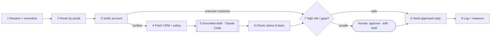

# Acme Review Studio

Your Acme Fibre draft workflow as a LangGraph graph, plus a Shiny app where the Principal Domain Expert
reviews one case at a time instead of working in Excel. The eval workbook stays the system of record:
the app reads it and writes reviews back to it.



Only step 5 calls a model. Steps 6 and 7 are plain Python you can read and test:
**step 6** checks every claim in the draft against the data fetched in step 4 (ticket IDs, ₹ amounts,
fix-time promises, refunds over ₹500, other customers' data, requests for OTPs or passwords), and
**step 7** escalates if the model asked for a human, a check found a blocking problem, or an
escalation guard (legal threat, injected instructions, refund over ₹500, …) matches the email.
The human step is a real LangGraph `interrupt`: the run pauses and resumes when you decide.

## Set up (once)

1. Python 3.10 or newer.
2. Install the dependencies:
   ```bash
   python -m venv .venv
   source .venv/bin/activate        # Windows: .venv\Scripts\activate
   pip install -r requirements.txt
   ```
3. Install [Claude Code](https://code.claude.com/docs/en/overview) and run `claude` once to log in.
   Check with `claude auth status`. The app calls `claude -p` with your login, so there is no API key to manage.

## Run it

```bash
shiny run app.py --launch-browser
```

The app starts with the **offline stand-in** drafter so you can click around without using Claude.
Open **⚙ Model** (top right) and switch to **Claude Code** when you're ready.
The stand-in is rule-based and wrong on purpose (it promises fix times and offers 50% to everyone),
so you can watch the checks catch it.

## The expert's loop (Critique Shadowing)

| Step | Where | What you do |
|---|---|---|
| 3 · Review data | **Cases** | Select a case, fix its label (intent, should-go-to-human, must include, must not say), set *Expert check*. |
| 3 · Review drafts | **Review** | **Run all cases not yet run**, then judge each draft: **P** = pass, **F** = fail (pick a failure mode, write the critique, **Ctrl+Enter**). **J/K** move between cases. |
| 4 · Fix and re-review | **Knowledge**, **⚙ Model** | Fix an article, an outage or a guard; set *Review round* to 2; run again. The Scoreboard compares rounds. |
| 5 · Build the judge | **Save to Excel** | Your verdicts and critiques land in the workbook's Review_Log: the few-shot examples for an LLM judge. |
| 6 · Error analysis | **Scoreboard** | Pass rate by intent, routing vs. expected (missed escalations first), failure modes, results per escalation rule. |

**Simulator** shows one run step by step, laid out like your diagram. Click a step to see what it did
(the prompt sent at step 4, the raw draft at step 5, flags at step 6, reasons at step 7).
When a reply is held, you play the human agent: send it, edit it, or don't send.

What the Review page shows so you don't have to look it up:
- the customer's CRM facts as chips next to the email,
- what a good reply contains (green) and must never say (red), highlighted inside the draft,
- whether the intent and the routing matched the expected answer,
- a suggested failure mode, pre-selected, which you can change.

## Where things are saved

| File | What |
|---|---|
| `data/Acme_Fibre_Grounded_Draft_Eval.xlsx` | Cases, customers, outages, articles. **Save to Excel** writes your edits and reviews here and keeps a timestamped backup next to it. |
| `runs/reviews.json` | Latest run and your review per (round, case). Saved on every click. |
| `runs/runs.jsonl` | Step 9 log: one line per run with model, latency, decision, flags, outcome. |
| `runs/checkpoints.sqlite` | LangGraph checkpoints, so a held reply can be resumed after a restart. |
| `runs/settings.json` | Drafting model, round, parallel drafts, guards. |

To use a different workbook: `ACME_XLSX=/path/to/file.xlsx shiny run app.py`.

## How the Claude Code call works

`acme/providers.py` runs, for each case:

```bash
claude -p --output-format json --json-schema '<draft schema>' \
  --system-prompt-file <acme prompt> --model sonnet \
  --disallowedTools "Bash,Edit,Write,..." --strict-mcp-config \
  --setting-sources user --permission-mode dontAsk --no-session-persistence
```

in an empty temporary folder, with the customer card, outage record and email on stdin. The structured
draft comes back in `structured_output`. The system prompt replaces Claude Code's coding prompt, the
tools it doesn't need are blocked, and no MCP servers load.
In testing a case took 5–9 s. Claude Code reports an *estimated* cost of a few cents per case; on a
Claude subscription it counts against your plan's usage. **Parallel drafts** (⚙ Model) sets how many run at once.

On Windows, prefer the native Claude Code installer (`claude.exe`). With the npm `claude.cmd`, the app
can't pass the JSON schema safely, so it asks for JSON in the prompt instead.

## Tests

The guardrails are specified as BDD scenarios in `tests/features/guardrails.feature` and run against a
scripted model, so they take under a second and never call Claude:

```bash
pytest
```

## Project layout

```
app.py               Shiny app (Review, Simulator, Cases, Knowledge, Scoreboard)
acme/workflow.py     LangGraph graph: the 9 steps + human interrupt
acme/checks.py       step 6 claim checks, step 7 guards, eval checks for the Review page
acme/providers.py    Claude Code (claude -p) and the offline stand-in
acme/lab.py          load the workbook; export edits and reviews back into it
acme/store.py        runs/reviews.json and runs/settings.json
acme/ui_bits.py      CSS, keyboard shortcuts, the pipeline diagram
tests/               pytest-bdd feature + step definitions
```

## UI update · Raj Champaneriya

Navigation and key actions use bundled official Google Material SVG artwork, the
same icon family exposed by MUI. This Python Shiny app does not require React/MUI
packages. License and source mapping: `acme/icons/`.

The footer carries Raj Champaneriya branding. Navigation has 24px side insets,
10px icon-to-label gaps, and softer decorative icons. Sidebar rows have more
padding. Case and workflow controls support native keyboard activation; workflow
steps stack in reading order on mobile. Existing navigation IDs remain unchanged.

Run `pytest` for 13 tests. See `REVIEW.md` for architecture/UX findings and
`reports/` for a parameterized Quarto reporting starter. `requirements-tested.txt`
records the resolved environment used during this review (Python 3.12.12).

## Reference Review layout

Review now follows the supplied visual reference: 320px case rail, A monogram and
profile identity in navigation, compact five-step workflow summary, framed customer
message, larger verdict actions, and bottom-aligned draft checkpoints. Full workflow
remains in Simulator. Actual data, provider labels and keyboard mappings are preserved;
no synthetic receipt times or Gemini attribution are added. New screenshots are
`review-reference-match.png` and `review-reference-mobile.png` in the delivery folder.
Validated at 1280×1024 and 390×844; 13 tests pass.
