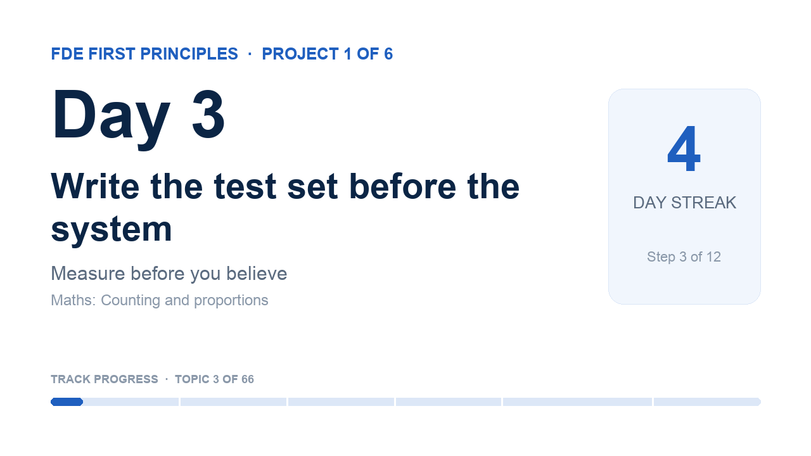

# YouTube details · Day 3

The coach sets these on your video when you ship with `fde-coach learn done --video <link>` (YouTube connected with `fde-coach youtube-auth`). Not connected? Paste them in YouTube Studio.

## Title

```
Day 3 · Write the test set before the system | FDE First Principles
```

## Description

```
How will you know the system works, before you build it?

Day 3 of 66 in FDE First Principles · Project 1 of 6: Measure before you believe
A public learning log: a software architect learning AI from first principles for the Forward Deployed Engineer role. One topic at a time, built from scratch and explained in plain words.

In this video
▸ For a beginner: A test set (or eval) is the scenario plus the expected output. But be aware: checking the output needs more than just a plain text comparison.
▸ For an engineer: Writing the tests first gives you a crucial input to validate assumptions, system expectations and expected behavior — and it exposes how complex the business rules really are.
▸ For a customer: The tests help stakeholders get familiar with the system, set expectations from the system for end users, and define the success criteria.

Maths in this topic: Counting and proportions. A proportion is a count divided by the total. 6 billing cases out of 30 is 6 ÷ 30 = 0.2 = 20%.

Learn it yourself (free)
• Your AI Product Needs Evals (Hamel Husain): https://hamel.dev/blog/posts/evals/
• Rules of Machine Learning (Google): rules 1 to 3: https://developers.google.com/machine-learning/guides/rules-of-ml#before_machine_learning

My notebook and journal for this topic
https://github.com/rajchampaneriya/continuous-learning/tree/main/fde-first-principles/1-measure-before-you-believe/03-test-set-first
The whole learning log: https://github.com/rajchampaneriya/continuous-learning/tree/main/fde-first-principles

Previous: Day 2 · Workflow or agent? Map the decisions first: https://youtu.be/i51y2NiYdDo

How this series runs
Every topic drops on a schedule with a deadline, a calendar event and this video as its finish line; each project ends with an article. The coach that runs it is open source: FDE Impromptu Coach, https://github.com/rajchampaneriya/fde-impromptu-coach
Articles: https://rajc.work

#FirstPrinciples #AIEngineering #ForwardDeployedEngineer
```

## Tags

```
FDE First Principles, first principles, AI engineering, forward deployed engineer, machine learning, LLM, learning in public
```

## Thumbnail



Upload `thumbnail.png` as the custom thumbnail (YouTube Studio → Details → Thumbnail).
