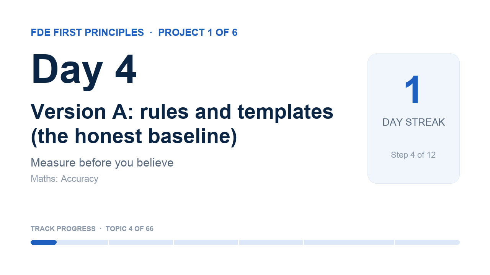

# Day 4 · Version A: rules and templates (the honest baseline)

<!-- learn:status -->
**Status:** ✅ shipped · attempt 2 · dropped 2026-10-20 · ship by Wed 21 Oct, 05:00 · shipped 2026-10-20 11:41 · project 1, step 4
<!-- /learn:status -->

> **First-principles question:** How far can plain code go before you need a model?

**Why it matters for an FDE:** A baseline tells you what the model has to beat. Many 'AI projects' never measure one.

**Time:** about 115 minutes, over 2 mornings

### 1 · Learn (about 30 minutes)
- [Building effective agents: 'Appendix 1, A. Customer support'](https://www.anthropic.com/engineering/building-effective-agents) · 5 min. Short: why support is a good fit for AI, and how to measure it.
- [Accuracy, recall, precision (Google ML Crash Course)](https://developers.google.com/machine-learning/crash-course/classification/accuracy-precision-recall) · 15 min. Read the accuracy part closely. Skim the rest; we come back to it.

**Maths you need today: Accuracy.** Accuracy = correct answers ÷ all answers. One number hides which mistakes you make, so also count the mistakes per intent.

### 2 · Build (about 60 minutes)
1. Write classify(message) with keywords (for example 'bill', 'refund' → billing). Add Hinglish words too.
2. Write one reply template per intent. Fill in the first name, area and outage ticket.
3. Run version A on every case and compute the intent accuracy.
4. Show the mistakes per intent. Read 5 wrong cases and write why the rules failed.

Your starter notebook is `notebook.ipynb` in this folder: fill in the **TODO** cells and run the ✅ self-check at the end.

### Done when
- [ ] Version A runs on every case without crashing.
- [ ] Intent accuracy is printed.
- [ ] A table of mistakes per intent is shown.
- [ ] 5 failures have a one-line reason each.

### 3 · Record (5 minutes or less)
- Show the accuracy number.
- Show one case where keywords failed (Hinglish is a good one).
- Say what a model would need to do to beat this.
- Two takes at most, then upload to YouTube as Unlisted and paste the link.

_Tempted to do more? Park it in `later.md`: Try regular expressions for customer IDs and amounts._

Project 1 · Measure before you believe: Build one customer-support assistant three ways (rules, one model call, an agent loop), measure all three, and recommend one with evidence.

## In my words
<!-- Fill these in before you ship (plain, simple English is perfect). Claude can help you turn what you said
     in your video into text, but keep your own words. -->
**For a beginner:** Simple keyword-based classification struggles with synonyms, multilingual expressions, ambiguous words, and multiple intents. It needs contextual understanding and explicit rules for intent prioritization.

**For an engineer:** Version A scored 67% accuracy on the 84 test cases. That is just round 1 — generally we need 3 to 5 iterations on the rules before reaching the UAT phase.

**For a customer:** Wrong replies mean customer support has more work and lots of angry customers to deal with. Soon many of them start using a competitor's product, which eventually results in job losses.

## What surprised me
…

## How I used AI
…

## Video
<!-- learn:video -->

<!-- /learn:video -->
