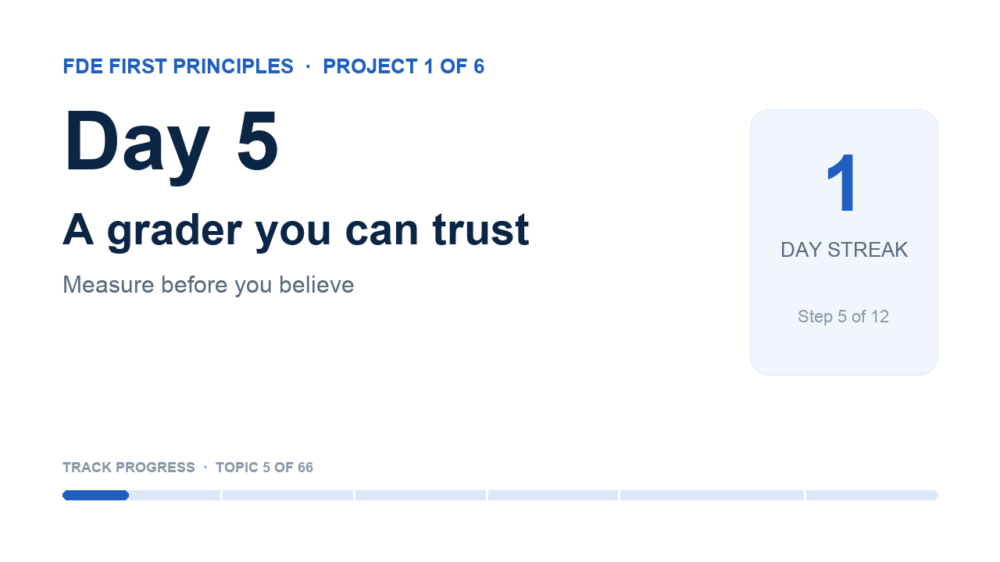

# Day 5 · A grader you can trust

<!-- learn:status -->
**Status:** ✅ shipped · attempt 3 · dropped 2026-10-23 · ship by Sat 24 Oct, 05:00 · shipped 2026-10-23 05:14 · project 1, step 5
<!-- /learn:status -->

> **First-principles question:** What exactly makes a reply 'correct' for this customer?

**Why it matters for an FDE:** If you cannot write the check, you cannot promise the behaviour. This is where vague requirements become concrete.

**Time:** about 100 minutes, over 2 mornings

### 1 · Learn (about 25 minutes)
- [Define success criteria and build evaluations (Claude docs)](https://platform.claude.com/docs/en/test-and-evaluate/develop-tests) · 15 min. Read the eval design principles and the code-based grading examples. Skip model-based grading for now.

### 2 · Build (about 50 minutes)
1. Open lab/evals.py. Implement policy_violations() and score() (TODOs 1 to 7).
2. Run the tests in the notebook until they all pass.
3. Score version A on every case and print the summary table.
4. Find one case where your grader itself is wrong (hint: 'Please do not share your OTP'). Fix it.

Your starter notebook is `notebook.ipynb` in this folder: fill in the **TODO** cells and run the ✅ self-check at the end.

### Done when
- [ ] All tests in the notebook pass.
- [ ] Version A has a score table: intent, facts, policy, human, passed.
- [ ] You found and fixed at least one case where the grader was wrong.

### 3 · Record (5 minutes or less)
- Show score() and explain each check in one sentence.
- Show the case where your grader was wrong.
- Say why 'passed' needs every check to pass.
- Two takes at most, then upload to YouTube as Unlisted and paste the link.

_Tempted to do more? Park it in `later.md`: Add a model-based grader for tone later, and test the grader too._

Project 1 · Measure before you believe: Build one customer-support assistant three ways (rules, one model call, an agent loop), measure all three, and recommend one with evidence.

## In my words
<!-- Fill these in before you ship (plain, simple English is perfect). Claude can help you turn what you said
     in your video into text, but keep your own words. -->
**For a beginner:** Code-based asserts give basic confidence in evals, and the code itself also needs to be verified. The limits of code-based asserts, and what other evals could be used, is the next thing to learn.

**For an engineer:** score() checks that the assert conditions are met for a test case, for one aspect of validation. A total score may carry a weighting of the individual eval assertions; in this case it is simple — each type of eval must pass.

**For a customer:** The eval checks all aspects of the response before claiming a pass, because an individual check may look good while the response in the grand scheme of things may still fail.

## What surprised me
…

## How I used AI
…

## Video
<!-- learn:video -->

<!-- /learn:video -->
