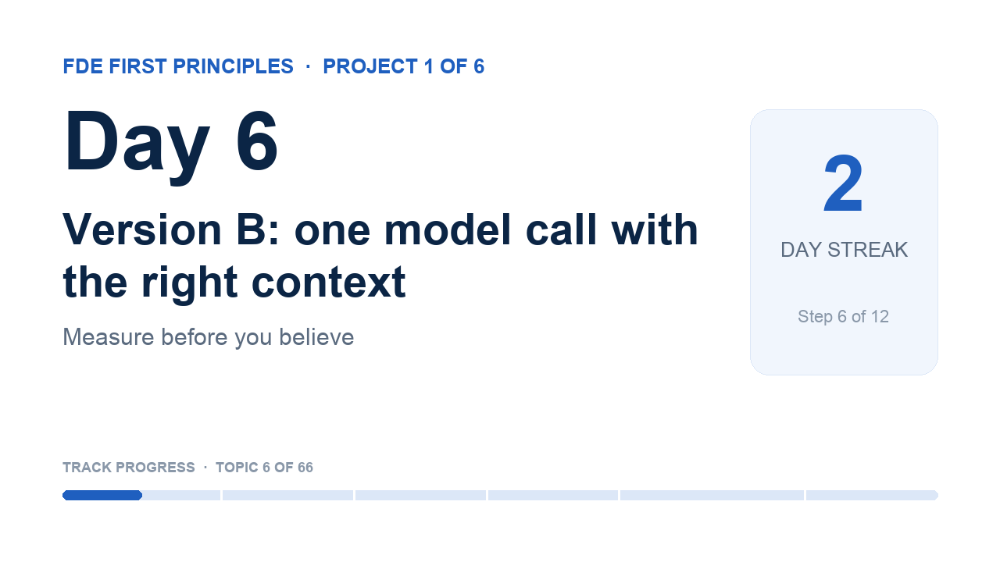

# YouTube details · Day 6

The coach sets these on your video when you ship with `fde-coach learn done --video <link>` (YouTube connected with `fde-coach youtube-auth`). Not connected? Paste them in YouTube Studio.

## Title

```
Day 6 · Version B: one model call with the right context | FDE First Principles
```

## Description

```
What does the model need to see to answer like a trained support agent?

Day 6 of 66 in FDE First Principles · Project 1 of 6: Measure before you believe
A public learning log: a software architect learning AI from first principles for the Forward Deployed Engineer role. One topic at a time, built from scratch and explained in plain words.

In this video
▸ For a beginner: I showed how changing the customer-support workflow improves answer quality overall, and which areas still need work.
▸ For an engineer: Evals give a structured mechanism to measure improvement in result quality between the keyword-classifier version (A) and the one-model-call version (B) of our customer-support workflow. This feedback is crucial for the development team and stakeholders: it shows the status of improvement and its direction.
▸ For a customer: Earlier, improvement was judged only by qualitative feedback from subject-matter experts. Now the automated eval gives quantifiable evidence of improvement, which supports the business-case justification for development spend to stakeholders.

Learn it yourself (free)
• Ollama: structured outputs: https://docs.ollama.com/capabilities/structured-outputs
• Building effective agents: 'Building block: The augmented LLM' and 'Workflow: Routing': https://www.anthropic.com/engineering/building-effective-agents

My notebook and journal for this topic
https://github.com/rajchampaneriya/continuous-learning/tree/main/fde-first-principles/1-measure-before-you-believe/06-one-llm-call
The whole learning log: https://github.com/rajchampaneriya/continuous-learning/tree/main/fde-first-principles

Previous: Day 5 · A grader you can trust: https://youtu.be/ec4bJ2_Jb-Y

How this series runs
Every topic drops on a schedule with a deadline, a calendar event and this video as its finish line; each project ends with an article. The coach that runs it is open source: FDE Impromptu Coach, https://github.com/rajchampaneriya/fde-impromptu-coach
Articles: https://rajc.work

#FirstPrinciples #AIEngineering #ForwardDeployedEngineer
```

## Tags

```
FDE First Principles, first principles, AI engineering, forward deployed engineer, machine learning, LLM, learning in public
```

## Thumbnail



Upload `thumbnail.png` as the custom thumbnail (YouTube Studio → Details → Thumbnail).
