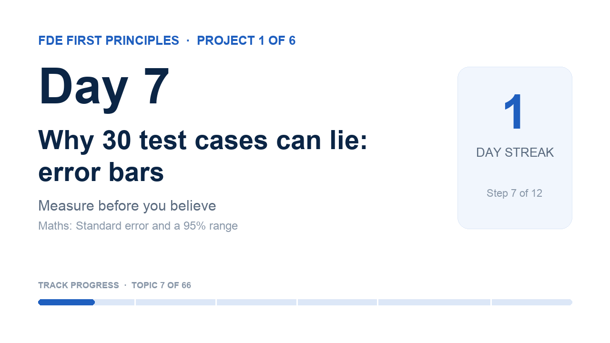

# YouTube details · Day 7

The coach sets these on your video when you ship with `fde-coach learn done --video <link>` (YouTube connected with `fde-coach youtube-auth`). Not connected? Paste them in YouTube Studio.

## Title

```
Day 7 · Why 30 test cases can lie: error bars | FDE First Principles
```

## Description

```
How big must a difference be before you believe it?

Day 7 of 66 in FDE First Principles · Project 1 of 6: Measure before you believe
A public learning log: a software architect learning AI from first principles for the Forward Deployed Engineer role. One topic at a time, built from scratch and explained in plain words.

In this video
▸ For a beginner: Testing an AI on a few cases is like flipping a coin 10 times: a fair coin can still land heads 7 times. A score from a small test set is a rough guess, and more cases make the guess sharper.
▸ For an engineer: Accuracy measured on n cases has a standard error of √(p(1−p)/n), and the 95% range is ±2 SE: ±15% at 30 cases, ±9% for our 84 cases, and about 256 cases for ±5%. Only call B better than A when the gap is bigger than the error bars, and remember that halving the range costs 4× the cases.
▸ For a customer: Our 80% score on 30 cases is like a restaurant rating from five reviews: the real figure could be anywhere from 65% to 95%. With around 250 real cases we can tell you, within ±5%, whether the new version is actually better before you pay to roll it out.

Maths in this topic: Standard error and a 95% range. If a system is right with probability p, a test of n cases wobbles by about √(p × (1 − p) ÷ n). About 95% of the time the truth is within 2 wobbles of what you measured.

Learn it yourself (free)
• A statistical approach to model evaluations (Anthropic): https://www.anthropic.com/research/statistical-approach-to-model-evals
• Seeing Theory: Basic probability (Brown University): https://seeing-theory.brown.edu/basic-probability/

My notebook and journal for this topic
https://github.com/rajchampaneriya/continuous-learning/tree/day-7/fde-first-principles/1-measure-before-you-believe/07-error-bars
The whole learning log: https://github.com/rajchampaneriya/continuous-learning/tree/day-7/fde-first-principles

Previous: Day 6 · Version B: one model call with the right context: https://youtu.be/Sc_RauiP3xw

How this series runs
Every topic drops on a schedule with a deadline, a calendar event and this video as its finish line; each project ends with an article. The coach that runs it is open source: FDE Impromptu Coach, https://github.com/rajchampaneriya/fde-impromptu-coach
Articles: https://rajc.work

#FirstPrinciples #AIEngineering #ForwardDeployedEngineer
```

## Tags

```
FDE First Principles, first principles, AI engineering, forward deployed engineer, machine learning, LLM, learning in public
```

## Thumbnail



Upload `thumbnail.png` as the custom thumbnail (YouTube Studio → Details → Thumbnail).
