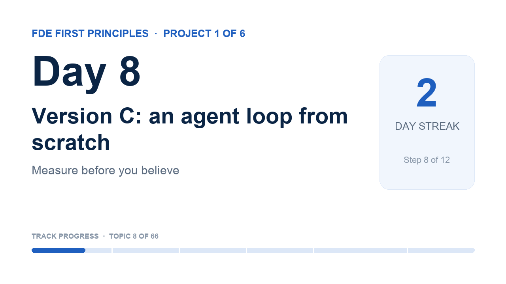

# Day 8 · Version C: an agent loop from scratch

<!-- learn:status -->
**Status:** ✅ shipped · dropped 2026-10-28 · ship by Fri 30 Oct, 05:00 · shipped 2026-10-29 08:13 · project 1, step 8
<!-- /learn:status -->

> **First-principles question:** What is an 'agent', really, once you remove the framework?

**Why it matters for an FDE:** An agent is a loop: the model asks for a tool, your code runs it, the result goes back. Knowing this lets you debug any framework a customer uses.

**Time:** about 115 minutes, over 2 mornings

### Set up
- lab/acme_tools.py is given: four tools and their JSON schemas. Today is about the loop.

### 1 · Learn (about 30 minutes)
- [Ollama: tool calling](https://docs.ollama.com/capabilities/tool-calling) · 10 min. Read a single tool call, then the agent-loop example.
- [Building effective agents: 'Agents' and 'Appendix 2: Prompt engineering your tools'](https://www.anthropic.com/engineering/building-effective-agents) · 10 min. Notice: the loop has a stop condition and a step limit.

### 2 · Build (about 60 minutes)
1. Write run_agent(case): send the email and the tools; while the reply has tool_calls, run each tool, add a 'tool' message, and call the model again. Stop after 6 steps.
2. At the end, ask for the same JSON as version B.
3. Print the full trace (each tool call and its result) for 2 cases.
4. Run on the first 10 cases. Count the steps per case.

Your starter notebook is `notebook.ipynb` in this folder: fill in the **TODO** cells and run the ✅ self-check at the end.

### Done when
- [ ] run_agent() always stops, never more than 6 steps.
- [ ] Two full traces are shown.
- [ ] Version C ran on at least 10 cases and the step counts are printed.

### 3 · Record (5 minutes or less)
- Show a trace and narrate each step.
- Point to the line that makes it an 'agent'.
- Say one risk you saw: a wrong tool, an extra step or a loop.
- Two takes at most, then upload to YouTube as Unlisted and paste the link.

_Tempted to do more? Park it in `later.md`: Add a tool that changes data (issue_refund), but only in project 6, with a human check._

Project 1 · Measure before you believe: Build one customer-support assistant three ways (rules, one model call, an agent loop), measure all three, and recommend one with evidence.

## In my words
<!-- Fill these in before you ship (plain, simple English is perfect). Claude can help you turn what you said
     in your video into text, but keep your own words. -->
**For a beginner:** A simple agent that performs actions based on the knowledge and tool capabilities you configure for it.

**For an engineer:** Derived from the ReAct pattern. The loop runs at most 6 steps, and the model decides which tool call is needed. `run_agent()` in the notebook holds the loop logic, `lab/llm.py` makes the model calls, and `lab/acme_tools.py` holds the tool definitions including their contracts.

**For a customer:** The reply emails are more accurate now because the agent checks real account details and the knowledge base instead of guessing.

## What surprised me

Even with a local small model doing the tool calls, the step counts were lower than I expected: 1–3 model calls per case out of the 6 allowed.

## How I used AI
…

## Video
<!-- learn:video -->

<!-- /learn:video -->
