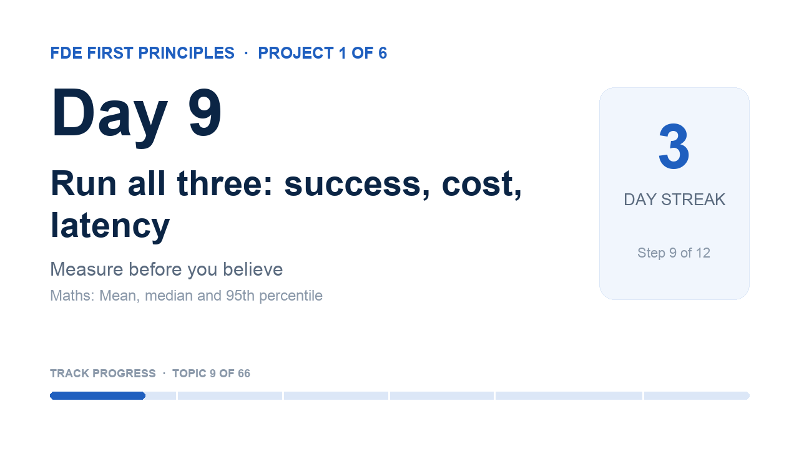

# YouTube details · Day 9

The coach sets these on your video when you ship with `fde-coach learn done --video <link>` (YouTube connected with `fde-coach youtube-auth`). Not connected? Paste them in YouTube Studio.

## Title

```
Day 9 · Run all three: success, cost, latency | FDE First Principles
```

## Description

```
Is the extra intelligence worth its price and its wait?

Day 9 of 66 in FDE First Principles · Project 1 of 6: Measure before you believe
A public learning log: a software architect learning AI from first principles for the Forward Deployed Engineer role. One topic at a time, built from scratch and explained in plain words.

In this video
▸ For a beginner: Every new feature adds cost and latency. Choosing which ones you are fine to live with — balancing time, cost and reply quality — is more of an art than a science.
▸ For an engineer: The job is to present the facts to the client and let them decide how to proceed.
▸ For a customer: Highest priority is to work with someone with judgement to find a balance and accept an output appropriate to the brand's reputation.

What surprised me
How widely the data points can contradict each other — and that giving clarity without hiding facts is what helps a client make an informed decision.

Maths in this topic: Mean, median and 95th percentile. The mean is pulled up by a few slow calls. The median is the middle call. p95 is the time that 95% of calls beat: the number users feel on a bad day.

Learn it yourself (free)
• Your AI Product Needs Evals: 'Logging Traces' and 'Looking At Your Traces': https://hamel.dev/blog/posts/evals/
• Building effective agents: 'When (and when not) to use agents': https://www.anthropic.com/engineering/building-effective-agents

My notebook and journal for this topic
https://github.com/rajchampaneriya/continuous-learning/tree/day-9/fde-first-principles/1-measure-before-you-believe/09-success-cost-latency
The whole learning log: https://github.com/rajchampaneriya/continuous-learning/tree/day-9/fde-first-principles

Previous: Day 8 · Version C: an agent loop from scratch: https://youtu.be/yXcNNqTxFW8

How this series runs
Every topic drops on a schedule with a deadline, a calendar event and this video as its finish line; each project ends with an article. The coach that runs it is open source: FDE Impromptu Coach, https://github.com/rajchampaneriya/fde-impromptu-coach
Articles: https://rajc.work

#FirstPrinciples #AIEngineering #ForwardDeployedEngineer
```

## Tags

```
FDE First Principles, first principles, AI engineering, forward deployed engineer, machine learning, LLM, learning in public
```

## Thumbnail



Upload `thumbnail.png` as the custom thumbnail (YouTube Studio → Details → Thumbnail).
