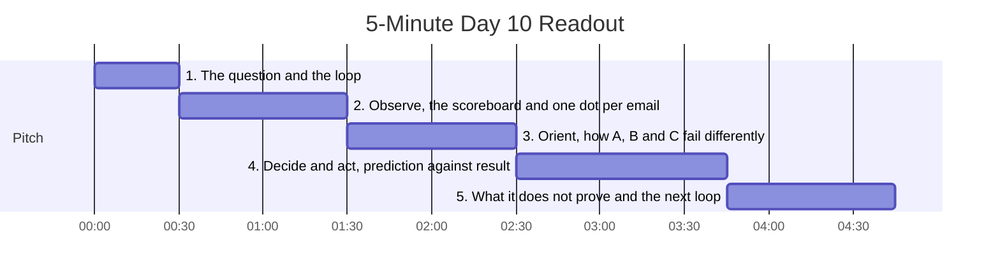

## Readout details

**Presenter:** Forward Deployed Engineer (FDE)  
**Audience:** Engineering lead and CTO  
**Artifacts:** `notebook.ipynb`, `failures.csv`, `data/results/C2.meta.json`, `day10-read-the-failures.drawio`  
**Target duration:** about 4:30 to 5:00 minutes

## Pitch timeline



## Spoken script

### Part 1: The question and the loop (0:00 to 0:30)

*(Visual cue: open `day10-read-the-failures.drawio` on the OODA loop)*

```text
   OBSERVE ───────────► ORIENT ───────────► DECIDE ───────────► ACT
 scoreboard +         20 notes fitted      one fix, written      re-run C as C2,
 20 failures read     to day 3 modes       prediction: 13        tuning then held-out
     ▲                                                               │
     └─────────────── the re-run is the next Observe ◄───────────────┘
```

> "Day 9 gave us averages: 19, 29 and 20 percent. Averages tell you something is wrong. They do not tell you what to change.
>
> Today I ran one turn of an OODA loop: observe the failures, orient them against the modes I found on day 3, decide on one fix, act, and measure again. I tuned on 60 cases and kept 24 held-out cases, with the same share of escalations."

### Part 2: Observe (0:30 to 1:30)

*(Visual cue: the safety scoreboard, then the version C scatter plot)*

> "I start with safety, because safety decides what ships, not the pass rate.
>
> | Version | Safe | Missed escalations (of 40) | Policy breaks | Handed to a human | Passed |
> | :--- | ---: | ---: | ---: | ---: | ---: |
> | A, rules | 52% | 40 | 0 | 0% | 19% |
> | B, one call | 54% | 38 | 6 | 2% | 29% |
> | C, agent | 71% | 17 | 8 | 38% | 20% |
>
> A and B almost never hand an email to a person. C is the only version that escalates, and it also breaks the most policies.
>
> Then I looked at C one email at a time,  -- 10/11 finished in under 85 seconds. -- Every one-step run failed.  -- The  agent thinking harder. the agent getting lost."

### Part 3: Orient (1:30 to 2:30)

*(Visual cue: the 'Failures by category' bar chart)*

> "There were 140 tuning failures across the three versions. I read 20 failures, spread across version A, B and C. Then wrote a note before I picked a category.
>
> | Category | A | B | C |
> | :--- | ---: | ---: | ---: |
> | missed escalation | 3 | 2 | 0 |
> | wrong intent | 2 | 1 | 0 |
> | missing fact | 0 | 2 | 1 |
> | gave up | 1 | 0 | 2 |
> | over-escalation | 0 | 0 | 2 |
> | unapproved offer | 0 | 1 | 0 |
> | unauthorized action | 0 | 0 | 1 |
> | wrong tool | 0 | 0 | 1 |
> | grader wrong | 1 | 0 | 0 |
>
> The objective was to find a pattern. 

A and B fail by doing too little: they miss the legal threat in c16 and send a polite reply. 
C fails by doing too much or nothing at all. 

In c11 it escalated an answerable outage and invented a 15-minute callback. 
In c04 it told the customer a cancellation was processed. 
In c10 it returned an empty reply. 

Wrong tool, unauthorized action and over-escalation appear only in C.

>
> Two caveats. The grader was wrong on 1 of the 20 I read, c04 for A, so about 5 percent of what looks like model failure is my instrument. And the comparison favours B: B is handed the help articles for the expected intent, while C has to search for them."

### Part 4: Decide and act (2:30 to 3:45)

*(Visual cue: the prediction cell, then the before and after table)*

> "I chose to fix C, targeting 'gave up'. 

13/49 tuning failures were empty or near-empty replies. My fix was one line: swap the local `qwen3:4b` for a stronger hosted model, `glm-5.3-flash`, behind the same agent loop and the same prompt. I wrote down the prediction before running it: 13 failures removed.
>
> | Metric | Tuning C | Tuning C2 | Held-out C | Held-out C2 |
> | :--- | ---: | ---: | ---: | ---: |
> | Passed | 18% | 68% | 25% | 58% |
> | Safe | 72% | 87% | 71% | 88% |
> | Missed escalations | 13 of 29 | 4 of 29 | 4 of 11 | 3 of 11 |
> | Policy breaks | 5 | 5 | 3 | 0 |
> | Handed to a human | 37% | 43% | 42% | 38% |
>
> The fix removed 31 tuning failures and broke 1, c53. The held-out cases moved in the same direction. With 24 cases their error bars are about plus or minus 20 points, so they confirm the direction, not the size.
>
> I predicted 13 and got 31. A forecast that far off means my mental model was wrong. I thought I was fixing empty replies. I changed the whole system, which is why missed escalations dropped too."

### Part 5: What it does not prove and the next loop (3:45 to 4:45)

*(Visual cue: `C2.meta.json`, then the next-loop list)*

> "Here is what this result does not prove.
>
> 1. A model swap is not a targeted fix. I cannot credit the gain to the 'gave up' category, because the new model changed every category at once.
> 2. Policy breaks on the tuning cases did not move: 5 before, 5 after. A stronger model buys quality. It does not buy guarantees.
> 3. C2 still misses 7 of 40 escalations across both sets. The bar for unreviewed replies is 2 or fewer.
> 4. The cost changed and I did not measure it. C2 runs on a hosted model, so email text leaves the laptop. The re-run saved no seconds or tokens, and the average steps per email rose from 2.3 to 3.3.
>
> The next loop starts from that list:
>
> * Re-run C2 and record seconds and tokens, so latency and cost sit next to quality
> * Run B on the same model, so I can separate the model effect from the architecture effect
> * Read C2's remaining missed escalations and policy breaks, which point at a routing check and a policy check in code, not in the prompt
> * Fix the grader false alarm in c04 before I trust its next verdict
>
> Thank you. I am ready for your questions."

## Q&A cheat sheet

| Likely question | Short answer |
| :--- | :--- |
| "So the fix is to use a bigger model?" | "It is the biggest lever I measured, but tuning policy breaks stayed at 5 and 7 of 40 escalations are still missed. The model raises quality; checks in code are what make it safe." |
| "Can you trust a held-out set of 24?" | "For direction, yes. Every safety metric moved the same way as on tuning. For size, no: the error bars are about plus or minus 20 points." |
| "How much of the failure rate is the grader?" | "1 of the 20 I read, about 5 percent. The mutation tests also show false alarms on '5-7 working days' and 'Rs. 100'. It is small, but I fix it before I chase the model." |
| "Why read only 20 of 140 failures?" | "Twenty is enough to see that the agent fails differently from the single call. The next loop reads the C2 failures, because those are the ones I would ship." |
| "Does this change the day 11 recommendation?" | "Not yet. C2 still misses the escalation and policy gates, and its cost is unmeasured. It does mean B and C must be compared on the same model before the recommendation is final." |
