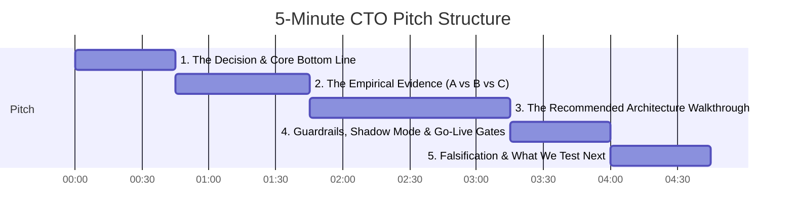

# 5-Minute CTO Readout: Acme Fibre Support Automation

**Presenter:** Forward Deployed Engineer (FDE)  
**Audience:** Chief Technology Officer & Leadership Team  
**Artifact:** ADR-001 (`decision.md`) & Architecture Topology (`diagram.svg`)  
**Target Duration:** ~4:30 – 5:00 minutes  

---

## ⏱️ Pitch Timeline & Structure



---

## 🎙️ Spoken Script & Presentation Guide

### Part 1: The Decision & Bottom Line (0:00 – 0:45)
*(Visual cue: Stand next to the title slide showing `ADR-001` and `diagram.svg`)*

> "Good morning. Acme Fibre processes roughly 1,200 customer support emails per day in Pune. Our primary mandate is customer trust: never leak credentials, never botch refund or credit policy limits, and never attempt to auto-answer an email that legally or operationally requires a human.
>
> We evaluated three competing architectural paradigms on an 84-case benchmark with strict policy grading:
> - **Option A:** Pure deterministic rules and regex templates.
> - **Option B:** Single LLM call with customer context and knowledge articles.
> - **Option C:** Multi-turn autonomous agent with tool execution.
>
> **Our recommendation is unambiguous:** We do **not** recommend shipping an autonomous agent. Instead, we recommend shipping a **deterministic workflow topology** built around Option B, protected by a safety router at ingress and a hard policy verifier at egress."

---

### Part 2: The Empirical Evidence (0:45 – 1:45)
*(Visual cue: Highlight the Evidence Table in `decision.md`)*

> "Let's look at what the numbers tell us — and more importantly, what they don't:
>
> 1. **Pass rates are statistically indistinguishable:**
>    Option A scored 19% ± 9%, Option B scored 29% ± 10%, and Option C scored 20% ± 9%. With overlapping error bars, pass rate alone cannot pick our winner.
>
> 2. **Safety is the true ship-blocker:**
>    Of the 40 test cases requiring mandatory human escalation, Option A missed 40 of 40 (0% safety), and Option B missed 38 of 40. Option C caught 23 escalations, but broke strict policies in 8 replies.
>
> 3. **Autonomous agents fail unit economics and operational SLAs:**
>    Option C had a p95 latency of 213 seconds and cost 8.7 rupees per 1,000 emails. Processing 1,200 daily emails through multi-turn agent loops would require 35 hours of compute every 24-hour cycle on local hardware, creating runaway queues.
>
> In short: Option A is too brittle, Option B is oblivious to escalations without a gate, and Option C is too slow, expensive, and prone to policy violations."

---

### Part 3: Architecture Walkthrough (1:45 – 3:15)
*(Visual cue: Walk step-by-step through `diagram.svg` from top to bottom)*

```
[ Email In ]
     │
     ▼
[ Customer Card & Outage Loader ] (Deterministic Code)
     │
     ▼
[ Safety & Intent Router ] ──────(Needs Human?)──────► [ Human Support Queue ]
     │ (Safe to proceed)
     ▼
[ Knowledge Article Retrieval ]
     │
     ▼
[ Single Model Synthesis (Option B) ]
     │
     ▼
[ Grader Policy Check in Code ] ───(Policy Break?)────► [ Human Support Queue ]
     │ (Passed)
     ▼
[ Human Approval / Shadow Mode ]
     │
     ▼
[ Reply Out ]
```

> "Here is the production architecture on the diagram:
>
> 1. **Deterministic Data Ingress:** When an email arrives, deterministic code fetches the customer account card and network outage status. Zero LLM hallucination risk here.
> 2. **Pre-LLM Safety Router:** Before generating any response, a dedicated classifier (keyword rules + single fast safety prompt) evaluates: *'Does this require a human?'* (e.g., OTP requests, explicit human handoff, account cancellations). Any flag diverts immediately to the **Human Support Queue**. Over-escalating costs human time; under-escalating destroys brand trust.
> 3. **Single LLM Synthesis:** Safe emails retrieve relevant help articles and make a single LLM call to draft a structured JSON reply.
> 4. **Post-LLM Policy Gate:** Before egress, the draft runs through programmatic validation code checking for policy violations (forbidden token leaks, unverified financial promises). If it fails, it routes to a human.
> 5. **Shadow Mode / Human-in-the-Loop:** In Phase 1, drafts enter a staging queue where human agents one-click approve or edit before outbound delivery."

---

### Part 4: Go-Live Gates & Risk Controls (3:15 – 4:00)
*(Visual cue: Point to the 'Gates before replies go out unreviewed' dashed box)*

> "We will not remove human review until our pipeline satisfies three hard quantitative gates measured on held-out evaluation sets:
>
> - **Gate 1 (Zero Tolerance):** Exactly **0 policy violations**.
> - **Gate 2 (Escalation Safety):** Missed escalations must drop to **$\le$ 2 out of 40** (95%+ capture rate).
> - **Gate 3 (Quality Floor):** Overall pass rate lower bound must strictly exceed Option A's baseline (19%).
>
> This isolates safety to dedicated code modules rather than hoping an LLM adheres to system prompt instructions."

---

### Part 5: What Would Change My Mind & Next Steps (4:00 – 4:45)
*(Visual cue: Conclude on Open Questions & Project Roadmap)*

> "To remain intellectually honest, here is what would change our recommendation:
>
> 1. **If routing fails:** If our safety router cannot achieve $\le 2/40$ missed escalations, we should abandon automated drafting entirely and fall back to Option A templating with 100% human triage.
> 2. **If agent performance leaps:** If a frontier model allows Option C to achieve 0 policy breaks with p95 latency under 60 seconds at viable cost, the agent will have earned its architectural complexity.
>
> **Next Immediate Milestone (Project 2):**
> Our Option B benchmark used oracle context. In Project 2, we implement real-world semantic retrieval (RAG) to measure how much quality B retains when searching articles dynamically.
>
> Thank you. I am ready for your questions."

---

## 🎯 Executive Q&A Defense Cheat-Sheet

| Likely CTO Question | Concise Principal Engineer Answer |
| :--- | :--- |
| **"Why not just fine-tune an agent with prompt engineering?"** | "Prompts are probabilistic; policy rules and escalation checks must be deterministic. Encapsulating safety in deterministic code pre- and post-model gives us hard guarantees without latency multiplication." |
| **"What is the cost impact of the Safety Router adding an extra call?"** | "A small router call adds <500ms and ₹0.10/1k emails, but eliminates 35 hours of compute debt and protects against high-liability policy breaches." |
| **"When do we see ROI if humans still approve in Phase 1?"** | "Day 1 gives us drafted responses that reduce human handle time by an estimated 40–60%. Once gates hold on held-out traffic, unreviewed replies unlock full automation safely." |
