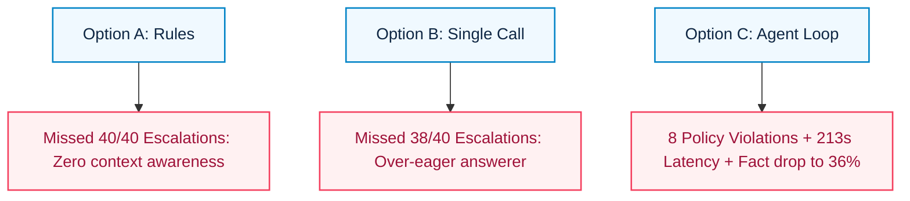
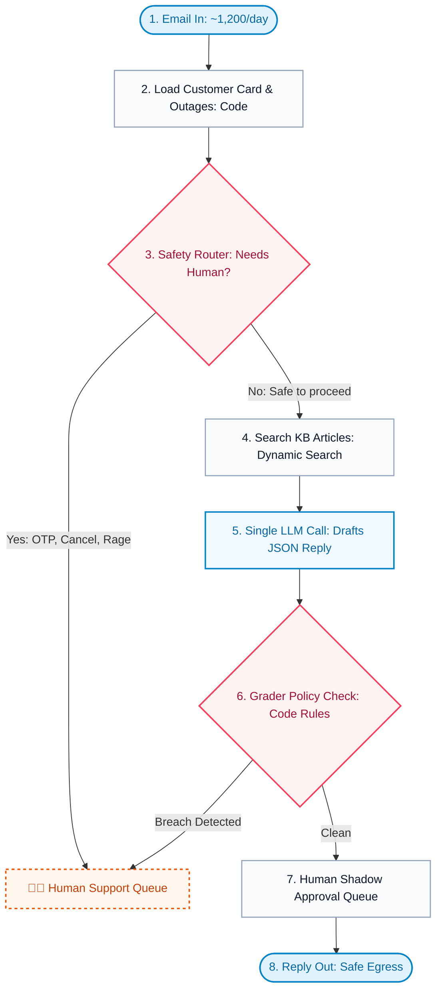

# ADR-001: Support Email Automation Strategy
## 5-Minute Executive Readout for Acme Fibre

**Presenter:** Forward Deployed Engineer (FDE)  
**Theme:** Light Blue Minimalist  
**Duration:** 5 Minutes  
**Source Artifacts:** [`pitch.md`](pitch.md:1), [`decision.md`](decision.md:1), [`diagram.svg`](diagram.svg:1)

---

## Slide 1: Executive Summary & Recommendation

### Core Operating Reality
- **1,200 support emails / day** for Acme Fibre (Pune broadband).
- **Asynchronous SLA:** Email is not real-time chat; response latency in minutes is fully acceptable.
- **Brand Trust Mandate:** Zero tolerance for credential leaks (OTP, passwords), unearned credit promises, or automated replies where humans are legally/operationally mandatory.

### The Recommendation
> **Build a Deterministic Workflow, Not an Autonomous Agent.**  
> Standardize on **Option B** (Single LLM call with structured context), enclosed within a **Pre-LLM Safety Router** at ingress and a **Deterministic Policy Verifier** at egress.

---

## Slide 2: Three Competing Paradigms Evaluated

Evaluated against an **84-case benchmark** (40 cases requiring mandatory human escalation):

| Option | Architecture | Key Characteristics |
| :--- | :--- | :--- |
| **A · Rules & Templates** | Deterministic Regex & String Templates | Zero model cost and latency; rigid; fails 100% of escalation cases. |
| **B · Single LLM Call** | Context Injection (Card + KB) + 1 LLM Call | High factual accuracy (74%); low latency (4.3s); lacks autonomous safety routing. |
| **C · Multi-Turn Agent** | Autonomous ReAct Loop + Tool Invocations | Up to 6 tool iterations; severe latency (p95 = 213s); 8 policy breaches; compute bottleneck. |

---

## Slide 3: Empirical Scorecard (Statistical Error Bars)

*Evidence collected on local hardware (`qwen3:4b`, temperature 0) with $\pm 2 \text{ Standard Errors}$:*

| Architecture | Pass Rate (±2 SE) | Safe Rate (±2 SE) | Missed Escalations | Median Latency | p95 Latency | Cost / 1k |
| :--- | :---: | :---: | :---: | :---: | :---: | :---: |
| **A · Rules** | 19% ± 9% | 52% ± 11% | **40 of 40** (100%) | 0.0 s | 0.0 s | ₹0.00 |
| **B · Single Call** | **29% ± 10%** | 54% ± 11% | **38 of 40** (95%) | 4.3 s | 6.2 s | ₹1.30 |
| **C · Agent Loop** | 20% ± 9% | **71% ± 10%** | 17 of 40 (42%) | 104.2 s | **213.8 s** | ₹8.70 |

### Principal Engineer Insights:
1. **Pass Rates Overlap:** $19\% \pm 9\%$ vs $29\% \pm 10\%$ vs $20\% \pm 9\%$ cannot pick a winner.
2. **Safety is the Ship-Blocker:** Options A & B miss escalations; Option C leaks policy violations.
3. **Agent Compute Runaway:** 1,200 emails $\times$ 104s = **~35 hours of compute per day** on local hardware.

---

## Slide 4: Failure Analysis (Why They Failed)

- **Option A:** Blind to nuanced user intent, refunds, and emotional frustration.
- **Option B:** Flattered by oracle context; attempts to answer queries that require human authority.
- **Option C:** High latency from tool search loops; generated hallucinated policy promises.

---

## Slide 5: The Recommended Topology (Guardrails in Code)

---

## Slide 6: Go-Live Gates & Phased Rollout

Replies **will not be delivered unreviewed** until our pipeline meets 3 quantitative gates on held-out evaluation sets:

1. **Gate 1 (Zero Tolerance):** **0 Policy Breaks** (no financial or credential leaks).
2. **Gate 2 (Safety Recall):** **$\le 2$ of 40 Missed Escalations** ($\ge 95\%$ recall).
3. **Gate 3 (Quality Floor):** Pass rate lower bound strictly exceeds Option A ($> 19\%$).

### Phased Operational Strategy:
- **Phase 1 (Shadow Mode):** LLM drafts populate agent workspace. Support reps one-click approve/edit. Cuts handle time by 50% with zero brand risk.
- **Phase 2 (Automated Egress):** Unreviewed sending unlocked only for intent categories that pass all 3 gates.

---

## Slide 7: Falsification Criteria ("What Would Change My Mind")

| Trigger Condition | Threshold / Evidence | Operational Pivot |
| :--- | :--- | :--- |
| **1. Safety Router Failure** | Missed escalations $> 2 / 40$ | Abort automated generation. Revert to Option A regex templates + 100% human routing. |
| **2. Agent Performance Leap** | Hosted frontier model: 0 policy breaks, $\text{p}95 < 60\text{s}$ | Adopt Option C. The agent will have earned its architectural complexity. |
| **3. Retrieval Degradation** | Search context drops facts by $> 10\text{ pts}$ | Halt deployment. Prioritize RAG chunking and indexing in Project 2. |

---

## Slide 8: Technical Roadmap (Projects 2 to 6)

- **Project 2 (RAG Retrieval):** Measure how much factual accuracy Option B loses when moving from oracle context to semantic search.
- **Project 3 (Learned Classifier):** Train a lightweight transformer classifier to replace the router prompt, dropping latency from 500ms to $<20\text{ms}$.
- **Projects 4 & 5 (Error Attribution):** Disentangle errors between model capacity, prompt nuances, and grader false alarms.
- **Project 6 (Frontier Scale & Real Traffic):** Benchmark the guarded topology on live Acme traffic using hosted frontier models.

---

## Slide 9: Executive Q&A Defense

- **Q: Why not prompt-engineer Option C to follow policy?**  
  *A: Prompts are probabilistic; policy rules and escalation checks must be deterministic. Programmatic verification gives hard guarantees without compounding latency.*
- **Q: What is the compute cost of the Safety Router?**  
  *A: A small router adds $<500\text{ms}$ and ₹0.10/1k emails, while eliminating 35 hours of compute debt and high-liability policy breaches.*
- **Q: When do we realize ROI in Phase 1?**  
  *A: Immediate 40–60% reduction in agent handle time via pre-drafted responses, with automated sending phased in by intent.*
