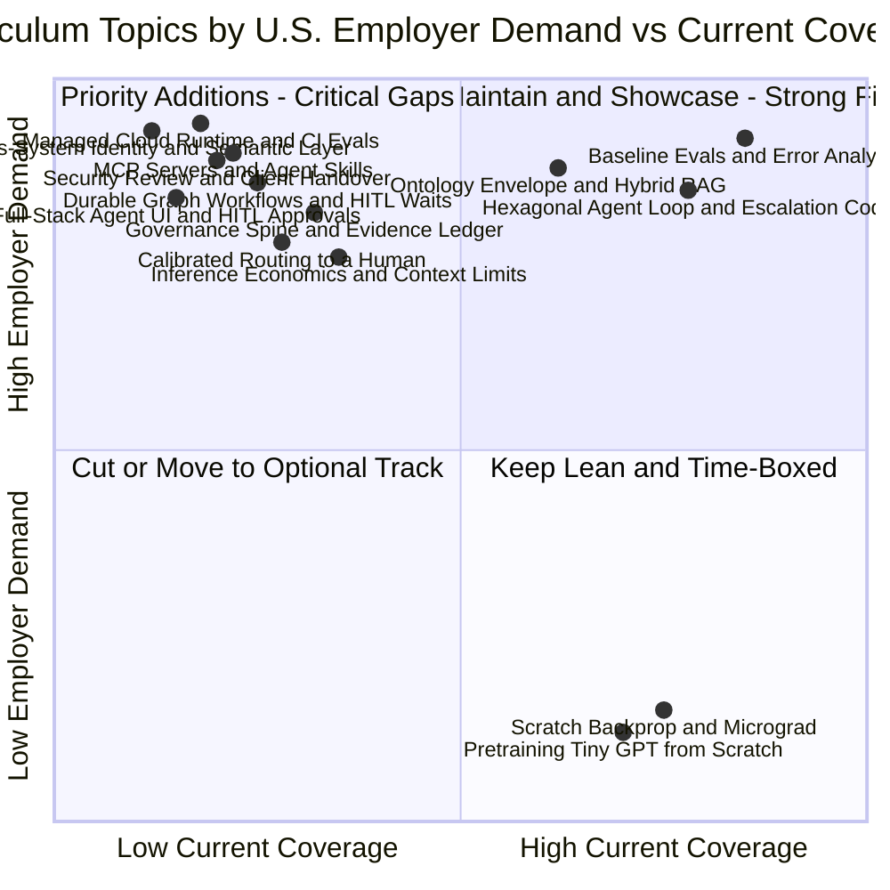
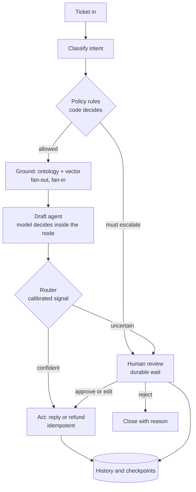
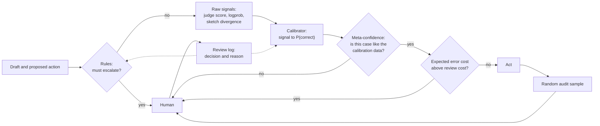
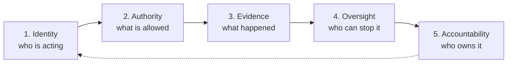
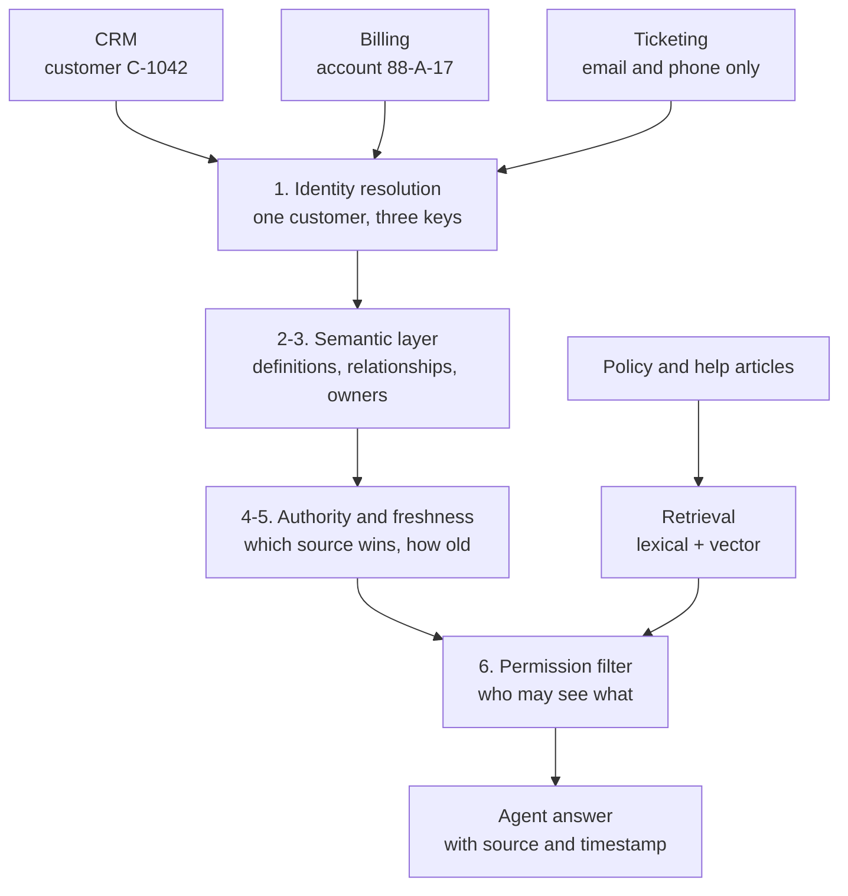

## 1. Executive Summary

Nov 9, 2026 · @Raj Champaneriya

> [!NOTE]
> Revised 11 November 2026. Adds graph engineering (Module E), hybrid routing to a human (Module F), and a governance spine (Module G). Project 4 splits into 4a and 4b, and remaining work moves from 90 to about 103 hours. Section 10 holds the review notes behind the revision.
>
> A second pass the same day (Section 11) tests the plan against the enterprise goal: help a client adopt AI and build meaning from data fragmented across the organization. It rebuilds Project 2 around cross-system meaning (Module H), trims Project 5, and extends Project 6. The total stays at 103 hours.

Keep the spine, move the hours. About half of the original plan (66 of 128 hours, projects 3 to 5) teaches how models are trained from scratch. Nothing the major cloud and AI vendors shipped since May 2026, and nothing in U.S. Forward-Deployed Engineer (FDE) or Full-Stack Development Engineer job postings, pays for pretraining mechanics. Employers pay for what Project 1 already does well: measuring systems rigorously, grounding them in enterprise context, building production full-stack and agentic interfaces, governing them with policy as code, and delivering them into customer environments within weeks.

Across the U.S. market, the boundary between Forward-Deployed Engineer, Full-Stack Engineer, and AI Application Engineer has converged. Leading engineering organizations expect engineers to pair AI-assisted software development (GitHub Copilot multi-file agent mode, Microsoft Copilot Studio, cursor/IDE workflows) with production cloud-native architecture (Azure AI Foundry, AWS Bedrock AgentCore, Google Gemini Enterprise Agent Platform, Model Context Protocol, OpenTelemetry, and DevSecOps).

| Decision     | Curriculum Part                         | Strategic Rationale                                                                                                                         |
|--------------|-----------------------------------------|---------------------------------------------------------------------------------------------------------------------------------------------|
| Keep         | Project 1, Measure before you believe   | AWS, Microsoft, Google, OpenAI, and Anthropic all shipped managed evaluation services in 2026. Rigorous measurement remains your asset.     |
| Reshape (11 Nov) | Project 2, Meaning across fragmented data | Vector similarity is one of seven questions about a fact. Rebuild the project around identity, definitions, relationships, authority, freshness, and permission across three source systems (Module H). |
| Add          | Evals that run without you              | Calibrated LLM judges against human labels, simulated multi-turn users, OpenTelemetry trace grading, CI gates, and drift monitoring.        |
| Add          | A production-shaped full-stack agent    | Managed agent runtime, MCP servers, Agent Skills, streaming React/Next.js agent UI, identity, Cedar policy as code, and HITL approvals.     |
| Add (11 Nov) | Graph engineering                       | The plan swaps free-form loops for workflow state machines but never teaches the graph. Add control flow, durability and replay, and durable human waits as Project 4a. |
| Add (11 Nov) | Hybrid routing to a human               | Escalation today is rules only. Add a calibrated signal, a check on when that signal can be trusted, a divergence signal, and a loop that learns from reviewer decisions. |
| Add (11 Nov) | A governance spine                      | Identity, policy, audit, and handover sit in separate projects. Organize them under five first-principles questions and one evidence ledger. |
| Compress     | Projects 3 to 5 (from 66h to 11h)       | Now 6h after the 11 November review. Retain 6 decision-driving topics: tokens/cost, temperature, context degradation, hallucination origins, training basics, and RAG vs FT.     |
| Rebuild      | Project 6, Back to the customer         | Rehearse a 6-week enterprise engagement: technical discovery, threat modeling and security review, executive readout, and handover.         |
| Deprioritize | Scratch micrograd and tiny GPT          | Retain only as an optional weekend track for personal curiosity or video channel content; remove from the core 90-day hiring critical path. |

### Current Baseline and Immediate Action

Days 1 to 9 shipped on schedule: 9 topics in 18 days (14 to 31 October). Day 10 has been open since 30 October with four missed tracker attempts, yet during those same 10 days you committed roughly 20 updates of substantive lab work (`continuous-learning` repo, day-11 README versions A, B, C, and `data/results` C3 runs) that the tracker failed to capture.

The C3 quality jump reflects real engineering, but three variables changed simultaneously: the underlying model (`glm-5.3-flash`), the grader, and the system design. Day 10 must isolate the gain by cause:

1. Re-grade saved runs A, B, C, and C2 using the current grader. Because C2 runs architecture C on `glm-5.3-flash`, the delta from C to C2 isolates the model contribution, and the delta from C2 to C3 isolates the architecture and policy contribution.
2. Draw a clean held-out evaluation set. Cases `c79` and `c80` sit in the current held-out list, but your day-5 notes explicitly reference both, meaning data leakage has occurred on the validation split.
3. Document one quantitative statement per cause with confidence intervals. This attribution paragraph forms the core evidence of the Day 11 Architecture Decision Record (ADR).

The highest-value mechanism you built is currently invisible in the tracker: deterministic escalation rules executing as code prior to LLM drafting, paired with an ontology envelope restricting permissible offers. That architecture directly implements policy as code and semantic grounding.

---

## 2. Gap Analysis

### 2026 Platform Convergence Across Core Vendors

Major platform providers converged on a unified production stack in 2026: managed agent harnesses, integrated trace evaluation, semantic business-context layers, open interoperability standards (MCP, A2A, Agent Skills), and identity governance.

| Theme                              | 2026 Platform Releases                                                                                                                                                                                                                            | Curriculum Impact                                                                                                                                                       |
|------------------------------------|---------------------------------------------------------------------------------------------------------------------------------------------------------------------------------------------------------------------------------------------------|-------------------------------------------------------------------------------------------------------------------------------------------------------------------------|
| Managed agent loops as products    | AWS [AgentCore managed harness][aws-harness] GA (Jun). Microsoft [Foundry hosted agents][ms-foundry] (Jun). Google [Gemini Enterprise Agent Platform][gcp-agent] ADK (Apr). OpenAI [Agents API][oai-devday] (Sep). Anthropic [Claude Managed Agents][ant-managed] (May). | Your hand-built loop (Day 8) builds foundational intuition. Next, port C3 to one managed cloud runtime and benchmark on the identical dataset.                          |
| Graph workflows and durable execution | Microsoft Agent Framework [durable workflows][maf-durable] (graph of executors, checkpoints, request ports, Durable Task backend). [Foundry workflows][foundry-workflows] visual designer and YAML. LangGraph [durable execution][lg-durable] with checkpointers and interrupts. Google graph-based ADK. | Added 11 Nov. Learn one graph runtime deeply (Agent Framework on Azure), build the durability mechanism once by hand, and map the others by primitive (Module E). |
| Evaluation as a platform primitive | AWS [AgentCore Evaluations][aws-evals] GA (Mar). Microsoft Foundry Rubric evaluator and trace optimizer (Jun). Google [Agent Evaluations][gcp-evals] GA (Jul) with user simulation and pytest CI. Anthropic Outcomes beta.                        | Expand Project 1 methods into automated pipelines: judge calibration against human labels, user simulation, OpenTelemetry trace grading, and CI gating.                  |
| Enterprise context layers          | Microsoft [IQ family][ms-iq] (Work, Fabric, Foundry IQ) and [Fabric IQ][fabric-iq] ontology preview. AWS AgentCore [knowledge layers][aws-knowledge] (Jun). Google [Gemini enterprise agent][gcp-work] (Oct).                                     | Formalize your ontology experiment as a controlled benchmark: evaluate ontology glossary alone vs. vector retrieval alone vs. hybrid grounding on identical test cases. |
| Open interoperability standards    | Anthropic donated Agent Skills to the [Agentic AI Foundation][aaif-skills] (Oct), joining MCP, A2A, and `AGENTS.md`. Microsoft Foundry Toolboxes aggregate tools behind one MCP endpoint. OpenAI proposed MCP Events.                             | Expose Acme domain tools via an MCP server with OAuth/scoped auth and package the evaluation grader as a portable Agent Skill.                                          |
| Identity, security, and policy     | Microsoft [Agent 365][ms-agent365-ga] (generally available since 1 May 2026) registry, Entra Agent ID, and RBAC. AWS AgentCore Policy GA using Cedar. Google agent identity, gateway, and dedicated workspace principals.                                                                                    | Add non-human identity management, least-privilege tool scoping, prompt injection defense, and Cedar/OPA policy-as-code enforcement.                                    |
| Constrained routing decisions      | OpenAI [Decisions API][oai-devday] preview for deterministic classification and routing across fixed action sets.                                                                                                                                 | Validates your Day 2 workflow-first architecture. Keep intent classification and escalation deterministic or strictly schema-constrained.                               |
| Stateful long-running memory       | OpenAI Dots, Google coworker agents, Anthropic dreaming research preview, and Microsoft Foundry procedural memory.                                                                                                                                | Cover at the architectural awareness level (state persistence diagrams and session checkpointing) without over-investing build hours.                                   |

> [!NOTE]
> Microsoft Ignite runs 17 to 20 November 2026. Re-verify the Foundry IQ, Agent 365, and GitHub Copilot rows immediately following the keynote announcements.

### Employer-Specific Skill Expectations (U.S. Market)

U.S. job postings for FDE and AI-enabled Full-Stack Engineers grew more than 729% year-over-year ([LeadDev][leaddev-fde]). Analyzing hiring bars across 11 bellwether U.S. employers reveals clear gaps in the original 128-hour plan:

| Target Employer | Core Hiring Bar (Late 2026)                                                                                                   | Gap in Original Curriculum                                                                                   |
|-----------------|-------------------------------------------------------------------------------------------------------------------------------|--------------------------------------------------------------------------------------------------------------|
| Microsoft       | Azure AI Foundry, GitHub Copilot Workspace/Agents, MCP Toolboxes, Microsoft IQ ontology, TypeScript/Python, AB-100            | No Azure AI Foundry deployment, no MCP server implementation, no formal GitHub Copilot agentic workflow lab  |
| Amazon (AWS)    | [AWS FDE pods][stateofai-fde] (45-day delivery), Bedrock AgentCore, Cedar policy, containers, [operational runbooks][pulse2-aws] | Missing Cedar policy-as-code, container/cloud deployment, and structured customer handover artifacts         |
| Google          | Gemini Enterprise Agent Platform, graph-based ADK, online drift monitoring, pytest CI evals, Cloud Run/GKE                    | Missing continuous drift monitoring, simulated multi-turn user harnesses, and cloud-hosted runtime parity    |
| Meta            | Full-stack velocity (React/TypeScript, GraphQL/streaming), Llama open-weight cost/latency optimization, eval rigor            | No front-end streaming UI for agent states/approvals; no latency vs. token cost SLA tradeoff modeling        |
| OpenAI          | [Deployment Company][stateofai-fde] embedded engineering, Agents API, Decisions API, structured outputs, security             | Missing constrained routing benchmarks and enterprise security review documentation                          |
| Anthropic       | [Claude Frontier Academy][ant-academy] model (use-case discovery, security review, handover), MCP, Agent Skills, `AGENTS.md`  | Missing two of Frontier Academy's three pillars: formal threat-model security review and client handover     |
| Stripe          | High-reliability TypeScript/Python APIs, idempotency, human-in-the-loop financial guardrails, deterministic audit             | `issue_refund` tool lacks idempotency keys, transactional rollback, and asynchronous human approval UI       |
| Datadog         | OpenTelemetry genai semantic conventions, distributed trace grading, SLOs for latency/cost/hallucination rate                 | Runs log to local JSONL files without OpenTelemetry spans, trace IDs, or real-time observability dashboards  |
| Thoughtworks    | Hexagonal architecture, evolutionary design, Continuous Delivery for ML/AI (CD4AI), pytest-bdd specification gates            | Strong hexagonal start in C3, but missing automated CI/CD quality gates that block regressions on PR merge   |
| NVIDIA          | Inference economics, KV-cache/context window degradation, NIM/vLLM throughput vs. TTFT tradeoffs, NIM microservices           | Original curriculum spent 66h on training math rather than inference latency, KV-cache limits, and unit cost |
| IBM             | Hybrid cloud governance, regulated industry compliance, explainable audit trails, deterministic policy envelopes              | Provenance hashes (model, prompt, grader, dataset) were missing or back-filled manually across run files     |

### Quadrant Gap Map

---

## 3. Recommended Curriculum Changes

### Structural Reallocation of Hours

Remaining curriculum work drops from 110 hours to about 103 hours (90 before the 11 November revision), with completion in mid-February 2027 at an 8-hour weekly pace. Model training mechanics drop from 66 hours to 6 hours, while automated evaluations, graph and production engineering, governance, and customer delivery expand from 17 hours to 66 hours. Grounding grows from 20 to 24 hours, with 18 of them moved from vector mechanics to cross-system meaning.

1. Shift from model building to platform integration and full-stack delivery. Replace scratch neural network construction with deploying C3 onto a managed cloud runtime (Azure AI Foundry or AWS Bedrock AgentCore), exposing domain tools over MCP, and wiring a lightweight TypeScript/React streaming interface for human-in-the-loop (HITL) refund approvals.
2. Elevate AI-assisted software engineering to a first-class workflow. Standardize all repository labs around `AGENTS.md`, reusable Agent Skills, and GitHub Copilot multi-file edit and test-generation workflows to match modern enterprise engineering velocity.
3. Enforce DevSecOps and observability by default. Every evaluation run must emit OpenTelemetry traces and record cryptographic hashes for the prompt, grader, model configuration, and test dataset.
4. Integrate communication and executive readiness. Fold your Impromptu framework (headline-first executive synthesis followed by evidence) directly into Project 6 technical discovery, security sign-off, and client handover deliverables.
5. Make the workflow graph the organizing artifact (added 11 November). Control flow, durability, human approval, routing thresholds, and governance evidence all attach to one explicit graph of C3. Build the graph first (Project 4a), then the platform around it (Project 4b).

### Rule Changes for the Learning System

The stall on Day 10 occurred because high-value engineering happened outside the rigid daily tracker labels. Apply seven operational rules to keep velocity visible and metrics accurate:

1. Give lab depth its own topic type. When an architectural experiment expands (such as C3 policy envelopes), open a dedicated lab topic requiring a merged PR and a 2-minute walkthrough video. Scheduled topics pause cleanly rather than logging false misses.
2. Log one open topic with attempt counters rather than consecutive failure rows. Display "open, attempt 5" on a single line so tracker noise does not distort completion telemetry.
3. Replace the legacy "skip orchestration and cloud deployment" rule. Re-evaluate platform abstractions once per quarter because managed agent harnesses, MCP gateways, and cloud eval services materially changed the deployment baseline in 2026.
4. Authorize one capped cloud budget per project starting in Project 3. Local Ollama models remain the default for rapid iteration, while a strict spending cap (estimated prior to execution) funds managed runtime, commercial frontier model, and cloud evaluation benchmarks.
5. Enforce automated provenance logging at runtime. Three of your seven historical run files required manual back-filling, and none captured the grader version. Every execution script must automatically write `model_id`, `prompt_sha`, `grader_sha`, and `dataset_sha` into run metadata.
6. Schedule a 30-minute market radar check at each project boundary. Review release notes from Microsoft Foundry, AWS Bedrock, Google Cloud, OpenAI, and Anthropic to keep architectural choices current (next checkpoint: post-Ignite on 17 November).
7. Reconcile repository topic counts. Synchronize the progress README (currently listing 59 topics) with `learning_path.json` and `build_curriculum.py`.

---

## 4. New Modules and Topics

### Module A: Automated Evaluation Pipelines and Observability (Added to Project 3)

* Judge calibration mathematics: confusion matrices, Cohen's kappa, alignment against human gold labels, and bias correction for position/verbosity.
* Paired statistical comparisons: bootstrap confidence intervals and McNemar's test across model and architecture revisions (relocated from old Day 63).
* Adversarial and multi-turn simulation: synthetic customer personas that probe edge cases, multilingual/Hinglish switching, and mid-conversation goal shifts.
* Chaos engineering for tool use: injecting HTTP 429/503 faults, malformed JSON payloads, and high-latency responses into Acme backend tools.
* OpenTelemetry trace grading: instrumenting agent steps with OpenTelemetry GenAI semantic conventions and grading intermediate tool selection, not only final prose.
* Continuous Integration quality gates: enforcing regression thresholds in GitHub Actions with `pytest-bdd` so pull requests fail automatically when safety or accuracy drops.
* Production drift monitoring: replaying shadow traffic and configuring automated alerts when intent distributions or rubric scores shift.
* Routing signals, offline (added 11 November): calibrated confidence, meta-confidence, and sketch divergence measured on saved runs. See Module F1 to F3.

### Module B: Production Agent Architecture, MCP, and Full-Stack HITL (Project 4b)

* Model Context Protocol (MCP) server engineering: wrapping Acme order, policy, and refund APIs in a standardized MCP server with strict JSON Schema validation and idempotency keys.
* Portable Agent Skills and `AGENTS.md`: packaging the evaluation grader and repository conventions into reusable skills compliant with Agentic AI Foundation specifications. Moved to Nice to Have in the 11 November revision.
* Managed cloud runtime migration: deploying the Project 4a graph onto Azure AI Foundry Agent Service (or AWS Bedrock AgentCore) and running parity benchmarks against the hand-built hexagonal loop. Now part of Module E6.
* Thin approval UI over a durable request: a small approval queue for high-value `issue_refund` actions (built in the fastest tool available; Shiny is fine, and TypeScript/React only if a full-stack role is the target) that shows the evidence, the router signals, and approve, edit, or reject with a reason. The durable pause and resume behind it are built in Module E3. The full streaming operator console is a Should Have extension.
* Non-human identity and Policy as Code: assigning scoped managed identities to agents and encoding deterministic refund caps and escalation rules in Cedar or Open Policy Agent (OPA).
* Adversarial security and prompt injection defense: executing indirect prompt injection attacks via poisoned customer tickets and verifying deterministic policy barriers (from old Day 61).

### Module C: Hybrid Semantic Grounding and Inference Economics (Added to Projects 2 and 5)

* Superseded by Module H7 on the cross-system question set (11 November). Original scope: controlled grounding ablation: quantitative benchmark comparing vector retrieval alone, ontology glossary/envelope alone, and hybrid retrieval + ontology across identical regional and edge-case datasets.
* Trimmed to the decision topics in the 11 November review (Project 5 is now 6 hours). Inference economics and latency engineering: analyzing tokenization overhead across languages (including Hinglish), Time to First Token (TTFT), KV-cache memory scaling, context rot in long prompts, and the ROI decision matrix between prompting, hybrid RAG, and fine-tuning.

### Module D: Enterprise Engagement Lifecycle and DevSecOps Handover (Added to Project 6)

* Structured technical discovery: qualifying high-ROI agent use cases, defining latency/cost/accuracy SLAs, and establishing deterministic fallback boundaries with customer stakeholders.
* Enterprise security review pack: data flow diagrams, PII redaction pipelines, RBAC/identity matrix, prompt injection test reports, and audit log retention schemas.
* Operational handover kit: production runbooks, on-call escalation playbooks, CI evaluation dashboards, and client champion enablement sessions.

### Module E: Graph Engineering (New Project 4a, added 11 November)

A loop lets the model pick the next step. A graph declares which steps are possible and lets the model choose only where you allow it. C3 already contains a graph hidden in its code: escalation rules run before drafting. Module E makes that graph explicit, then makes it survive crashes and human delays. Each facet has the same four parts: a first-principles question, a build, an explanation artifact, and a pass condition.

#### E1. Control flow

* Question: which decisions belong to code, which to the model, and which to a person?
* Concepts: nodes, typed state, sequence, conditional edges, fan-out and fan-in, bounded cycles, sub-workflows.
* Build: redraw C3 as an explicit graph in Microsoft Agent Framework workflows. Keep the domain logic behind the existing hexagonal ports so each node is a thin adapter.
* Explain: one before-and-after diagram (loop versus graph) with every edge labeled code, model, or human.
* Done when: the graph version scores within the confidence interval of the hand-built C3 on the same eval set, and every edge has a `pytest-bdd` scenario.

#### E2. Durability and replay

* Question: what must be written down so a run survives the death of its process without doing any side effect twice?
* Concepts: two mechanisms. A snapshot checkpoint saves state at step boundaries. An event history records every completed step and rebuilds state by re-running the orchestration code against that record. The second mechanism forces two rules: orchestration code must be deterministic (no clock, random values, or direct I/O), and every side-effecting step must be idempotent because it can run more than once.
* "Replay" means three different things. Learn to tell them apart:

| Replay kind         | What runs again                                                                 | Used for                              |
|---------------------|---------------------------------------------------------------------------------|---------------------------------------|
| Recovery replay     | Orchestration code only; finished model and tool calls return recorded results  | Crash recovery ([Durable Task][dt-agents]) |
| Time travel or fork | Every node after the chosen checkpoint, including model calls, so answers can differ | Debugging and what-if ([LangGraph][lg-timetravel]) |
| Audit replay        | Nothing; the history is read back                                               | Explaining one decision to a reviewer |

* Build, in three steps: (1) by hand, about 100 lines: an append-only event log and a replay function for one C3 run; (2) the same run with the framework's checkpoint storage; (3) the same run on a Durable Task backend running locally. Then run a kill test: stop the worker at every step boundary and restart it.
* Explain: an animation or stepper of the event log filling up, the crash, and the replay skipping finished steps.
* Done when: this scenario passes at every kill point. Given a refund run killed after `issue_refund` returned, when the worker restarts, then the run completes and exactly one refund exists.
* Caveat worth a paragraph in your write-up: checkpointing is not the same as durable execution. Microsoft's [own comparison][dt-agents] describes Agent Framework workflows as developer-controlled checkpointing with manual failure recovery, and Durable Task as automatic. [Diagrid's critique][diagrid-durable] makes the same point about several frameworks.

#### E3. Human in the loop

* Question: how do you place a slow, expensive, authoritative step inside a graph?
* Concepts: a durable wait that consumes no compute; a request payload that carries the evidence; a typed response (approve, edit, reject, plus a reason); timeout and escalation; idempotent resume; the decision stored as a label.
* Build: model the `issue_refund` approval as a request port (Agent Framework) or interrupt (LangGraph). Restart the worker while the request is pending. Add a timeout path. Write each decision to a review log with case ID, router signals, and reason.
* Explain: a timeline diagram showing the run parked for a day at zero compute, then resuming.
* Done when: an approval submitted after a restart resumes the run, an unanswered request escalates on timeout, and every decision lands in the review log that Module F reads.

#### E4. Agent native

* Question: does the runtime treat an agent (model, tools, conversation thread) as a first-class node, or do you build the agent loop yourself on a general workflow engine?
* Concepts: an agent-directed loop nested inside a code-directed graph; agent as node; streaming events; tool approval; the trade against general engines such as Durable Task, Temporal, or Logic Apps, which are stronger on durability and weaker on agent primitives.
* Build: an ablation. Move the escalation decision from a coded edge into the agent's instructions and rerun the eval set.
* Explain: two diagrams of the same workflow, one with the decision on an edge and one inside the agent, with the measured difference between them.
* Done when: one quantified sentence, with a confidence interval, states what the coded edge buys in policy compliance. That sentence is your evidence for the workflow-first position.

#### E5. Visual authoring

* Question: who needs to read or change the graph, and can they?
* Concepts: declarative YAML and a visual designer as two views of one graph; a graph that is diffable in a pull request; the limits of declarative logic; a diagram generated from code so it never drifts.
* Build: express the C3 routing skeleton as a [declarative workflow][maf-declarative], open it in the [Foundry workflow designer][foundry-workflows], and add a CI step that generates a Mermaid diagram from the code-first graph.
* Explain: the generated diagram becomes the opening slide of the client SME session.
* Done when: both versions pass the same eval gate, and your buddy playing the client SME finds a seeded wrong edge from the diagram alone.
* Caveats to verify after Ignite: the Foundry designer does not support hosted agents, and the visual round trip exists for declarative YAML, not for a code-first builder chain.

#### E6. Azure native

* Question: which Azure primitive carries which responsibility, and which would you choose for a given client?

| Responsibility         | Azure primitive                                         | Portable equivalent                  |
|------------------------|---------------------------------------------------------|--------------------------------------|
| Graph and control flow | Agent Framework workflows                               | LangGraph, Google ADK                |
| Durability             | Durable Task Scheduler, Durable Functions extension     | Temporal, a Postgres checkpointer    |
| Hosting                | Foundry Agent Service (hosted and workflow agents)      | Bedrock AgentCore, a container       |
| Visual and low-code    | Foundry workflow designer, Logic Apps agent loop        | Awareness only                       |
| Identity and registry  | Entra Agent ID, Agent 365                               | Cloud IAM, workload identity         |
| Observability          | OpenTelemetry into Azure Monitor and Foundry            | Any OpenTelemetry backend            |

* Build: deploy the Project 4a graph to Foundry and rerun the parity benchmark (this absorbs the earlier "managed cloud runtime migration" topic). Write a one-page client decision note: Durable Task versus Agent Framework workflows versus Logic Apps.
* Explain: the primitive map above as a single diagram, reusable in discovery calls.
* Done when: one traced cloud run exists, the parity table is filled, and the primitive map is committed. This facet runs in Project 4b, after the post-Ignite radar check.

### Module F: Hybrid Routing to a Human (Projects 3 and 4b, added 11 November)

Routing is a decision under uncertainty with a budget. A wrong autonomous refund costs money and trust. A human review costs minutes. Reviewer time is the scarce resource, so the router exists to spend it on the cases most likely to be wrong. "Hybrid" has two layers: rules first (policy says this category always goes to a person), then a statistical signal for everything the rules allow.

#### F1. Calibrated signal

* Question: when the system says 0.8, is it right 8 times in 10?
* Concepts: raw confidence is a score, not a probability. Self-reported confidence can collapse to a single value ([one 2026 study][arxiv-frugal] found a fine-tuned model answering 0.95 by default). Calibration (isotonic regression or Platt scaling) on labeled cases turns a score into a probability. Check it with a reliability diagram and expected calibration error. Set the threshold from costs: escalate when (1 - p) x cost of an error exceeds the cost of a review. Judge the router with a risk-coverage curve.
* Build: on saved C3 runs with grader labels, collect three raw signals (judge score, token log-probability, verbalized confidence). Fit a calibrator on a calibration split. Plot the reliability diagram and the risk-coverage curve. Pick the threshold from an explicit cost ratio.
* Explain: the reliability diagram before and after calibration, side by side.
* Done when: at a fixed review budget (for example 15% of cases), the router catches more errors than random routing, with a bootstrap confidence interval.
* Two notes. This is the same mathematics as the Project 3 judge calibration applied to a different object. It also needs a three-way data split: tune, calibrate, test.

#### F2. Meta-confidence

* Question: can I trust the confidence number on this particular case?
* Concepts: calibration is an average over the data it was fitted on. It fails quietly on cases unlike that data: a new region, Hinglish, a new product line. Signals of low meta-confidence: embedding distance from the calibration set (Project 2 gives you the tools), few calibration examples behind this score range (a wide interval), high calibration error on this slice, and disagreement between the judge and the agent.
* Build: measure calibration error per slice on `cases_regional.jsonl` and the Hinglish cases. Add a "far from calibration data" flag from embedding distance. Route flagged cases to a person whatever the confidence says.
* Explain: a scatter plot of cases in embedding space, colored by whether the confidence number was honest.
* Done when: a table shows calibration error inside versus outside the calibration distribution, and counts the errors the flag caught that the threshold alone missed.

#### F3. Sketch and divergence

* Question: if I ask for the answer several cheap ways, do the answers agree?
* Concepts: a sketch is a short structured proposal (intent, action, amount, policy clause), not full prose. Produce several sketches from varied samples, prompts, or a second model, and measure divergence field by field. High divergence exposes uncertainty that self-reported confidence hides. [Agreement-based routing][arxiv-frugal] and [reasoning-trace disagreement][arxiv-disagreement] are the research versions of this idea. A second use: when the executed run drifts from its own opening sketch, stop and ask.
* Build: five sketches per case on the local model. Compute a divergence score. Add it to the F1 calibrator as a fourth signal. Measure the lift on the risk-coverage curve and the extra tokens per case.
* Explain: three example cases shown as sketch grids, one where all five agree and two where they split.
* Done when: you can state "divergence adds X points of error capture at a 15% review budget for Y extra tokens per case" with a confidence interval, or you document a null result.

#### F4. Learning loop

* Question: how does every human decision make the next routing decision better?
* Concepts: each decision is a label with four destinations: recalibrating the threshold, new regression cases in the eval set, recurring fixes promoted into rules or ontology entries, and drift alarms on override and escalation rates. Two traps. Selective labels: you only learn about cases you escalated, so audit a random sample of autonomous actions. Automation bias: reviewers rubber-stamp, so seed known-wrong cases and measure whether they are caught. People need calibrating too; [one 2026 study][arxiv-complementarity] calibrated both AI and human confidence before routing between them.
* Build: the E3 review log feeds a scheduled recalibration script. Add the audit sampler and a three-number dashboard: escalation rate, override rate, audited error rate.
* Explain: the loop as one diagram, with last week's numbers on each arrow.
* Done when: a simulated two-week replay shows the threshold moving after a distribution shift, and one promoted rule removing a recurring escalation.

### Module G: Governance Spine (Projects 4a, 4b, and 6, added 11 November)

Governance answers one question: who may do what, on whose behalf, with what evidence, and who answers when it goes wrong? For an FDE on a six-week clock, it is the difference between a working demo and something a client can sign. Start from five questions and map every product feature and regulation onto them.

| Question                         | First principle                                                   | Where it lives in your build                                                        | Evidence artifact                                      |
|----------------------------------|-------------------------------------------------------------------|-------------------------------------------------------------------------------------|--------------------------------------------------------|
| 1. Who is acting?                | Every agent has its own identity, separate from builder and user  | Agent identity (Entra Agent ID blueprint and instance, as in your `governance.md`)  | Identity matrix: agent, owner, sponsor, scopes         |
| 2. What may it do?               | Least privilege, with policy decided outside the model            | Tool scopes on the MCP server, Cedar or OPA rules, graph edges as decision rights   | Policy files plus BDD scenarios that prove a denial    |
| 3. What happened?                | Every action can be reconstructed                                 | Durable history, OpenTelemetry traces, provenance hashes                            | An audit replay of one case, end to end                |
| 4. Who can stop or override it?  | Human oversight in proportion to risk                             | Human nodes, router thresholds, timeouts, a kill switch, rollback triggers in the ADR | Review log, override rate, audited error rate        |
| 5. Who owns it after you leave?  | Named accountability and controlled change                        | Owner matrix, CI eval gate as change approval, runbook, decommission path           | Handover kit and a shared-responsibility table         |

The graph from Module E is the governance map. Edges are decision rights. Human nodes are oversight. The history is evidence. Router thresholds are risk appetite written as numbers. This is why the three additions belong together.

Supporting topics:

* Risk tiering. Classify each action by reversibility and blast radius, then let the tier set the controls: a read-only answer needs logging; a reversible low-value action can run autonomously with audit sampling; an irreversible or above-cap action needs approval.
* Data boundaries. Which data may flow to which model and region, where PII is redacted, and how long traces are retained.
* Shared responsibility. Platform-managed, shared, and customer controls (already in your `governance.md`). The FDE owns making the customer-side list explicit before handover.
* Regulatory mapping, at awareness level. NIST AI RMF (govern, map, measure, manage) and ISO/IEC 42001 both reduce to the five questions. The EU AI Act's human oversight and record-keeping duties for high-risk systems map to questions 4 and 3. The [Digital Omnibus agreement][eu-omnibus] moves stand-alone high-risk obligations to 2 December 2027; confirm its formal adoption status before quoting dates to a client.

Build and explain:

* G1. Governance ledger: one page listing each control, where it is enforced in the graph or code, its evidence artifact, and its owner.
* G2. Controls as executable specifications: `pytest-bdd` scenarios for the refund cap, the must-escalate categories, and identity scope. A control without a failing-then-passing test is a claim, not a control.
* G3. A five-minute "five questions" walkthrough, headline first, using your Impromptu structure.
* G4. A week-one security intake checklist for the six-week engagement, so the client's review starts on day 3 and not in week 5.
* Done when: your buddy, playing the client CISO, picks any refund from the run log and you show the acting identity, the policy decision, the trace, the approver, and the owner in under two minutes.

### Module H: Meaning Across Fragmented Data (Reshapes Project 2, added 11 November)

Meaning does not live in the model, and it does not live in any one system. For any fact an agent uses, six questions need an answer. Each one is a skill a client pays for.

| # | Question about a fact                        | Capability                                            |
|---|----------------------------------------------|-------------------------------------------------------|
| 1 | Which real-world thing is this about?        | Identity resolution across systems                    |
| 2 | What does this term mean, and who says so?   | Definitions with an owner (glossary, metric definitions) |
| 3 | How is it connected to other things?         | Relationships (ontology, knowledge graph)             |
| 4 | Which source wins when systems disagree?     | Authority: a system of record per attribute           |
| 5 | How old is it?                               | Freshness carried with the fact                       |
| 6 | Who may see it?                              | Permission enforced at retrieval                      |

Similarity search answers a seventh, narrower question: which text resembles this question? It is the right tool for unstructured content and it cannot answer questions 1 to 6. The original Project 2 spent most of its hours there.

| Lab | Topic                                             | Hours |
|-----|---------------------------------------------------|-------|
| H0  | Fragmented Acme estate and cross-system question set | 3   |
| H1  | Identity resolution                               | 3     |
| H2  | Definitions, relationships, and owners            | 4     |
| H3  | Structured questions through the semantic layer   | 3     |
| H4  | Unstructured retrieval (the compressed vector track) | 6  |
| H5  | Authority and freshness                           | 2     |
| H6  | Permission-aware retrieval                        | 1.5   |
| H7  | Ablation and article                              | 1.5   |

#### H0. Fragmented estate and question set (test set first)

* Question: what does the business need answered that no single system can answer?
* Build: split Acme into three synthetic systems (CRM, billing, ticketing) with different customer keys and different owners. Seed the conflicts a real client has: two definitions of "active customer," a stale address, one customer entered twice, a refund recorded in billing and missing in ticketing. Then write about 30 business questions that span systems, each with its expected answer and the systems it needs. Write them before any retrieval code.
* Explain: a map of the estate with every seeded conflict marked.
* Done when: today's C3 is scored on the question set. Expect it to fail many. That measured gap is the reason for the rest of the module.

#### H1. Identity resolution

* Question: is customer C-1042 in the CRM the same person as account 88-A-17 in billing?
* Concepts: deterministic keys, fuzzy matching, match precision and recall, and unequal error costs. A false split loses context. A false merge shows one customer's data to another, which is a privacy incident. Uncertain matches go to a person (Module F applies here too).
* Build: a resolver that uses rules first and similarity second. Label 100 candidate pairs and measure it.
* Explain: three example pairs (clear match, clear non-match, uncertain) with the evidence for each.
* Done when: precision and recall are reported with confidence intervals, the false-merge rate is stated, and uncertain matches route to review.

#### H2. Definitions, relationships, and owners

* Question: when two teams use the same word differently, which meaning does the agent use, and who decided?
* Build: extend `ontology.ttl` with the contested terms and metrics. Give each one an owner, a source of truth, and an effective date. Start with the five most disputed terms, not a full taxonomy. Resolve the drift your semantic explorer already found between `business_rules.json` and `ontology.ttl`.
* Explain: one concept page per disputed term in the Meaning tab of Acme Review Studio.
* Done when: `validate_ontology_ops()` catches a seeded cross-system disagreement, and your buddy playing the client SME signs off the five definitions.

#### H3. Structured questions through the semantic layer

* Question: most enterprise facts sit in tables, so how should an agent query them?
* Build: answer the numeric questions two ways. First the model writes SQL against the raw schemas. Then the model picks governed metrics and dimensions from the semantic layer, and code generates the query. Compare accuracy, and consistency across repeated runs.
* Evidence to test against: the [dbt Labs 2026 benchmark][dbt-bench] reports semantic-layer grounding lifting one frontier model from 90.0% to 98.2% and another from 84.1% to 100% on modeled questions, as [summarized by Atlan][atlan-t2s].
* Done when: an accuracy table with confidence intervals exists, plus a list of the question types the semantic layer cannot express.

#### H4. Unstructured retrieval

* Scope: the original vector track, compressed. One notebook for embedding and cosine intuition. Then chunking, `recall@k`, and hybrid lexical plus vector search over policy and help articles. NumPy versus a vector database becomes a one-page decision note, not a build.
* Done when: `recall@k` is reported on the document questions and the decision note is committed.

#### H5. Authority and freshness

* Question: billing and CRM disagree about a customer's plan. Which one does the agent believe, and does it say how old the fact is?
* Build: a system-of-record table per attribute. Every fact travels with its source and timestamp. A conflict rule picks the authoritative source. Stale facts are stated as stale or escalated.
* Done when: on the seeded conflicts, the agent cites the authoritative source every time and flags every stale fact.

#### H6. Permission-aware retrieval

* Question: can the agent leak something its caller is not allowed to see?
* Build: filter at retrieval by the caller's identity, never by instruction in the prompt. Write the access rules as `pytest-bdd` scenarios: a support role cannot retrieve payment details or another region's customers.
* Done when: zero leaks on a seeded access test set. This is evidence for governance question 2 in Module G.

#### H7. Ablation and article

* Build: on the cross-system question set, compare vector RAG alone, the semantic layer alone, and the full meaning layer (identity, definitions, authority, permission, retrieval).
* Done when: the benchmark is published with one sentence per layer stating what it bought.

---

## 5. Topics to Remove or Deprioritize

| Topic / Legacy Module                                       | Original Hours | Action                  | Justification                                                                                                                              |
|-------------------------------------------------------------|----------------|-------------------------|--------------------------------------------------------------------------------------------------------------------------------------------|
| Project 4: Build `micrograd` scalar autograd engine         | 19             | Move to Optional Track  | Zero occurrence in 2026 FDE and Full-Stack AI Application job requirements; tests calculus mechanics rather than production system design. |
| Project 5: Pretrain a character-level Tiny GPT              | 27             | Move to Optional Track  | Pretraining from scratch is confined to foundation model research labs, not forward-deployed, cloud, or full-stack engineering roles.      |
| Project 3: Manual gradient descent and backprop derivations | 20             | Compress to 2h notebook | Condense Days 23 to 26 into a single conceptual notebook focused on what training optimizes and why fine-tuning changes style, not facts.  |
| Unconstrained multi-agent free-form chat loops              | 6              | Replace                 | Replaced by constrained routing (Decisions API pattern), deterministic workflow state machines, and policy-governed tool execution.        |
| Ad-hoc manual JSONL result logging                          | 4              | Replace                 | Replaced by automated runtime provenance hashing (`model`, `prompt`, `grader`, `dataset`) and OpenTelemetry trace spans.                   |

### Conditions That Would Reverse These Cuts

Three specific scenarios would justify restoring parts of old Projects 3 to 5 to the mandatory path:

* Your target interview loop explicitly tests ML internals. If a specific Principal ML Engineer or Research Engineer loop includes whiteboard backpropagation derivations, restore the 19-hour `micrograd` module prior to that interview.
* Your enterprise clients self-host and fine-tune open-weight models on sovereign infrastructure. Regulated defense, banking, or sovereign cloud engagements running custom LoRA/vLLM clusters require deeper coverage of quantization, GPU memory math, and supervised fine-tuning pipelines.
* Content growth on the Build2Understand channel takes priority over immediate 90-day U.S. job market alignment. From-scratch Karpathy-style builds perform strongly on video platforms; treat that as a deliberate content strategy decision separate from hiring readiness.

---

## 6. Hands-on Projects and Capstones

Hours are calculated using the curriculum baseline formula and should be recomputed via `build_curriculum.py` once Project 1 actuals are logged.

| Project | Module Title                                         | Core Topics and Practical Labs (In Order)                                                                                                                                                                                                                                       | Hours | Capstone Deliverable and Measurable Outcome                                                                                            |
|---------|------------------------------------------------------|---------------------------------------------------------------------------------------------------------------------------------------------------------------------------------------------------------------------------------------------------------------------------------|-------|----------------------------------------------------------------------------------------------------------------------------------------|
| 1       | Measure before you believe (Finish)                  | Inspect C3 v3 failures · isolate C3 gain by cause across model, grader, and design (Day 10) · write the evidence-backed ADR (Day 11) · author and verify technical article (Day 12)                                                                                             | 7     | Published ADR and article on `rajc.work` with statistically sound attribution table across runs A, B, C, C2, and C3.                   |
| 2       | Meaning across fragmented data                       | Fragmented Acme estate and cross-system question set, written first · identity resolution · definitions, relationships, and owners in the semantic layer · structured questions through the semantic layer vs. raw schema · unstructured retrieval (embeddings, chunking, `recall@k`, hybrid lexical + vector) · authority and freshness · permission-aware retrieval · ablation and article (Module H) | 24    | Benchmark on questions that span three source systems, comparing vector RAG alone, the semantic layer alone, and the full meaning layer, with identity-match precision and recall and zero leaks on the access test. |
| 3       | Evals that run without you                           | Calibrate LLM judge against human labels (confusion matrix, Cohen's kappa) · paired statistical comparisons · simulated multi-turn users · fault injection on broken tools · OpenTelemetry trace grading · `pytest-bdd` CI gate · drift alerts · routing signals offline: calibrated confidence, meta-confidence, sketch divergence, risk-coverage curve (Module F1 to F3) | 22    | Automated GitHub Actions CI pipeline with a calibrated LLM judge (kappa >= 0.80) that fails the build on accuracy or policy regression, plus a routing report showing error capture at a fixed review budget against random routing. |
| 4a      | Graph engineering: a durable workflow with a human in it | Redraw C3 as an explicit graph · control flow in Agent Framework workflows · durability by hand (event log and replay), then framework checkpoints and a Durable Task backend · kill test with idempotent `issue_refund` · durable human approval with timeout · agent-native ablation (coded edge vs. model decides) · generated diagram, with declarative YAML and visual authoring at awareness level (Module E1 to E5) | 13    | C3 as a graph that survives a kill at every step boundary with zero duplicate refunds, resumes a human approval after a restart, and passes the Project 3 eval gate. |
| 4b      | A production-shaped agent platform                   | Expose Acme tools as an MCP server with idempotency keys · live router and learning loop wired into the graph (Module F4) · thin approval queue over the durable request, in the fastest tool available · Azure-native hosting on Foundry with parity benchmark and primitive map (Module E6) · agent identity and Cedar policy as code · prompt injection red-team | 13    | Cloud-deployed graph with MCP tools, an approval queue, Cedar policy guardrails, a recalibrating router, and 100% block rate on seeded injections. |
| 5       | Inside the model: mechanics that change decisions    | Tokenization economics and multilingual/Hinglish cost (Day 48) · context limits and long-context degradation (Day 51) · where hallucination comes from (Day 55) · build vs. tune vs. retrieve decision · softmax, temperature, attention, and training as one diagram each | 6     | A cost, latency, and context calculator plus three executive diagrams that guide a customer's build-vs-tune-vs-retrieve decision. |
| 6       | The 6-week enterprise engagement rehearsal           | Customer discovery and use-case scoping · data readiness assessment against the six questions of Module H · value hypothesis with a measured baseline · week-one security intake · threat model and enterprise security review pack · governance ledger and controls as BDD specifications (Module G) · final system ADR (Day 64) · headline-first executive readout (Day 65) · operational handover runbook, SLO dashboard, owner matrix, and a stewardship model for definitions · recorded live rehearsal | 18    | Recorded 45-minute live customer simulation (discovery, security sign-off, exec readout, handover), a data readiness scorecard and value baseline, a governance ledger that passes the two-minute audit drill, and a production deployment template. |

---

## 7. Alignment with U.S. Job Market Trends

### Role-to-Curriculum Mapping

| Target U.S. Job Role       | Primary Curriculum Projects | Demonstrated Portfolio Artifacts                                                                                       | Key Technical Stack Validated                                                                       |
|----------------------------|-----------------------------|------------------------------------------------------------------------------------------------------------------------|-----------------------------------------------------------------------------------------------------|
| Forward-Deployed Engineer  | Projects 1, 2, 4, 6         | 6-week engagement pack, customer discovery rubric, ontology envelope, security review pack, recorded executive readout | Python, TypeScript, MCP, Azure AI Foundry / Bedrock AgentCore, hybrid RAG, executive communication  |
| AI Application Engineer    | Projects 1, 2, 3, 4, 5      | Calibrated LLM-as-a-Judge harness, hybrid ontology + vector RAG pipeline, latency/cost tradeoff model                  | LLM APIs, embeddings, vector databases, prompt engineering, evaluation frameworks, structured output |
| Full-Stack Engineer (AI)   | Projects 3, 4, 6            | React/TypeScript approval queue over a durable request for `issue_refund`, crash-safe workflow graph, MCP API server     | TypeScript, React/Next.js, Python FastAPI, MCP, REST/SSE streaming, idempotent state management     |
| AI Agent Developer         | Projects 1, 3, 4            | Hexagonal C3 agent vs. managed runtime benchmark, portable Agent Skills, `AGENTS.md`, multi-turn user simulator        | Agentic workflows, MCP, Agent Skills, tool-use fault recovery, deterministic routing                |
| Platform Engineer (AI/ML)  | Projects 3, 4               | OpenTelemetry GenAI trace pipeline, `pytest-bdd` CI/CD regression gates, drift alerting, provenance hash enforcement   | OpenTelemetry, GitHub Actions CI/CD, Docker/containers, observability dashboards, shadow replay     |
| Cloud / DevSecOps Engineer | Projects 4, 6               | Non-human agent identity config, Cedar/OPA policy-as-code engine, prompt injection red-team suite, security review pack | Azure / AWS IAM, Cedar policy language, secret/PII governance, threat modeling, compliance auditing |

### High-ROI Certifications and Credentials (Next 90 Days)

Prioritize credentials that directly validate the architecture built in Projects 3 and 4 without diverting hours into unrelated exam prep:

1. Microsoft Certified: Azure AI Engineer Associate / AB-100 Agentic AI track. Selecting Microsoft Foundry as your managed runtime in Project 4 covers roughly 80% of the hands-on objectives required for Microsoft's 2026 agentic certification path.
2. GitHub Copilot Certification. Validates proficiency in AI-assisted software development, workspace agents, custom instructions, and automated test generation sought by enterprise engineering teams.
3. AWS Certified AI Practitioner or Solutions Architect Associate (Optional alternative). Relevant if your immediate client engagements standardize on Amazon Bedrock AgentCore and Cedar policies.

---

## 8. Phased Implementation Roadmap

### Phase 1: Immediate Two-Week Sprint (Nov 9 to Nov 21, 2026)

Complete Project 1 by Monday 16 November, synchronize after Microsoft Ignite, and launch Project 2. Each work block represents one 80-minute focused morning session, with Sundays reserved for rest.

* [ ] Mon 9 Nov: Ship Day 10 at minimum viable scope before Tuesday's 05:00 deadline. Inspect C3 v3's 11 failures, populate the category-by-version matrix, and report v1 to v3 as the controlled before-and-after comparison.
* [ ] Tue 10 Nov: Re-grade saved runs A, B, C, and C2 with the current grader. Produce the three-way attribution table (model, grader, design) as primary evidence for the Day 11 ADR.
* [ ] Wed 11 Nov: Validate C3 on an uncontaminated evaluation split (either a fresh sample or `cases_regional.jsonl` if untouched during tuning). Automate runtime logging of grader, prompt, model, and dataset SHA hashes across all run metadata. Cut the clean set three ways (tune, calibrate, test) so Module F has a calibration slice the test set never touches.
* [ ] Thu 12 Nov: Complete Day 11 ADR. Document the architectural decision, operating conditions, and rollback triggers using the attribution table.
* [ ] Fri 13 Nov: Draft Day 12 article (first 300 words from memory to test conceptual clarity, followed by strict verification of every metric against run files).
* [ ] Sat 14 Nov: Expand Day 12 article to 800-1,200 words incorporating the attribution chart and ADR recommendation.
* [ ] Mon 16 Nov: Edit and publish the Project 1 article on `rajc.work`. Mark Project 1 complete.
* [ ] Tue 17 Nov: Commit the revised 103-hour plan into `learning_path.json` and regenerate trackers via `build_curriculum.py`. Review the Microsoft Ignite keynote and update the 2026 vendor table, watching Agent Framework workflows, Foundry workflows, Durable Task, and Agent 365 for changes that affect Module E.
* [ ] Wed 18 to Thu 19 Nov: Execute Project 2 Topic 1 (Module H0: build the fragmented Acme estate and write the cross-system question set before any retrieval code).
* [ ] Fri 20 to Sat 21 Nov: Execute Project 2 Topic 2 (Module H1: identity resolution across CRM, billing, and ticketing).

### Phase 2: Execution Plan (Nov 2026 to Feb 2027)

| Phase   | Target Window            | Focus Area                                                 | Milestone Exit Criteria                                                                                     |
|---------|--------------------------|------------------------------------------------------------|-------------------------------------------------------------------------------------------------------------|
| Phase 1 | Weeks 1-2 (Nov 9-21)     | Close Project 1 and launch Project 2 foundations           | Project 1 article live on `rajc.work`; `learning_path.json` updated; fragmented Acme estate and identity resolution lab complete.               |
| Phase 2 | Weeks 3-5 (Nov 23-Dec 8) | Complete Project 2 (Meaning Across Fragmented Data)        | Cross-system benchmark published comparing vector RAG, the semantic layer, and the full meaning layer.      |
| Phase 3 | Weeks 5-7 (Dec 9-Dec 26) | Complete Project 3 (Automated Evals, OTel, CI Gates, Routing Signals) | Calibrated LLM judge (kappa >= 0.80), OpenTelemetry trace grading, GitHub Actions CI gate active, and risk-coverage curve for the router committed. |
| Phase 4a | Weeks 8-9 (Dec 28-Jan 7) | Complete Project 4a (Graph Engineering)                    | C3 graph passes the kill test at every step boundary and resumes a human approval after a restart.         |
| Phase 4b | Weeks 9-11 (Jan 8-Jan 19) | Complete Project 4b (MCP, Router, Hosting, Policy)      | Graph running on Azure AI Foundry with MCP server, approval queue, recalibrating router, and Cedar policies. |
| Phase 5 | Weeks 11-12 (Jan 20-Jan 25) | Complete Project 5 (Model Internals for Decision Makers)   | Cost, latency, and context calculator and three decision diagrams published.                       |
| Phase 6 | Weeks 12-14 (Jan 26-Feb 13) | Complete Project 6 (6-Week Engagement Rehearsal)         | Recorded live client simulation (discovery, security review, readout, handover), data readiness scorecard, governance ledger, and final capstone article. |

---

## 9. Priority Ranking

### Must Have, Should Have, and Nice to Have Matrix

| Priority Tier | Curriculum Items and Capabilities                                                                                                                                                              | Delivery Window | Hiring Signal Impact                                                                                  |
|---------------|------------------------------------------------------------------------------------------------------------------------------------------------------------------------------------------------|-----------------|-------------------------------------------------------------------------------------------------------|
| Must Have     | Cause-by-cause attribution (Day 10-12) · Cross-system meaning benchmark with identity resolution, semantic layer, and permission-aware retrieval (Proj 2) · Calibrated LLM judge and `pytest-bdd` CI gate (Proj 3) · Durable C3 graph with kill test and durable human approval (Proj 4a) · Calibrated routing threshold with risk-coverage evidence (Proj 3, 4b) · MCP server + Managed Runtime + Cedar policy (Proj 4b) · Data readiness assessment, value baseline, and governance ledger (Proj 6) | Weeks 1 to 11   | Directly matches 80%+ of U.S. FDE, AI Application Engineer, and Full-Stack AI screening requirements. |
| Should Have   | Meta-confidence signal · Learning-loop dashboard and audit sampling · Sketch divergence only if the calibrated signal leaves errors uncaught · Streaming operator console beyond the thin approval queue · OpenTelemetry GenAI trace grading · Multi-turn simulated customers · Enterprise security review pack and handover runbook (Proj 6) | Weeks 6 to 14   | Differentiates Senior/Principal candidates in system design, DevSecOps reviews, and client readiness. |
| Nice to Have  | Long-running procedural memory diagrams · Second graph runtime (LangGraph or ADK port of the same graph) · Agent Skill packaging of the grader · Declarative YAML and visual authoring beyond awareness · Multi-cloud runtime portability beyond primary cloud · Optional weekend track (`micrograd` and Tiny GPT for video channel content) | Post-Feb 2027   | Useful for content creation and specialized research loops, but non-blocking for immediate U.S. roles. |

### Architectural Risk Mitigation

Two structural risks apply regardless of cloud vendor selection:

* Rapid API churn across cloud providers. AWS deprecated original Bedrock Agents for new customers in 2026, and Google consolidated Vertex AI components into the Gemini Enterprise Agent Platform. Mitigate churn by keeping C3 domain logic strictly behind hexagonal ports and adapters, learning one primary managed runtime deeply (such as Microsoft Foundry), and mapping competing clouds by architectural primitive.
* Recruiter and vendor bias in job-market aggregates. Treat headline hiring growth percentages as directional indicators rather than exact quotas, and anchor portfolio proof in reproducible code, calibrated evaluations, and live deployment artifacts.

---

## 10. Review Notes and Revision (11 November 2026)

### What the review found

1. Project 4 was overloaded. Seven deliverables in 20 hours, mixing Must Have and Should Have items. It is now split into 4a (the graph) and 4b (the platform around it).
2. The plan had no home for the workflow graph. Section 5 replaces free-form loops with "deterministic workflow state machines," and the vendor table notes Google's graph-based ADK, but no topic taught control flow, durability, or replay. Module E fills that gap.
3. Human-in-the-loop appeared only as a React UI. The hard parts are the durable pause, what evidence reaches the reviewer, and what happens to the decision afterward. The UI is now a thin approval queue over a durable request.
4. Escalation was rules only. Rules cover the cases you anticipated. A calibrated signal covers the rest, and Project 3 already teaches the mathematics. Module F starts in Project 3 and goes live in Project 4b.
5. Governance topics existed without an organizing model. Cedar, identity, provenance hashes, and the security pack sat in different projects. Module G adds almost no new tooling; it adds the five questions and one ledger that tie them together.
6. Calibration needs its own data. When you draw the clean held-out set (Day 10, item 2), cut it three ways: tune, calibrate, test. Reusing the test split to fit a calibrator repeats the `c79` and `c80` leak in a new form.
7. One stale source. The Agent 365 row cited the Ignite 2025 announcement. Agent 365 has been generally available since 1 May 2026, and the row now says so.

### What pays for the additions

| Change                                                              | Hours |
|---------------------------------------------------------------------|-------|
| New Project 4a, graph engineering (Module E1 to E5)                 | +14   |
| Project 3 gains routing signals offline (Module F1 to F3)           | +5    |
| Project 3 loses vendor eval parity (now measured in 4b hosting)     | -2    |
| Old Project 4 becomes 4b: Agent Skill packaging moves to Nice to Have, the streaming console thins to an approval queue, the frontier run folds into the parity benchmark, and the live router (F4) and Azure-native hosting (E6) are added | -6    |
| Project 6 gains the governance ledger and audit drill (Module G)    | +2    |
| Net                                                                 | +13   |

Total remaining work is about 103 hours, and completion moves from late January to mid-February 2027 at 8 hours a week. These are estimates; recompute them with `build_curriculum.py`. If Full-Stack roles are a real target, keep the streaming operator console and accept about 3 more hours.

### Open questions

* Three terms are interpreted, not sourced: "agent native" (agents as first-class runtime nodes), "meta-confidence" (confidence in the confidence number), and "sketch and divergence" (agreement across several cheap structured proposals). If they come from a specific article or framework, adjust the labs to its definitions.
* Confirm that durable graph workflows on the Durable Task backend are available for Python. If they are not, run the E2 durability lab on the Durable Task Python SDK directly and keep the graph in Agent Framework.
* Microsoft Ignite (17 to 20 November) is likely to change details of Agent Framework, Foundry workflows, and Agent 365. Do facets E5 and E6 after the radar check.

---

## 11. Principal Engineer Review Against the Enterprise Goal (11 November 2026)

### The goal and the test

The goal: help an enterprise adopt AI and build meaning from data that is fragmented across the organization.

An enterprise adopts AI when five conditions hold. Every hour in the plan should strengthen one of them.

| Condition          | What it means                                                                 |
|--------------------|-------------------------------------------------------------------------------|
| 1. Meaning         | The system knows what the organization's data means, across systems           |
| 2. Trust           | Someone can measure whether it works                                          |
| 3. Permission      | Risk owners can say yes                                                       |
| 4. Fit             | It sits inside real work: systems of record, workflows, and people            |
| 5. Value and ownership | Someone can show the gain and run it after you leave                      |

Three questions were asked of each topic. Which condition does this skill strengthen? Would a client pay for it inside a six-week engagement? Will it still matter when the vendor names change?

### Findings

1. The plan optimizes for a proxy. Its stated objective is alignment with job postings at 11 employers. The goal above is different. The two agree on trust, fit, and permission, and they diverge in Project 2.
2. Project 2 taught similarity, not meaning. By my reading of its topic list, about 3 of its 20 hours touched business meaning and none crossed a system boundary. Vector search answers "which text resembles this question." A fragmented estate asks other things: which customer is this, what does "active" mean and who says so, which system wins, how old is this, who may see it. Module H rebuilds Project 2 around those questions.
3. The Acme lab has one clean source. Your semantic explorer already found drift across four files of one small model. A client has the same drift across CRM, billing, and ticketing, each with its own keys and owner. Until Acme is fragmented on purpose, the evals, the router, and the governance ledger are all tested on an easier problem than the real one.
4. Project 5 over-invested in mechanics no client asks about. The cost and latency calculator, context limits, hallucination origins, and the build-versus-tune-versus-retrieve decision earn their place. Softmax, attention, and training shrink to one diagram each.
5. Discovery lacked the two questions that decide an engagement: is the data ready, and what is the value hypothesis with a baseline? Project 6 now includes both, plus an operating model that names who stewards the definitions after handover. Definitions with no steward drift, as your four-file model already shows.
6. Three tool choices served the résumé more than the client: React specifically (the approval queue can be built in whatever is fastest), visual authoring (awareness is enough), and second-vendor parity.
7. Depth should be gated by evidence. Run the sketch-divergence lab (F3) only if the calibrated signal (F1) leaves errors uncaught. Apply the same rule to any second runtime or second cloud.
8. What holds up unchanged: Project 1, Project 3, durability and human waits (E2, E3), the calibrated router (F1, F4), and the governance spine (Module G).

Market evidence agrees with finding 2, though every survey below is vendor-sponsored and should be read as directional. In a [Teradata study][teradata-stall] of 1,000 technology and data leaders, 77% said that 20% or less of their enterprise data is ready for agents to act on. In a [Modern Data Company survey][mdc-survey], 75.9% named data quality and trust among the top three barriers to production. [Verdantix][verdantix-ready] frames the requirement as information that is authoritative, contextualized, permitted, and traceable, which is Module H's list.

### Reallocation (total unchanged at 103 hours)

| Project | Before | After | Change                                                                                         |
|---------|--------|-------|------------------------------------------------------------------------------------------------|
| 1       | 7      | 7     | None                                                                                           |
| 2       | 20     | 24    | Rebuilt as Module H. Vector mechanics shrink to 6 hours; 18 hours go to cross-system meaning   |
| 3       | 22     | 22    | None                                                                                           |
| 4a      | 14     | 13    | Visual authoring drops to awareness                                                            |
| 4b      | 14     | 13    | Approval queue built in the fastest tool available                                             |
| 5       | 11     | 6     | Keep the four decision topics; one diagram each for the rest                                   |
| 6       | 15     | 18    | Add data readiness assessment, value baseline, and stewardship operating model                 |
| Total   | 103    | 103   |                                                                                                |

### A rule for future additions

Write each new topic as a capability sentence that survives a vendor rename, then name the vendor as the instance. "Resume a workflow after a crash without repeating a side effect" is a skill. "Use the Durable Task Scheduler" is where you practice it this quarter.

### Open questions

* Which stack do your actual engagements run on? The plan leans on Azure. If your clients are on a hybrid estate, keep the capability sentences and swap the instance.
* Can a real, anonymized schema from a past engagement shape the H0 fixture? Three invented systems teach the pattern. A real schema teaches the mess.

---

## Sources

### Repository Baseline (Inspected 9 November 2026)

* [curriculum.md](https://github.com/rajchampaneriya/fde-impromptu-coach/blob/main/fde-learn/references/curriculum.md)
* [fde-first-principles progress](https://github.com/rajchampaneriya/continuous-learning/tree/main/fde-first-principles) and experiment logs in `data/results`

### 2026 Vendor Announcements

* AWS: [AgentCore managed harness GA][aws-harness] · [AgentCore Evaluations and Policy][aws-evals] · [AgentCore knowledge layers][aws-knowledge] · [Bedrock Agents Classic transition](https://builder.aws.com/content/3ItUUFljIPOutbUGruzDO3RX7Gw/amazon-bedrock-agentcore)
* Microsoft: [Foundry at Build 2026][ms-foundry] · [Build 2026 analysis, Microsoft IQ][ms-iq] · [Fabric IQ status][fabric-iq] · [Ignite 2025 Book of News, Agent 365][ms-agent365] · [Ignite 2026 dates](https://www.moscone.com/node/852)
* Google: [Gemini Enterprise Agent Platform][gcp-agent] · [Agent Evaluations GA][gcp-evals] · [Gemini agent for work][gcp-work]
* OpenAI: [DevDay 2026 for developers][oai-devday]
* Anthropic: [Claude Managed Agents update][ant-managed] · [Agent Skills donated to the Agentic AI Foundation][aaif-skills] · [Claude Frontier Academy][ant-academy]

### Graph Engineering, Routing, and Governance (Added 11 November 2026)

* Microsoft: [Durable Task for AI agents and the comparison of agentic workflow options][dt-agents] · [Durable workflows in Agent Framework][maf-durable] · [Durable extension][maf-durable-ext] · [Foundry workflows][foundry-workflows] · [Declarative workflows][maf-declarative] · [Agent 365 general availability][ms-agent365-ga]
* LangGraph: [Durable execution][lg-durable] · [Time travel][lg-timetravel]
* Durability critique: [Still Not Durable, Diagrid][diagrid-durable]
* Routing research: [Toward Human-AI Complementarity Across Diverse Tasks][arxiv-complementarity] · [Self-consistency, agreement routing, and the self-reported confidence result][arxiv-frugal] · [Reasoning-trace disagreement as a routing signal][arxiv-disagreement]
* Regulation: [EU AI Act Omnibus agreement, Gibson Dunn][eu-omnibus]

### Data Meaning and Enterprise Readiness (Added 11 November 2026)

* Readiness surveys (vendor-sponsored, directional): [Teradata, why enterprise AI stalls][teradata-stall] · [Modern Data Company survey, via IT Brief][mdc-survey] · [Verdantix, data readiness for AI agents][verdantix-ready]
* Semantic layer evidence: [dbt Labs, semantic layer vs. text-to-SQL 2026 benchmark][dbt-bench] · [Atlan summary of the benchmark][atlan-t2s]

### U.S. Market and FDE Hiring Signals

* [AWS, OpenAI, and Anthropic FDE programs compared][stateofai-fde]
* [AWS FDE engagement model][pulse2-aws]
* [FDE job postings growth, Indeed via LeadDev][leaddev-fde]
* [2026 FDE hiring trends across ~1,000 job posts](https://getperspective.ai/blog/2026-fde-hiring-trends-what-1000-job-posts-reveal)

[aws-harness]: https://aws.amazon.com/about-aws/whats-new/2026/06/amazon-bedrock-agentcore-harness-generally-available
[ms-foundry]: https://devblogs.microsoft.com/foundry/agent-service-build2026/
[gcp-agent]: https://siliconangle.com/2026/04/22/google-brings-agentic-development-optimization-governance-one-roof-gemini-enterprise-agent-platform/
[oai-devday]: https://infoq.com/news/2026/10/openai-devday-2026
[ant-managed]: https://claude.com/resources/articles/new-in-claude-managed-agents
[aws-evals]: https://aws.amazon.com/fr/blogs/aws/amazon-bedrock-agentcore-adds-quality-evaluations-and-policy-controls-for-deploying-trusted-ai-agents/
[gcp-evals]: https://developers.googleblog.com/en/agent-and-model-evaluations-in-gemini-enterprise-agent-platform-are-now-ga/
[ms-iq]: https://futurumgroup.com/?p=90820
[fabric-iq]: https://atlan.com/know/microsoft-fabric/what-is-fabric-iq/
[aws-knowledge]: https://awsinsider.net/articles/2026/06/25/amazon-bedrock-agentcore-adds-three-new-layers-of-agent-knowledge.aspx
[gcp-work]: https://siliconangle.com/google-cloud-introduces-gemini-agent-to-change-enterprise-work
[aaif-skills]: https://www.i-scoop.eu/agent-skills-agentic-ai-foundation/
[ms-agent365]: https://news.microsoft.com/ignite-2025-book-of-news/
[leaddev-fde]: https://leaddev.com/hiring/the-rise-of-the-forward-deployed-engineer
[stateofai-fde]: https://www.thestateofai.com/news/amazon-bets-one-billion-on-forward-deployed-engineers
[pulse2-aws]: https://pulse2.com/amazon-aws-invests-1-billion-to-embed-ai-forward-deployed-engineers-with-customers/
[ant-academy]: https://anthropic.com/news/claude-frontier-academy
[dt-agents]: https://learn.microsoft.com/en-us/azure/durable-task/sdks/durable-task-for-ai-agents
[maf-durable]: https://devblogs.microsoft.com/dotnet/durable-workflows-in-microsoft-agent-framework/
[maf-durable-ext]: https://learn.microsoft.com/en-us/agent-framework/hosting/azure-functions
[foundry-workflows]: https://learn.microsoft.com/azure/foundry/agents/concepts/workflow
[maf-declarative]: https://learn.microsoft.com/agent-framework/workflows/declarative
[ms-agent365-ga]: https://www.itelio.com/en/microsoft-message-center/MC1296867
[lg-durable]: https://docs.langchain.com/oss/python/langgraph/durable-execution
[lg-timetravel]: https://docs.langchain.com/oss/python/langgraph/use-time-travel.md
[diagrid-durable]: https://www.diagrid.io/blog/still-not-durable-how-microsoft-agent-framework-and-strands-agents-repeat-the-same-mistake
[arxiv-complementarity]: https://arxiv.org/pdf/2605.04070
[arxiv-frugal]: https://arxiv.org/pdf/2604.11104
[arxiv-disagreement]: https://arxiv.org/pdf/2606.04223
[eu-omnibus]: https://www.gibsondunn.com/eu-ai-act-omnibus-agreement-postponed-high-risk-deadlines/
[teradata-stall]: https://www.teradata.com/insights/ai-and-machine-learning/why-enterprise-ai-stalls-before-it-scales
[mdc-survey]: https://itbrief.co.uk/story/ai-agents-outpace-trust-in-enterprise-data-survey-finds
[verdantix-ready]: https://www.verdantix.com/insights/report/market-trends--data-readiness-for-ai-agents
[dbt-bench]: https://docs.getdbt.com/blog/semantic-layer-vs-text-to-sql-2026
[atlan-t2s]: https://atlan.com/know/ai-agent/data-for-ai/text-to-sql-for-enterprise/
