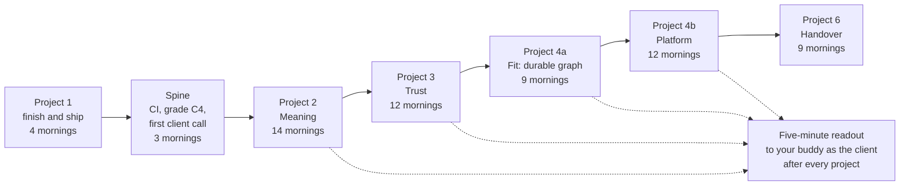
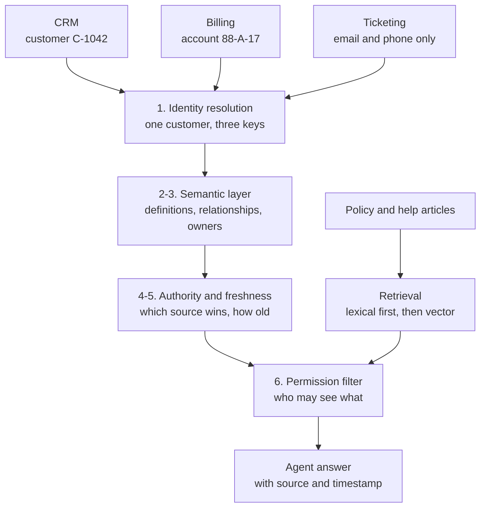
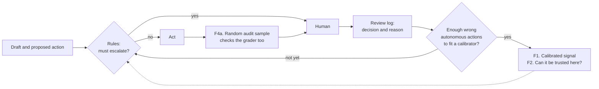
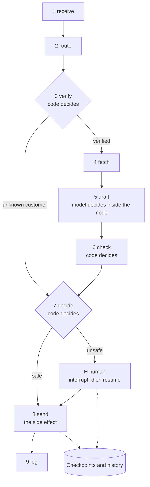
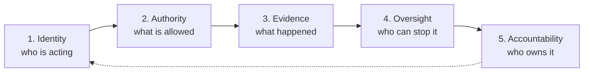

## 1. The plan on one page

> [!NOTE]
> Revised 14 November 2026. Read this section each morning (about four minutes). Read Section 3 only for the lab you are on. Section 5 says what this revision changed and why. The 9 and 11 November versions are in git history and pull request #30.

**Goal.** Help an enterprise adopt AI and build meaning from data that is fragmented across the organization, inside a six-week engagement.

**Constraint.** One 80-minute morning, six days a week. Knowledge is not the bottleneck, and neither is the plan. Shipping is: Days 10, 11, and 12 are drafted and none has shipped (Section 5).

### The rule: ship, then deepen

1. One morning, one commit, one sentence on what it showed.
2. When a topic's done-list is met, record that morning (two takes at most) and ship. Extra depth goes to `later.md`.
3. A gated lab opens only when its trigger fires. Depth is earned by evidence.
4. The plan is frozen while a project is open. Changes wait in `later.md` until the project's article is live. This is already a coaching rule in `fde-learn`. Every plan revision since 9 November broke it, this one included. This is the last change before Project 1 ships.

### The path

Project 5 (4 mornings) is no longer a phase. Each of its explainers follows the lab that raises its question. The spine is a CI gate, the graded C4 run, and a first client call; every later lab attaches to them.

| Condition for adoption | The capability, in a sentence that survives a vendor rename                                     | Where                          |
|------------------------|-------------------------------------------------------------------------------------------------|--------------------------------|
| Trust                  | Show with error bars whether it works and why it changed.                                       | Projects 1 and 3               |
| Meaning                | Answer a business question that no single system can answer, and say which source you believed. | Project 2                      |
| Fit                    | Run the workflow so that a crash or a day-long human wait never repeats a side effect.          | Projects 4a and 4b             |
| Permission             | Show a risk owner who acted, under which rule, with what evidence, and who can stop it.         | Governance ledger, in the labs |
| Value and ownership    | Leave it running with a baseline, a runbook, and a named owner.                                 | Project 6                      |

Total: 67 mornings, about 89 hours, about 11 weeks at six mornings a week. That is an estimate, not a deadline. About a quarter of those mornings (16) finish, measure, or explain work that already exists.

### The next two weeks

One line is one morning unless it says two. Sunday is rest.

* [ ] Sat 14 Nov. Day 10: write "In my words" in three plain sentences, record from `pitch.md`, ship. Nothing else.
* [ ] Mon 16 Nov. Day 11: ship ADR-001 as drafted. Its scope is A, B, and C plus the C2 finding. C3 and C4 belong to a later ADR (lab E4).
* [ ] Tue 17 Nov. Day 12: check every number in `article.md` against the run files. Cut to the minimum scope: 500 words, one table, one diagram, the recommendation.
* [ ] Wed 18 Nov. Day 12: publish on `rajc.work` and ship. Project 1 is done and the freeze lifts. The same day, merge the `learning_path.json` change for the spine and Project 2 (only those), or run `fde-coach learn pause`, so Thursday's 06:00 drop is the right topic.
* [ ] Thu 19 Nov. Spine: one GitHub Actions workflow runs the 63 existing scenarios on every pull request. Done when a pull request that breaks a policy rule turns red.
* [ ] Fri 20 Nov. Spine: grade the saved C4 run by case file (base, abuse, multi-turn, regional). Done when one table shows passed, safe, and missed escalations per file, with intervals.
* [ ] Sat 21 Nov. Spine: a 30-minute market check after Microsoft Ignite (17 to 20 November), then a 20-minute first client call with your buddy. Give the ADR-001 headline, then ask: "What do you need answered that no single system can answer?" Done when you hold ten questions in the client's words.
* [ ] Mon 23 Nov. H0: split Acme into CRM, billing, and ticketing with five seeded conflicts. Done when a map of the estate marks each conflict.
* [ ] Tue 24 Nov. H0: write the ten questions as test cases with expected answers, then score C4 on them. Done when the baseline is committed. Expect a low score.
* [ ] Wed 25 and Thu 26 Nov. H1: identity resolution, rules first. Done when precision, recall, and the false-merge count are reported on labelled pairs.
* [ ] Fri 27 and Sat 28 Nov. H2: the five most disputed terms, each with an owner and a source of truth.

---

## 2. Inventory: what the plan asked for and what already exists

The 9 and 11 November plans were written from the market inward. This table starts from the code. Paths are under `fde-first-principles/`; "Studio" is `1-measure-before-you-believe/03-test-set-first/acme-review-studio/`.

| The plan asked for                                             | The repository already has                                                                                                                                                               | What is left                                                          |
|----------------------------------------------------------------|------------------------------------------------------------------------------------------------------------------------------------------------------------------------------------------|-----------------------------------------------------------------------|
| Redraw C3 as an explicit graph in a new framework (E1)         | A nine-step LangGraph state graph in Studio `acme/workflow.py`, with C3 as a pluggable drafter. Only step 5 calls a model.                                                               | Label each edge code, model, or human. No port in Project 4a.         |
| A durable human approval (E3)                                  | `interrupt()` and `resume` over a SQLite checkpointer, a `waiting_for_human` run state, and resume tests.                                                                                | Restart while waiting, a timeout path, a decision log.                |
| Declarative YAML and visual authoring (E5)                     | Studio `workflows/studio-declarative.yaml` (10 nodes, 11 edges) drives the same graph, and the Simulator view draws it.                                                                  | A diagram generated from the spec in CI.                              |
| An ablation: coded edge against "the model decides" (E4)       | C2 (the model decides) and C3 (code decides) are both saved, on the same model and the same 84 case ids.                                                                                 | One re-grade and one sentence.                                        |
| A kill test with an idempotent `issue_refund` (E2)             | No `issue_refund` exists in the code. The tools are `lookup_customer`, `search_kb`, `get_article`, and `escalate`. Checkpoints are snapshots.                                            | One write tool, the event log by hand, the kill test.                 |
| Calibrate an LLM judge against human labels (Project 3)        | Studio `judge_round1.py`. Round 1 on 32 cases: precision 0.70 (7 of 10), recall 0.88 (7 of 8). Verdict in the round 1 review: a pre-screen, not yet a gate.                              | Re-validate on fresh cases after the outage-absence fix.              |
| A `pytest-bdd` CI gate (Project 3)                             | 63 scenarios in 14 feature files. No workflow file under `.github/`.                                                                                                                     | One workflow file.                                                    |
| Multi-turn users, regional slices, a red team (Projects 3, 4b) | 256 cases: 84 base, 80 abuse twins (31 abuse vectors, one of them injection), 40 multi-turn, 52 regional. C4 ran on all 256 on 10 November; the saved file holds replies without grades. | Grade the saved run by file. Indirect injection is not covered yet.   |
| A routing threshold from an explicit cost ratio (F1)           | Studio `reports/thresholds.yml`: missed escalation ₹2,000, unsafe auto-send ₹1,000, unneeded escalation ₹60, four minutes per review.                                                    | Use it.                                                               |
| A learning-loop dashboard (F4)                                 | Studio `reports/review-dashboard.qmd`: escalation triggers and disagreement rates.                                                                                                       | An audit sample and an override rate.                                 |
| Provenance hashes at run time (rule 5)                         | Studio `acme/sim/versions.py` hashes cases, labels, and artifacts. Lab run metadata records the case hash and model, not the prompt or grader.                                           | Two fields in the lab's run metadata.                                 |
| Definitions with owners (H2)                                   | `data/acme/ontology.ttl` with `acme:ownedBy`, `validate_ontology_ops()`, and a Meaning tab in the Studio.                                                                                | Cross-system terms, once H0 exists.                                   |
| Trace grading (Project 3)                                      | A span contract in Studio `acme/sim/trace.py`, and `tool_calls` saved in the latest C3 and C4 run rows.                                                                                  | Grade tool choice from saved rows. OpenTelemetry export waits for E6. |

One number changes Module F. In the C3 v4 run, 41 replies were sent without a person and the grader found none of them wrong (1 of 42 in v3). All 6 remaining failures were on the escalated side. A statistical router learns from wrong autonomous actions, and this lab has none to learn from. Section 3 moves the routing study to where the errors are.

---

## 3. Lab reference

Read only the lab you are on. Each lab keeps its first-principles question and one pass condition. When a project starts, its labs move into `learning_path.json`, and the topic README the tracker generates carries the detail.

### Spine (3 mornings, straight after Project 1)

| Lab               | Question                                              | Smallest build                                                             | Done when                                                                                   |
|-------------------|-------------------------------------------------------|----------------------------------------------------------------------------|---------------------------------------------------------------------------------------------|
| CI gate           | Does a regression stop a merge without me?            | One workflow that runs both `pytest` suites offline on every pull request. | A pull request that breaks a policy rule turns red.                                         |
| Grade C4          | What did the 10 November run on 256 cases show?       | Grade the saved replies by case file. No new model calls.                  | One table per file with intervals, and the run metadata gains the prompt and grader hashes. |
| First client call | What does the client need that no one system answers? | Twenty minutes with your buddy as the client, headline first.              | Ten cross-system questions in the client's words.                                           |

The CI gate is one mechanism with four later uses: governance controls (G2), access rules (H6), the kill test (E2), and graph edges (E1). Build it once, here.

### Project 2 · Meaning across fragmented data (Module H, 14 mornings)

Meaning does not live in the model, and it does not live in any one system. For any fact an agent uses, six questions need an answer.

| # | Question about a fact                      | Capability                                  |
|---|--------------------------------------------|---------------------------------------------|
| 1 | Which real-world thing is this about?      | Identity resolution across systems          |
| 2 | What does this term mean, and who says so? | Definitions with an owner                   |
| 3 | How is it connected to other things?       | Relationships (ontology)                    |
| 4 | Which source wins when systems disagree?   | Authority: a system of record per attribute |
| 5 | How old is it?                             | Freshness carried with the fact             |
| 6 | Who may see it?                            | Permission enforced at retrieval            |

Similarity search answers a seventh, narrower question: which text resembles this one? It is the right tool for documents and it cannot answer questions 1 to 6.

| Lab | Question                                                                      | Smallest build                                                                                                                                      | Done when                                                                                               | Mornings |
|-----|-------------------------------------------------------------------------------|-----------------------------------------------------------------------------------------------------------------------------------------------------|---------------------------------------------------------------------------------------------------------|----------|
| H0  | What does the business need answered that no single system can answer?        | Three synthetic systems with different keys and owners, five seeded conflicts, and ten questions with expected answers. Grow to about 30 before H7. | C4 is scored on the questions. The gap is the reason for the rest.                                      | 2        |
| H1  | Is customer C-1042 in the CRM the same person as account 88-A-17 in billing?  | A resolver with rules first and similarity second. Label the candidate pairs.                                                                       | Precision, recall, and the false-merge count are reported. Uncertain matches go to a person.            | 2        |
| H2  | When two teams use one word differently, which meaning wins, and who decided? | Add the five most disputed terms to `ontology.ttl`, each with an owner, a source of truth, and an effective date.                                   | `validate_ontology_ops()` catches a seeded disagreement, and your buddy signs off the five definitions. | 2        |
| H3  | Most enterprise facts sit in tables. How should an agent query them?          | Answer the numeric questions twice: the model writes SQL on raw schemas, then the model picks governed metrics and code writes the query.           | An accuracy table with intervals, and a list of question types the semantic layer cannot express.       | 2        |
| H4  | When is similarity search the right tool?                                     | One notebook: embeddings and cosine by hand, then `recall@k` for lexical against vector search on the document questions.                           | `recall@k` is reported for both, with a one-page note on when a vector database earns its place.        | 1        |
| H5  | Billing and CRM disagree. Which one does the agent believe?                   | A system-of-record table per attribute. Every fact travels with its source and timestamp.                                                           | On the seeded conflicts the agent cites the authoritative source and flags every stale fact.            | 1        |
| H6  | Can the agent leak what its caller may not see?                               | Filter at retrieval by caller identity, never by prompt. Access rules as scenarios in the CI gate.                                                  | Zero leaks on a seeded access test set.                                                                 | 1        |
| H7  | What did each layer buy?                                                      | On the full question set, compare vector search alone, the semantic layer alone, and the full meaning layer.                                        | One sentence per layer, published. Then the article (2 mornings).                                       | 1 + 2    |

A false merge in H1 shows one customer's data to another. Count it separately from a false split, because it is a privacy incident. Gated depth: chunking and hybrid search open only if lexical `recall@5` misses document questions in H4. The H3 claim to test comes from a vendor benchmark ([dbt Labs][dbt-bench]); test it on your own questions.

### Project 3 · Trust that runs without you (12 mornings)

| Lab                 | Question                                                     | Smallest build                                                                                       | Done when                                                                                                                              | Mornings |
|---------------------|--------------------------------------------------------------|------------------------------------------------------------------------------------------------------|----------------------------------------------------------------------------------------------------------------------------------------|----------|
| Judge re-validation | When the judge says "fail", how often is it right?           | Apply the outage-absence fix from the round 1 review. Validate on cases not used to tune the rubric. | Recall of at least 0.8 and precision of at least 0.7 with intervals (the bar the round 1 review set), or the judge stays a pre-screen. | 2        |
| Paired comparison   | Is C4 better than C3 v4, or is it noise?                     | Paired differences on the same 84 cases.                                                             | One sentence with an interval.                                                                                                         | 1        |
| Broken tools        | What does the agent do when a tool fails?                    | Make `search_kb` and `lookup_customer` time out, error, and return malformed data.                   | No policy break and no invented fact under any fault, with one scenario per fault.                                                     | 1        |
| Trace grading       | Did it take the right steps, not only write the right words? | Grade tool choice from the `tool_calls` already saved in the run rows.                               | A table of right, wrong, and skipped tool calls by version.                                                                            | 1        |
| F4a, F1, F2         | See Module F below.                                          |                                                                                                      |                                                                                                                                        | 5        |
| Article             |                                                              | Minimum scope.                                                                                       | Live on `rajc.work`.                                                                                                                   | 2        |

The judge has 32 labelled cases, 8 of them expert fails. That is too few to defend an agreement threshold such as kappa of 0.80, so this lab keeps the bar the round 1 review already set.

#### Module F · Hybrid routing to a human

Routing is a decision under uncertainty with a budget. Reviewer time is the scarce resource, so the router spends it on the cases most likely to be wrong. "Hybrid" has two layers: rules first, then a statistical signal for what the rules allow.

The rules layer already works: C3 v4 missed 0 of 40 escalations. The statistical layer has nothing to learn from yet (Section 2). So the order changes: audit first, then study the method where errors exist.

| Lab                       | Question                                             | Smallest build                                                                                                                                                                                                                     | Done when                                                                                                                                                | Mornings |
|---------------------------|------------------------------------------------------|------------------------------------------------------------------------------------------------------------------------------------------------------------------------------------------------------------------------------------|----------------------------------------------------------------------------------------------------------------------------------------------------------|----------|
| F4a. Audit first          | Is "none wrong" true, or is the grader blind?        | Read a random sample of 20 autonomous replies from the C4 run, across all four case files.                                                                                                                                         | The count of "grader passed, expert fails" is recorded. These are the first router labels.                                                               | 1        |
| F1. Calibrated signal     | When the system says 0.8, is it right 8 times in 10? | A method study on C2, the version without code rules. Run it on all 256 cases and grade it. Collect a judge score and a stated confidence. Fit a calibrator with five-fold cross-fitting. Set the threshold from `thresholds.yml`. | A reliability diagram and a risk-coverage curve. At a 15% review budget the router beats random routing with an interval, or you document a null result. | 3        |
| F2. Meta-confidence       | Can I trust the confidence number on this case?      | Calibration error per case file: base, abuse, multi-turn, regional. Flag cases far from the calibration data.                                                                                                                      | A table of calibration error inside and outside the calibration data, and the errors the flag caught.                                                    | 1        |
| F3. Sketch and divergence | If I ask several cheap ways, do the answers agree?   | Gated. Open it only if F1 leaves errors uncaught at the review budget.                                                                                                                                                             |                                                                                                                                                          | gated    |
| F4b. Learning loop        | How does each human decision improve the next one?   | The E3 review log feeds recalibration. Add an override rate to the existing dashboard. Runs in Project 4b, when the log exists.                                                                                                    | A replay shows the threshold moving after a shift.                                                                                                       | 1 (4b)   |

Why C2: it passed about 65% of the base 84 when graded on 1 November, so 256 cases should give roughly 90 errors if the other files behave like the base. Why cross-fitting: a three-way split of 256 cases starves each part. The arithmetic: a router that catches half the errors has an interval of about ±32 points with 10 errors, ±18 with 30, and ±11 with 90. Random routing at a 15% budget catches 15%.

### Project 4a · Fit: a durable graph with a human in it (Module E, 9 mornings)

A loop lets the model pick the next step. A graph declares which steps are possible and lets the model choose only where you allow it. You already run that graph. Project 4a makes it survive crashes and human delays, on the runtime you have. The Azure-native version is lab E6 in Project 4b.

| Lab                       | Question                                                                                          | Smallest build                                                                                                                                                                                    | Done when                                                                                                                              | Mornings |
|---------------------------|---------------------------------------------------------------------------------------------------|---------------------------------------------------------------------------------------------------------------------------------------------------------------------------------------------------|----------------------------------------------------------------------------------------------------------------------------------------|----------|
| G4. Security intake       | What will the client's security review ask in week one?                                           | A one-page intake checklist built from the five governance questions.                                                                                                                             | Your buddy, as the client CISO, finds nothing missing that blocks a start.                                                             | 1        |
| E1. Control flow          | Which decisions belong to code, which to the model, and which to a person?                        | One diagram of the existing graph with every edge labelled code, model, or human.                                                                                                                 | Every edge has a scenario in the CI gate.                                                                                              | 1        |
| E2. Durability and replay | What must be written down so a run survives its process dying, without doing a side effect twice? | Add one write tool (an append to a credit ledger). By hand, in about 100 lines: an append-only event log and a replay function for one run. Then a kill test at each of the nine step boundaries. | Given a run killed after the side effect returned, when the worker restarts, then the run completes and exactly one ledger row exists. | 3        |
| E3. Human in the loop     | How do you place a slow, expensive, authoritative step inside a graph?                            | Restart the process while a request is pending. Add a timeout path. Write each decision (approve, edit, or hold, plus a reason) to a review log.                                                  | An approval sent after a restart resumes the run, and an unanswered request escalates.                                                 | 2        |
| E4. Agent native          | What does a coded edge buy over letting the model decide?                                         | Re-grade the saved C2 and C3 v4 runs with one grader. No new build.                                                                                                                               | One sentence with an interval. It opens the next ADR.                                                                                  | 1        |
| E5. Visual authoring      | Who needs to read or change the graph, and can they?                                              | Generate a Mermaid diagram from `studio-declarative.yaml` in CI.                                                                                                                                  | Your buddy finds a seeded wrong edge from the diagram alone.                                                                           | 1        |

"Replay" means three different things. Learn to tell them apart.

| Replay kind         | What runs again                                                                      | Used for                                           |
|---------------------|--------------------------------------------------------------------------------------|----------------------------------------------------|
| Recovery replay     | Orchestration code only; finished model and tool calls return recorded results       | Crash recovery ([Durable Task][dt-agents])         |
| Time travel or fork | Every node after the chosen checkpoint, including model calls, so answers can differ | Debugging and what-if ([LangGraph][lg-timetravel]) |
| Audit replay        | Nothing; the history is read back                                                    | Explaining one decision to a reviewer              |

Checkpointing is not the same as durable execution. A snapshot saves state at step boundaries. An event history rebuilds state by re-running deterministic orchestration code, which is why every side-effecting step must be idempotent. The saved gradings already hint at E4's answer: C2 missed 7 of 40 escalations and C3 v4 missed 0 of 40. Two grader versions produced those numbers, so re-grade before you quote them.

### Project 4b · Platform (12 mornings, after the post-Ignite check)

| Lab                 | Question                                            | Smallest build                                                                                                                        | Done when                                                                            | Mornings |
|---------------------|-----------------------------------------------------|---------------------------------------------------------------------------------------------------------------------------------------|--------------------------------------------------------------------------------------|----------|
| E6. Azure native    | Which Azure primitive carries which responsibility? | Port the same graph to Agent Framework workflows, host it on Foundry, and rerun the eval gate. Write a one-page client decision note. | One traced cloud run, a filled parity table, and the primitive map below, committed. | 4        |
| MCP server          | Can any agent runtime call the Acme tools?          | Wrap the four read tools and the ledger tool in one MCP server with schema validation and an idempotency key on the write.            | The graph passes the eval gate through the server.                                   | 2        |
| Identity and policy | Who is acting, and what may it do?                  | A scoped identity for the agent. Policy decided outside the model. One scenario that proves a denial.                                 | The denial scenario fails, then passes, in the CI gate.                              | 2        |
| Indirect injection  | Can a poisoned ticket or article steer the agent?   | Add poisoned-content cases beside the injection pairs already in the abuse set.                                                       | A 100% block rate on the seeded cases.                                               | 1        |
| F4b. Learning loop  | See Module F.                                       |                                                                                                                                       |                                                                                      | 1        |
| Article             |                                                     | One article for Projects 4a and 4b, minimum scope.                                                                                    | Live on `rajc.work`.                                                                 | 2        |

| Responsibility         | Azure primitive                                     | Portable equivalent                        |
|------------------------|-----------------------------------------------------|--------------------------------------------|
| Graph and control flow | Agent Framework workflows                           | LangGraph (what you run today), Google ADK |
| Durability             | Durable Task Scheduler, Durable Functions extension | Temporal, a Postgres checkpointer          |
| Hosting                | Foundry Agent Service                               | Bedrock AgentCore, a container             |
| Visual and low-code    | Foundry workflow designer, Logic Apps agent loop    | Awareness only                             |
| Identity and registry  | Entra Agent ID, Agent 365                           | Cloud IAM, workload identity               |
| Observability          | OpenTelemetry into Azure Monitor and Foundry        | Any OpenTelemetry backend                  |

Your policy as code already exists: `business_rules.json`, `escalation.py`, and ten scenarios in `policy_rules.feature`. Cedar is the language of AWS AgentCore Policy. Learn it when a client runs on AWS; on an Azure build, use the controls that platform enforces.

### Governance spine (Module G, inside the labs)

Governance answers one question: who may do what, on whose behalf, with what evidence, and who answers when it goes wrong?

| Question                        | First principle                                                  | Where it lives in your build                                       | Evidence artifact                             |
|---------------------------------|------------------------------------------------------------------|--------------------------------------------------------------------|-----------------------------------------------|
| 1. Who is acting?               | Every agent has its own identity, separate from builder and user | Agent identity (as in your `governance.md`)                        | Identity matrix: agent, owner, scopes         |
| 2. What may it do?              | Least privilege, with policy decided outside the model           | `business_rules.json`, tool scopes, graph edges as decision rights | Scenarios that prove a denial                 |
| 3. What happened?               | Every action can be reconstructed                                | Checkpoints and history, saved `tool_calls`, version hashes        | An audit replay of one case, end to end       |
| 4. Who can stop or override it? | Human oversight in proportion to risk                            | The human node, `thresholds.yml`, timeouts                         | Review log, override rate, audited error rate |
| 5. Who owns it after you leave? | Named accountability and controlled change                       | Owner matrix, the CI gate as change approval, the runbook          | Handover kit                                  |

* G1. Governance ledger: one page, one row per control, with where it is enforced, its evidence, and its owner. Start it in the spine and add a row with each lab. It costs no separate morning.
* G2. Controls as executable specifications. This is the CI gate. A control without a failing-then-passing test is a claim.
* G3. The "five questions" walkthrough is the Project 4 readout.
* G4. The week-one security intake checklist (Project 4a, first morning).
* Done when: your buddy, as the client CISO, picks any run from the log and you show the acting identity, the policy decision, the trace, the approver, and the owner in under two minutes.

Classify each action by reversibility and blast radius, and let the tier set the control. Regulations map onto the five questions at awareness level. Confirm current EU AI Act dates before you quote them to a client ([Gibson Dunn][eu-omnibus]).

### Project 5 · Explainers (4 mornings, inside host labs)

| Explainer                          | Host lab             | Artifact                                                                 |
|------------------------------------|----------------------|--------------------------------------------------------------------------|
| Tokens, cost, and regional scripts | After "Grade C4"     | A cost table per case file, from the tokens already saved in the run     |
| Context limits                     | After H4             | One diagram: what goes in the context and what it costs                  |
| Where hallucination comes from     | After H5             | One diagram: a missing fact against a stale fact against an invented one |
| Build, tune, or retrieve           | Before the final ADR | A one-page decision note for a client                                    |

### Project 6 · Handover (9 mornings)

Discovery, data readiness, and the value baseline no longer wait for the end. They are the first client call and lab H0. The readout is practised after every project. What remains:

| Lab                  | Smallest build                                                                           | Done when                                                         | Mornings |
|----------------------|------------------------------------------------------------------------------------------|-------------------------------------------------------------------|----------|
| Security review pack | Data flow diagram, threat model, identity matrix, and the injection test report.         | The pack answers every item on the G4 intake checklist.           | 2        |
| Final ADR            | The decision, its conditions, and its rollback triggers.                                 | One page, with evidence from Projects 2 to 4.                     | 1        |
| Handover kit         | Runbook, owner matrix, and a stewardship model for the definitions.                      | Your buddy can run the eval gate and name each owner without you. | 2        |
| Rehearsal            | A recorded 45-minute client simulation: discovery, security sign-off, readout, handover. | Recorded, with three things to change.                            | 2        |
| Article              | Minimum scope.                                                                           | Live on `rajc.work`.                                              | 2        |

---

## 4. Not now

Each item is parked with the trigger that reopens it.

| Parked                                                   | Trigger                                                                                                                                                |
|----------------------------------------------------------|--------------------------------------------------------------------------------------------------------------------------------------------------------|
| `micrograd` and Tiny GPT (old Projects 3 to 5)           | An interview loop that tests ML internals, a client that self-hosts and tunes open-weight models, or a deliberate choice to make them channel content. |
| Sketch and divergence (F3)                               | F1 leaves errors uncaught at the review budget.                                                                                                        |
| Chunking and hybrid search beyond H4                     | Lexical `recall@5` misses document questions.                                                                                                          |
| OpenTelemetry export, drift monitoring                   | A hosting platform that ingests traces (E6), or real or replayed traffic.                                                                              |
| A second graph runtime or a second cloud                 | A client on that stack.                                                                                                                                |
| Cedar                                                    | A client on AWS AgentCore.                                                                                                                             |
| A streaming operator console in React                    | A full-stack role becomes the target.                                                                                                                  |
| Agent Skill packaging of the grader, long-running memory | A client asks for it.                                                                                                                                  |
| Attribution of the C3 gain on a clean held-out set       | Lab E4. Cases `c79` and `c80` sit in the held-out list and in the day-5 notes, so draw a fresh set first.                                              |
| Role mapping, certifications, and the employer table     | Removed from this plan. They measure a proxy (job postings), not the goal.                                                                             |

---

## 5. What this revision changed, and why (14 November)

The review asked one question of every line: what is the smallest thing that moves the goal forward tomorrow morning?

### Where things stood on 14 November

| Signal         | What the repository shows on 14 November                                                                                                                                                                                                    |
|----------------|---------------------------------------------------------------------------------------------------------------------------------------------------------------------------------------------------------------------------------------------|
| Shipped        | 9 topics by 31 October, slightly ahead of budget (18 budgeted mornings in 16 working days). None since.                                                                                                                                     |
| Day 10         | Open for 15 days with 8 logged misses. Its done-list is met: 20 failures labelled, the fix run (C2) saved with before and after numbers, a five-minute script written. Only "In my words", the recording, and the ship command are missing. |
| Days 11 and 12 | Drafted before the tracker dropped them: ADR-001 (678 words) and the article (1,068 words).                                                                                                                                                 |
| The plan       | Revised three times between 9 and 11 November. Remaining work went from 110 to 90 to 103 hours while shipped work stayed at zero.                                                                                                           |
| The lab        | Ahead of the plan. Section 2 checks 13 planned items against the code. Twelve already exist in whole or in part.                                                                                                                            |

Three records disagree. The tracker says you are behind. The plan says 103 hours remain. The code says much of that work exists. The code is right, so this plan starts from the code.

### Findings and changes

| Finding                                       | Evidence                                                                                                                                                                   | Change                                                                                          |
|-----------------------------------------------|----------------------------------------------------------------------------------------------------------------------------------------------------------------------------|-------------------------------------------------------------------------------------------------|
| The bottleneck is shipping, not scope         | Days 10 to 12 are drafted and none is shipped. Day 10 has 8 logged misses with its done-list met.                                                                          | The rule in Section 1. The next four mornings ship drafts and build nothing.                    |
| The plan grew faster than the work            | 110, then 90, then 103 hours remaining across three revisions in three days. The document reached 729 lines and a 28-minute read.                                          | One page to read daily. A freeze while a project is open.                                       |
| The plan re-planned work that exists          | The 13 rows of Section 2.                                                                                                                                                  | Labs start from the code. Project 4a keeps the LangGraph graph; the Azure port is one lab (E6). |
| Module F could not pass its own test          | 0 wrong among 41 autonomous replies in C3 v4. The calibrator had no errors to fit.                                                                                         | Audit first. The method study runs on C2, with cross-fitting.                                   |
| One lab leaned on a tool that does not exist  | `issue_refund` appears in the plan and nowhere in the code.                                                                                                                | E2 adds one small write tool as its first step.                                                 |
| The same mechanism was planned four times     | CI gate, controls as tests, access rules, kill test.                                                                                                                       | Build the CI gate once, in the spine.                                                           |
| The proxy survived its own review             | The 11 November review named job postings a proxy, yet the employer table, role map, and certifications stayed. Eight of the employer table's eleven rows cited no source. | Removed. Market evidence is a few sourced lines in Section 6.                                   |
| Client feedback came last                     | The rehearsal sat in weeks 12 to 14 of a plan for six-week engagements.                                                                                                    | A first client call on 21 November, and a readout after every project.                          |
| Hours were false precision                    | Project 2 priced its ablation and article together at 1.5 hours. The tracker's own formula gives an article about 3 mornings.                                              | Sizes are in mornings. Articles ship at minimum scope in 2.                                     |
| The 9 November sprint list made Day 10 bigger | It attached the attribution work to an open topic.                                                                                                                         | That work is now lab E4, after Project 1.                                                       |

Five questions produced most of these changes:

1. Suppose the curriculum were already finished. What would be missing? Only the shipped proof. That led to the inventory.
2. What if the readout came first? That moved the first client call to 21 November.
3. Where are the errors? That moved the routing study to C2.
4. What if nothing new may be built this week? Three ships are waiting.
5. Which labs are one mechanism under several names? That produced the spine.

Not checked in this review: the web sources added on 11 November (they are listed separately under Sources), and the grader, which was read and not run. Every number in Sections 1 and 2 comes from files in the repository at `0f0ac98`.

---

## 6. Evidence

All five major vendors converged on one production stack in 2026. None of it asks you to train a model.

| Theme                              | What shipped in 2026                                                                                                                                                                                                                                                        |
|------------------------------------|-----------------------------------------------------------------------------------------------------------------------------------------------------------------------------------------------------------------------------------------------------------------------------|
| Managed agent loops                | AWS [AgentCore managed harness][aws-harness] (June). Microsoft [Foundry hosted agents][ms-foundry] (June). Google [Gemini Enterprise Agent Platform][gcp-agent] (April). OpenAI [Agents API][oai-devday] (September). Anthropic [Claude Managed Agents][ant-managed] (May). |
| Graph workflows, durable execution | Microsoft Agent Framework [durable workflows][maf-durable] and [Foundry workflows][foundry-workflows]. LangGraph [durable execution][lg-durable]. A [critique of framework durability][diagrid-durable].                                                                    |
| Evaluation as a platform feature   | AWS [AgentCore Evaluations][aws-evals]. Google [Agent Evaluations][gcp-evals] with user simulation and CI. Microsoft Foundry rubric evaluator. Anthropic Outcomes (beta).                                                                                                   |
| Enterprise context layers          | Microsoft [IQ family][ms-iq] and the [Fabric IQ][fabric-iq] ontology (preview). AWS AgentCore [knowledge layers][aws-knowledge]. Google's [Gemini agent][gcp-work].                                                                                                         |
| Open standards                     | Agent Skills joined MCP, A2A, and `AGENTS.md` at the [Agentic AI Foundation][aaif-skills] (October).                                                                                                                                                                        |
| Identity and policy                | Microsoft [Agent 365][ms-agent365-ga] and Entra Agent ID. AWS AgentCore Policy in Cedar. Google agent identity and gateway.                                                                                                                                                 |
| Constrained decisions              | OpenAI [Decisions API][oai-devday] (preview) for routing across a fixed set of answers.                                                                                                                                                                                     |

Market signals, all directional:

* FDE job postings on Indeed rose more than 729% from April 2025 to April 2026 ([LeadDev][leaddev-fde]).
* About 1,000 FDE job posts list core engineering, then LLM applications, retrieval, evals, and agent orchestration, then customer discovery, which is rising fastest ([Perspective AI][perspective-fde]).
* AWS, OpenAI, and Anthropic each funded forward-deployed programmes in 2026. AWS runs pods of five or six for 45 days, and Anthropic's academy grades a simulated deployment through security review and handover ([comparison][stateofai-fde], [AWS model][pulse2-aws], [Claude Frontier Academy][ant-academy]).
* Vendor-sponsored surveys name data readiness as the main barrier to production agents ([Teradata][teradata-stall], [Modern Data Company][mdc-survey], [Verdantix][verdantix-ready]).

---

## Sources

### Repository (inspected 14 November 2026)

* [curriculum.md](https://github.com/rajchampaneriya/fde-impromptu-coach/blob/main/fde-learn/references/curriculum.md) and [coaching.md](https://github.com/rajchampaneriya/fde-impromptu-coach/blob/main/fde-learn/references/coaching.md) in `fde-impromptu-coach`
* [fde-first-principles](https://github.com/rajchampaneriya/continuous-learning/tree/main/fde-first-principles) at commit `0f0ac98`: `.learn/progress.json`, `data/results`, `data/acme`, `lab`, `tests`, and the Studio

### Opened and checked on 9 November 2026

* AWS: [AgentCore managed harness][aws-harness] · [AgentCore Evaluations and Policy][aws-evals] · [AgentCore knowledge layers][aws-knowledge]
* Microsoft: [Foundry at Build 2026][ms-foundry] · [Microsoft IQ][ms-iq] · [Fabric IQ status][fabric-iq]
* Google: [Gemini Enterprise Agent Platform][gcp-agent] · [Agent Evaluations][gcp-evals] · [Gemini agent for work][gcp-work]
* OpenAI: [DevDay 2026 for developers][oai-devday]
* Anthropic: [Claude Managed Agents][ant-managed] · [Agent Skills at the Agentic AI Foundation][aaif-skills] · [Claude Frontier Academy][ant-academy]
* FDE demand: [programmes compared][stateofai-fde] · [AWS engagement model][pulse2-aws] · [postings growth][leaddev-fde] · [hiring trends][perspective-fde]

### Added on 11 November 2026, not re-opened in the 14 November review

* Durability: [Durable Task for AI agents][dt-agents] · [Durable workflows in Agent Framework][maf-durable] · [Foundry workflows][foundry-workflows] · [LangGraph durable execution][lg-durable] · [LangGraph time travel][lg-timetravel] · [Still Not Durable, Diagrid][diagrid-durable]
* Identity and regulation: [Agent 365 general availability][ms-agent365-ga] · [EU AI Act Omnibus agreement, Gibson Dunn][eu-omnibus]
* Data meaning: [dbt Labs, semantic layer against text-to-SQL][dbt-bench] · [Teradata][teradata-stall] · [Modern Data Company survey][mdc-survey] · [Verdantix][verdantix-ready]

[aws-harness]: https://aws.amazon.com/about-aws/whats-new/2026/06/amazon-bedrock-agentcore-harness-generally-available
[ms-foundry]: https://devblogs.microsoft.com/foundry/agent-service-build2026/
[gcp-agent]: https://siliconangle.com/2026/04/22/google-brings-agentic-development-optimization-governance-one-roof-gemini-enterprise-agent-platform/
[oai-devday]: https://infoq.com/news/2026/10/openai-devday-2026
[ant-managed]: https://claude.com/resources/articles/new-in-claude-managed-agents
[aws-evals]: https://aws.amazon.com/fr/blogs/aws/amazon-bedrock-agentcore-adds-quality-evaluations-and-policy-controls-for-deploying-trusted-ai-agents/
[gcp-evals]: https://developers.googleblog.com/en/agent-and-model-evaluations-in-gemini-enterprise-agent-platform-are-now-ga/
[ms-iq]: https://futurumgroup.com/?p=90820
[fabric-iq]: https://atlan.com/know/microsoft-fabric/what-is-fabric-iq/
[aws-knowledge]: https://awsinsider.net/articles/2026/06/25/amazon-bedrock-agentcore-adds-three-new-layers-of-agent-knowledge.aspx
[gcp-work]: https://siliconangle.com/google-cloud-introduces-gemini-agent-to-change-enterprise-work
[aaif-skills]: https://www.i-scoop.eu/agent-skills-agentic-ai-foundation/
[leaddev-fde]: https://leaddev.com/hiring/the-rise-of-the-forward-deployed-engineer
[perspective-fde]: https://getperspective.ai/blog/2026-fde-hiring-trends-what-1000-job-posts-reveal
[stateofai-fde]: https://www.thestateofai.com/news/amazon-bets-one-billion-on-forward-deployed-engineers
[pulse2-aws]: https://pulse2.com/amazon-aws-invests-1-billion-to-embed-ai-forward-deployed-engineers-with-customers/
[ant-academy]: https://anthropic.com/news/claude-frontier-academy
[dt-agents]: https://learn.microsoft.com/en-us/azure/durable-task/sdks/durable-task-for-ai-agents
[maf-durable]: https://devblogs.microsoft.com/dotnet/durable-workflows-in-microsoft-agent-framework/
[foundry-workflows]: https://learn.microsoft.com/azure/foundry/agents/concepts/workflow
[ms-agent365-ga]: https://www.itelio.com/en/microsoft-message-center/MC1296867
[lg-durable]: https://docs.langchain.com/oss/python/langgraph/durable-execution
[lg-timetravel]: https://docs.langchain.com/oss/python/langgraph/use-time-travel.md
[diagrid-durable]: https://www.diagrid.io/blog/still-not-durable-how-microsoft-agent-framework-and-strands-agents-repeat-the-same-mistake
[eu-omnibus]: https://www.gibsondunn.com/eu-ai-act-omnibus-agreement-postponed-high-risk-deadlines/
[teradata-stall]: https://www.teradata.com/insights/ai-and-machine-learning/why-enterprise-ai-stalls-before-it-scales
[mdc-survey]: https://itbrief.co.uk/story/ai-agents-outpace-trust-in-enterprise-data-survey-finds
[verdantix-ready]: https://www.verdantix.com/insights/report/market-trends--data-readiness-for-ai-agents
[dbt-bench]: https://docs.getdbt.com/blog/semantic-layer-vs-text-to-sql-2026
