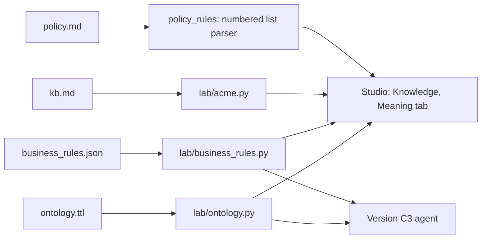

## The problem

The Acme semantic model is small (about 600 lines across four files), but one business fact lives in
several places. Nobody can review or change it with confidence, because the reviewer has to read
Turtle, JSON and two Markdown files and join them in their head.

Take the retention offer. Its facts are spread like this:

| Fact                                | Where it is written today                                                                |
|-------------------------------------|------------------------------------------------------------------------------------------|
| 50% off for 1 month                 | `policy.md` rule 13, `kb.md` KB11, `ontology.ttl` definition, `business_rules.json`      |
| Tenure of 13 months or more         | `policy.md` rule 10, `ontology.ttl` definition, `business_rules.json`                    |
| At most once in 12 months           | `policy.md` rule 10, `ontology.ttl` (`acme:oncePerMonths` and definition), `business_rules.json` |
| Doesn't count toward the ₹500 limit | `policy.md` rules 8 and 13, `ontology.ttl` (`acme:countsTowardLimit` and definition)     |
| Governed by which rules             | `ontology.ttl` (`acme:enforcesRule` and the `acme:source` string), `business_rules.json` |
| Customer-facing wording             | `kb.md` KB11                                                                             |
| Owner                               | `ontology.ttl` (`acme:ownedBy`)                                                          |

The explorer exists to answer three questions for a business reviewer:

1. What does this concept mean, and what governs it?
2. Which file do I edit to change it?
3. Do the files agree?

## Build on what already exists

The lab already loads, reasons over and checks this model. The agent the lab measures (Version C3)
reads the model through `lab/ontology.py`. The explorer must show the model the agent sees, so it
reuses that module instead of building a second pipeline.

| Need                                   | Already in the repository                                     |
|----------------------------------------|---------------------------------------------------------------|
| Load `ontology.ttl` and run SPARQL     | `lab/ontology.py` `_store()` (pyoxigraph)                     |
| Inheritance down the class hierarchy   | `reason_owl_rl()` (defeasible inheritance, inverse, domain)   |
| Concept with rules, articles, owner    | `terms()`, `domain_edges()`                                   |
| Search by English or regional label    | `define("paisa wapas")`, `extract_concepts()`                 |
| Thresholds                             | `lab/business_rules.py` `load_business_rules()`               |
| Help articles                          | `lab/acme.py` `kb_by_id()`                                    |
| Cross-file governance checks           | `validate_ontology_ops()`                                     |
| A UI the domain expert already uses    | Acme Review Studio (Shiny), Knowledge page                    |
| Importing the lab from the studio      | `acme/providers.py` `LAB_ROOT` (used by the C3 provider)      |

> [!WARNING]
> Don't swap in RDFLib with the `owlrl` package. Standard OWL 2 RL does not copy values stated on a
> class (such as `acme:countsTowardLimit` or `acme:enforcesRule`) down to its subclasses, so the
> explorer would show fewer facts than the agent uses. It also applies `rdfs:domain` to the class IRIs
> themselves and adds noise such as `acme:RetentionOffer a acme:Concession`. `reason_owl_rl()` filters
> that out on purpose.

## Drift that exists today

`validate_ontology_ops()` returns `ok: True` on the current files, yet these disagreements exist:

* `business_rules.json` lists rules 8 and 10 for the retention offer; `ontology.ttl` states rules 10 and 13.
* `acme:PolicyRule` and `acme:ruleNumber` say "rules 1 to 11"; `policy.md` and the ontology have 13 rules.
* The `ontology.ttl` header says thresholds live in `business_rules.json`, but `acme:oncePerMonths 12`
  and definitions with ₹500, ₹100, 13 months, 50% and 24 hours are also in the ontology.
* `acme:source` strings repeat the `acme:documentedIn` and `acme:enforcesRule` edges by hand and
  already differ from them (for example, `acme:Concession` says "policy 8" but enforces rules 3 and 8).
* `business_rules.json` names its owner "Billing & Policy Operations", which is not one of the
  ontology's operational owners.
* After reasoning, the retention offer is governed by rules 3, 8, 10 and 13. Rules 3 and 8 come from
  `acme:Concession`. A view that shows only stated edges (rules 10 and 13) hides half the picture.

These are the explorer's first demo, and the first checks to add.

## Design: a Meaning tab in Acme Review Studio

Add one read-only sub-tab, **Meaning**, to the studio's Knowledge page next to *Help articles & policy*.
No new service, front end or container.



The tab has three views.

### Concept card

Pick a concept by any label (English or regional). The card shows each fact once, with where it
came from and which file to edit:

```text
retention offer                    also called: 50% off, loyalty discount

Meaning      50% off for 1 month, offered once and politely ...           edit: ontology.ttl
Is a         discount > concession; once-only offer                       edit: ontology.ttl
Numbers      50% for 1 month, tenure 13+ months, once per 12 months       edit: business_rules.json
₹500 limit   doesn't count (stated here; overrides concession's "counts") edit: ontology.ttl
Rules        10, 13 stated; 3, 8 inherited from concession                edit: ontology.ttl
             click a rule to read its text                                edit: policy.md
Help         KB11 · Retention offer                                       edit: kb.md
Owner        Customer Retention & Lifecycle                               edit: ontology.ttl
Checks       business_rules.json lists rules 8, 10; ontology says 10, 13
```

Leave out lifecycle (all 27 classes are `active`), IRIs and datatypes. Put those behind a
*Technical details* toggle if anyone asks.

### Rule view

Pick a rule number. Show its text from `policy.md` and every concept that enforces it, stated or
inherited. This is the impact check before changing a rule: rule 10 touches tenure, once-only offer,
late-fee waiver and retention offer.

### Checks

A table from `validate_ontology_ops()`, one row per finding, each with the file to fix.

## Code changes

All changes are small additions to `lab/ontology.py`, one parser and one Shiny panel.

### Stated versus inherited

Keep an unreasoned copy of the ontology next to the reasoned one, and compare.

```python
@lru_cache(maxsize=1)
def _asserted() -> Store:
    store = Store()
    store.load(path=str(ONTOLOGY), format=RdfFormat.TURTLE)
    return store


def provenance(word: str) -> List[Dict[str, str]]:
    """Every fact about a concept, marked 'stated' or 'inherited'."""
    iri = define(word)["iri"]
    q = PREFIXES + f"SELECT ?p ?o WHERE {{ <{iri}> ?p ?o FILTER(?p != rdf:type) }}"
    stated = {(r["p"].value, r["o"].value) for r in _asserted().query(q)}
    return [
        {"property": r["p"].value, "value": r["o"].value,
         "origin": "stated" if (r["p"].value, r["o"].value) in stated else "inherited"}
        for r in _store().query(q)
    ]
```

To name the ancestor ("inherited from concession"), check which entry in
`domain_edges(word)["superclasses"]` states the same property and value in `_asserted()`.

### Policy rule text

`policy.md` is a numbered list, so a regular expression is enough:

```python
def policy_rules() -> Dict[int, str]:
    text = (DATA / "policy.md").read_text(encoding="utf-8")
    return {int(n): " ".join(body.split())
            for n, body in re.findall(r"^(\d+)\. (.+?)(?=^\d+\. |^## |\Z)", text, re.M | re.S)}
```

### New checks in `validate_ontology_ops()`

Compare stated edges (from `_asserted()`), not reasoned ones, so inherited rules don't hide a gap.

| Check                                                                                    | Catches today          |
|------------------------------------------------------------------------------------------|------------------------|
| Each `business_rules.json` entry's `policy_rules` equals its concept's stated `acme:enforcesRule` | Retention offer 8, 10 versus 10, 13 |
| Rule numbers in `policy.md` equal the `acme:PolicyRuleN` individuals                    | Future drift           |
| Every `KBnn` heading in `kb.md` has an `acme:KBnn` individual, and the reverse          | Future drift           |
| Each `kb_article` in `business_rules.json` is among its concept's `acme:documentedIn`   | Future drift           |
| A number in `business_rules.json` (tenure, cooldown, amount) appears in the concept's definition | Prose falling behind the JSON |

Add a scenario per check to `tests/test_ontology.py`, so a pull request that edits one file and forgets
another fails in CI rather than in a customer reply.

### Studio panel

```python
from acme.providers import LAB_ROOT  # the C3 provider already puts this on sys.path
from lab.ontology import terms, define, domain_edges, provenance, policy_rules, validate_ontology_ops

ui.nav_panel("Meaning",
             ui.input_selectize("concept", None, choices=sorted(terms())),
             ui.output_ui("concept_card"),
             ui.output_data_frame("ontology_checks"))
```

> [!IMPORTANT]
> The studio's other Knowledge tabs edit the workbook copy of articles and policy. The Meaning tab reads
> `fde-first-principles/data/acme`, the files the C3 agent uses. Keep it read-only and label the
> source on screen, so nobody edits the workbook expecting the ontology to change.

## Simplify the model itself

The explorer makes drift visible; fewer copies make it rarer. Give each kind of fact one home:

| Kind of fact                               | Home                  | Remove from                                   |
|--------------------------------------------|-----------------------|-----------------------------------------------|
| What was agreed, in words                  | `policy.md`           |                                               |
| What the customer is told                  | `kb.md`               |                                               |
| Vocabulary, hierarchy, links, owner        | `ontology.ttl`        | `policy_rules` and `kb_article` in `business_rules.json` (derive them through `concept`) |
| Numbers: rupees, months, hours, percent    | `business_rules.json` | `acme:oncePerMonths` in `ontology.ttl`         |
| Which sources back a concept               | edges in `ontology.ttl` | `acme:source` strings (derive from the edges) |

Numbers inside `skos:definition` stay, because `glossary()` puts them in the model's prompt. The
last check in the table above keeps them honest.

These removals change what `compute_entitlements()` and C3 read, so they need the grader and the BDD
suite rerun (`../.venv/bin/python -m pytest -v` from `fde-first-principles/`) before and after.

## What the first draft proposed and why it's dropped

| First draft                                  | Decision | Reason                                                                   |
|----------------------------------------------|----------|--------------------------------------------------------------------------|
| React and TypeScript front end               | Drop     | The domain expert already works in the Shiny studio                      |
| FastAPI service and REST models              | Drop     | The studio imports the lab in process                                    |
| RDFLib with `owlrl`                          | Drop     | Infers a different model from the one the agent uses (see warning above) |
| pySHACL and `shapes.ttl`                     | Drop     | The real gaps are cross-file; Python checks in `validate_ontology_ops()` cover them |
| Cytoscape graph                              | Later    | A card answers the three questions; add a Mermaid view if a picture is needed |
| Docker Compose                               | Drop     | `shiny run app.py` is the deployment                                     |
| Lifecycle panel                              | Drop     | Every concept is `active`                                                |
| PNG or PDF export                            | Drop     | A browser screenshot is enough for a demo                                |
| Ten-day plan                                 | Replace  | Three steps below                                                        |

## Plan

1. Add `_asserted()`, `provenance()`, `policy_rules()` and the five checks to `lab/ontology.py`, with tests.
2. Add the Meaning tab with the concept card, rule view and checks table.
3. Agree the one-home table with the policy owner, fix the drift found, and remove the duplicates.

## Demo in three minutes

1. Open **Meaning** and type "छूट" (Hindi for discount). The card resolves it to *discount* and shows
   that its rupee value counts toward the limit, inherited from *concession*.
2. Switch to *retention offer*. Show the override ("doesn't count"), the inherited rules 3 and 8, and
   the check that `business_rules.json` disagrees with the ontology on its rules.
3. Open rule 10 and show the four concepts it touches: "Before changing this rule, here is everything
   it affects, and here is the file to edit."

## Done when

* Any concept can be found by an English or regional label
* Each fact on the card shows whether it is stated or inherited, and the file to edit
* A rule shows its `policy.md` text and every concept it touches
* The checks report the retention-offer rule mismatch and the "rules 1 to 11" text until they are fixed
* The card shows the same facts that C3 receives, because both read `lab/ontology.py`
