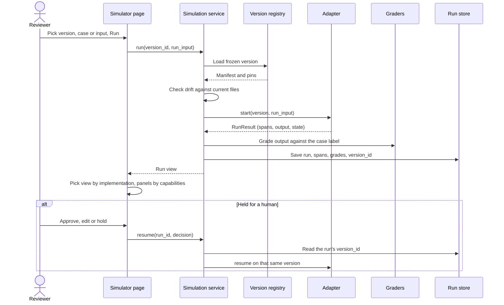
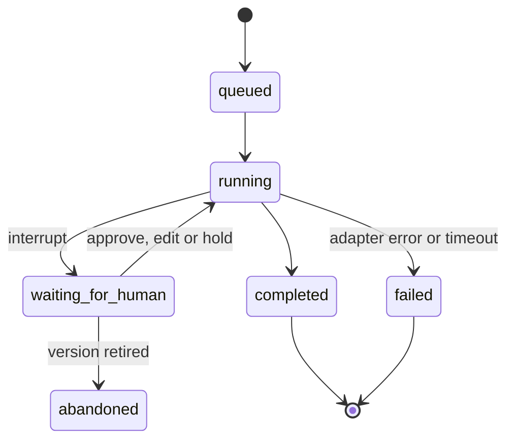
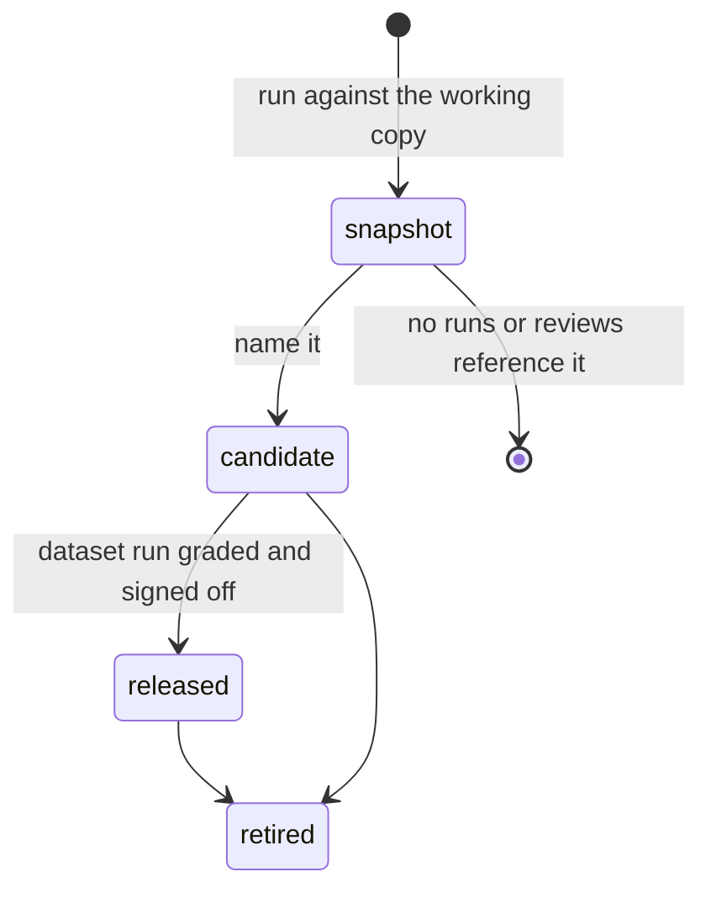
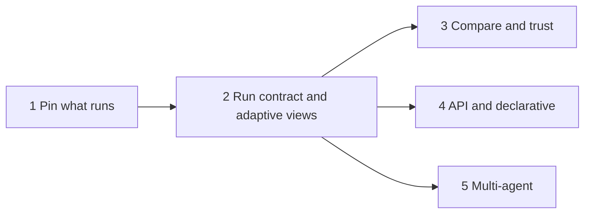

## The problem

The Simulator in Acme Review Studio runs one case through one workflow: the nine-step LangGraph graph in
`acme/workflow.py`, with a swappable drafter at step 5. That was enough while the question was "does this
draft pass?". The question now is "does this *version* of the workflow pass, and is it better than the last
one?". The studio can't answer it today, and the code shows why.

| Gap | Evidence in the code | Consequence |
|---|---|---|
| The Simulator knows one shape | `STEPS` in `acme/workflow.py`, the `LAYOUT` grid in `acme/ui_bits.py`, and `sim_step_detail()` in `app.py` branches on step ids 4 to 7 | An agent loop, a multi-agent team or a remote API can't be shown |
| C3's own loop is hidden | `C3Provider.draft()` returns the full lab row (tool calls, escalation sources) in `raw`; the `draft` node drops `raw` | The reviewer sees a flattened draft, not the tool calls that produced it |
| Step 4 shows a prompt C3 never used | C3 builds its own decision envelope, yet the Simulator still shows step 4's `user_prompt` | Misleading evidence during review |
| A run doesn't say what ran | `to_record()` keeps provider and model only: no prompt, guards, policy, KB, ontology or code commit | Two runs labelled `c3` can differ and nobody can tell |
| One provider for every session | `_settings()` replaces `DEPS.provider` process-wide, and the `draft` node reads `deps.provider` when it runs | Switching the model mid-batch mixes two drafters in one round |
| Rounds stand in for versions | `ReviewStore` keys on `round:case_id`; a re-run overwrites and keeps one `previous_verdict` | No way to compare version A with version B on the same case |
| Two data sources | The studio workflow reads the workbook; C3 reads `fde-first-principles/data/acme` | A version must pin both, or its results aren't comparable |

## Goals and non-goals

Goals:

* Run any dataset case, or a free-form input, against a named, immutable version of a workflow
* Record exactly what ran, so every result traces back to code, model, prompts, guards and data
* Show each run in the view that matches how that version is built
* Compare two versions on the same case, and on the whole dataset
* Keep the Review page, Scoreboard, graders and Quarto reports working on one common output

Non-goals:

* Hosting or routing live customer traffic
* Replacing the workbook as the system of record for cases and labels
* A visual workflow designer
* A separate simulator service, front end or database server

## Terms

| Term | Meaning |
|---|---|
| Workflow | A runnable definition that turns a case into a reply and a routing decision |
| Implementation model | How a workflow is built: orchestrated, declarative, agent loop, multi-agent, API-driven or custom |
| Version | An immutable, content-addressed snapshot of a workflow and everything it depends on |
| Component | A runnable part bound into a slot of another workflow, such as C3 bound into step 5 |
| Adapter | Code that runs one implementation model and returns the common run result |
| Span | One unit of work in a run: a step, a model call, a tool call, a handoff, a human decision |
| Working copy | The editable settings and knowledge in the studio today; every run against it is auto-snapshotted |

## Implementation models

The Simulator must handle each of these. Three already exist in the repository; three are planned so the
contract doesn't need to change when they arrive.

| Model | In this repository | How it runs | What its trace holds | Simulator view |
|---|---|---|---|---|
| Orchestrated | Studio nine-step graph (`acme/workflow.py`) | LangGraph state graph, code steps, one model step, human `interrupt` | Step spans, a model call under step 5, the human decision | Step graph |
| Declarative | Guards are already data in `runs/settings.json`; the graph isn't | A YAML spec of allowlisted nodes and edges, compiled to the same LangGraph engine | Same as orchestrated, plus the spec source | Step graph and spec tab |
| Agent loop | C3 (`lab/version_c3.py` `run_agent()`), `lab/agent.py` | The model picks tools for up to `MAX_STEPS = 6` turns; guards run after the draft | Decision envelope, turns, tool calls with arguments and results, escalation sources | Turn timeline |
| Multi-agent | None yet | Agents hand work to each other, for example triage, then billing or outage specialist, then reviewer | Agent spans, handoffs, messages between agents | Swimlanes |
| API-driven | None yet; a Copilot Studio, Foundry or any HTTP agent | A black box behind an HTTPS endpoint | One HTTP exchange, plus remote spans when the service returns them | Exchange inspector |
| Custom | Version B (`lab/version_b.py`), the offline stand-in | A registered Python callable | Whatever spans the adapter emits | Span tree |

> [!IMPORTANT]
> Models nest. "C3 in the studio" is an orchestrated version whose step 5 is bound to an agent-loop
> component. The Simulator therefore picks a renderer per span, not per page: the page shows the step
> graph, and opening step 5 shows C3's turn timeline inside it.

## Architecture

Everything stays in the Shiny process, as the semantic explorer does. The new code lives in one package,
`acme/sim/`, and the existing workflow becomes one adapter among several.

```drawio
<mxfile>
  <diagram id="unOl8my0oruL4x1TniP4" name="Page-1">
    <mxGraphModel dx="1046" dy="838" grid="0" gridSize="10" guides="1" tooltips="0" connect="1" arrows="1" fold="1" page="1" pageScale="1" pageWidth="850" pageHeight="1100" math="0" shadow="0">
      <root>
        <mxCell id="0" />
        <mxCell id="1" parent="0" />
        <UserObject label="" mermaidData="{&#xa;  &quot;data&quot;: &quot;flowchart LR\n    subgraph Studio[Shiny studio]\n        SIM[Simulator page]\n        REV[Review and Scoreboard]\n    end\n    SIM --&gt; SVC[Simulation service]\n    SVC --&gt; REG[Version registry]\n    SVC --&gt; ADR{Adapter registry}\n    ADR --&gt; OA[Orchestrated: LangGraph]\n    ADR --&gt; DA[Declarative: spec to LangGraph]\n    ADR --&gt; AA[Agent loop: lab C3]\n    ADR --&gt; MA[Multi-agent]\n    ADR --&gt; HA[API: HTTPS]\n    ADR --&gt; CA[Custom callable]\n    OA &amp; DA &amp; AA &amp; MA &amp; HA &amp; CA --&gt; RR[RunResult: output and spans]\n    RR --&gt; GR[Graders: eval_checks, policy_violations]\n    GR --&gt; ST[Run store]\n    ST --&gt; REV\n    ST --&gt; RND[Renderer registry]\n    RND --&gt; SIM&quot;,&#xa;  &quot;config&quot;: null&#xa;}" id="38">
          <mxCell connectable="0" parent="1" style="group;transparentBounds=1;editIcon=1;lockedGroup=0;groupPadding=10;" vertex="1">
            <mxGeometry as="geometry" />
          </mxCell>
        </UserObject>
        <UserObject label="Shiny studio" mermaidId="n:Studio" mermaidBaseStyle="html=1;whiteSpace=wrap;strokeWidth=1;verticalAlign=top;fillColor=light-dark(#ffffde,#1f2020);strokeColor=light-dark(#aaaa33,#cccccc);fontColor=light-dark(#333333,#cccccc);fontFamily=Trebuchet MS,Verdana,Arial,sans-serif;fontSize=16;" mermaidBaseValue="Shiny studio" id="2">
          <mxCell parent="38" style="html=1;whiteSpace=wrap;strokeWidth=1;verticalAlign=top;fillColor=light-dark(#ffffde,#1f2020);strokeColor=light-dark(#aaaa33,#cccccc);fontColor=light-dark(#333333,#cccccc);fontFamily=Trebuchet MS,Verdana,Arial,sans-serif;fontSize=16;" vertex="1">
            <mxGeometry height="154" width="2225" x="10" y="10" as="geometry" />
          </mxCell>
        </UserObject>
        <UserObject label="Simulator page" mermaidId="n:SIM" mermaidBaseStyle="html=1;whiteSpace=wrap;strokeWidth=1;fillColor=light-dark(#ECECFF,#1f2020);strokeColor=light-dark(#9370DB,#cccccc);fontColor=light-dark(#333333,#cccccc);fontFamily=Trebuchet MS,Verdana,Arial,sans-serif;fontSize=16;" mermaidBaseValue="Simulator page" id="3">
          <mxCell parent="2" style="html=1;whiteSpace=wrap;strokeWidth=1;fillColor=light-dark(#ECECFF,#1f2020);strokeColor=light-dark(#9370DB,#cccccc);fontColor=light-dark(#333333,#cccccc);fontFamily=Trebuchet MS,Verdana,Arial,sans-serif;fontSize=16;" vertex="1">
            <mxGeometry height="54" width="167" x="35" y="75" as="geometry" />
          </mxCell>
        </UserObject>
        <UserObject label="Review and Scoreboard" mermaidId="n:REV" mermaidBaseStyle="html=1;whiteSpace=wrap;strokeWidth=1;fillColor=light-dark(#ECECFF,#1f2020);strokeColor=light-dark(#9370DB,#cccccc);fontColor=light-dark(#333333,#cccccc);fontFamily=Trebuchet MS,Verdana,Arial,sans-serif;fontSize=16;" mermaidBaseValue="Review and Scoreboard" id="4">
          <mxCell parent="2" style="html=1;whiteSpace=wrap;strokeWidth=1;fillColor=light-dark(#ECECFF,#1f2020);strokeColor=light-dark(#9370DB,#cccccc);fontColor=light-dark(#333333,#cccccc);fontFamily=Trebuchet MS,Verdana,Arial,sans-serif;fontSize=16;" vertex="1">
            <mxGeometry height="54" width="226" x="1964" y="45" as="geometry" />
          </mxCell>
        </UserObject>
        <UserObject label="Simulation service" mermaidId="n:SVC" mermaidBaseStyle="html=1;whiteSpace=wrap;strokeWidth=1;fillColor=light-dark(#ECECFF,#1f2020);strokeColor=light-dark(#9370DB,#cccccc);fontColor=light-dark(#333333,#cccccc);fontFamily=Trebuchet MS,Verdana,Arial,sans-serif;fontSize=16;" mermaidBaseValue="Simulation service" id="5">
          <mxCell parent="38" style="html=1;whiteSpace=wrap;strokeWidth=1;fillColor=light-dark(#ECECFF,#1f2020);strokeColor=light-dark(#9370DB,#cccccc);fontColor=light-dark(#333333,#cccccc);fontFamily=Trebuchet MS,Verdana,Arial,sans-serif;fontSize=16;" vertex="1">
            <mxGeometry height="54" width="191" x="262" y="380" as="geometry" />
          </mxCell>
        </UserObject>
        <UserObject label="Version registry" mermaidId="n:REG" mermaidBaseStyle="html=1;whiteSpace=wrap;strokeWidth=1;fillColor=light-dark(#ECECFF,#1f2020);strokeColor=light-dark(#9370DB,#cccccc);fontColor=light-dark(#333333,#cccccc);fontFamily=Trebuchet MS,Verdana,Arial,sans-serif;fontSize=16;" mermaidBaseValue="Version registry" id="6">
          <mxCell parent="38" style="html=1;whiteSpace=wrap;strokeWidth=1;fillColor=light-dark(#ECECFF,#1f2020);strokeColor=light-dark(#9370DB,#cccccc);fontColor=light-dark(#333333,#cccccc);fontFamily=Trebuchet MS,Verdana,Arial,sans-serif;fontSize=16;" vertex="1">
            <mxGeometry height="54" width="171" x="518" y="209" as="geometry" />
          </mxCell>
        </UserObject>
        <UserObject label="Adapter registry" mermaidId="n:ADR" mermaidBaseStyle="rhombus;html=1;strokeWidth=1;whiteSpace=wrap;fillColor=light-dark(#ECECFF,#1f2020);strokeColor=light-dark(#9370DB,#cccccc);fontColor=light-dark(#333333,#cccccc);fontFamily=Trebuchet MS,Verdana,Arial,sans-serif;fontSize=16;" mermaidBaseValue="Adapter registry" id="7">
          <mxCell parent="38" style="rhombus;html=1;strokeWidth=1;whiteSpace=wrap;fillColor=light-dark(#ECECFF,#1f2020);strokeColor=light-dark(#9370DB,#cccccc);fontColor=light-dark(#333333,#cccccc);fontFamily=Trebuchet MS,Verdana,Arial,sans-serif;fontSize=16;" vertex="1">
            <mxGeometry height="202" width="202" x="503" y="395" as="geometry" />
          </mxCell>
        </UserObject>
        <UserObject label="Orchestrated: LangGraph" mermaidId="n:OA" mermaidBaseStyle="html=1;whiteSpace=wrap;strokeWidth=1;fillColor=light-dark(#ECECFF,#1f2020);strokeColor=light-dark(#9370DB,#cccccc);fontColor=light-dark(#333333,#cccccc);fontFamily=Trebuchet MS,Verdana,Arial,sans-serif;fontSize=16;" mermaidBaseValue="Orchestrated: LangGraph" id="8">
          <mxCell parent="38" style="html=1;whiteSpace=wrap;strokeWidth=1;fillColor=light-dark(#ECECFF,#1f2020);strokeColor=light-dark(#9370DB,#cccccc);fontColor=light-dark(#333333,#cccccc);fontFamily=Trebuchet MS,Verdana,Arial,sans-serif;fontSize=16;" vertex="1">
            <mxGeometry height="54" width="241" x="777" y="209" as="geometry" />
          </mxCell>
        </UserObject>
        <UserObject label="Declarative: spec to LangGraph" mermaidId="n:DA" mermaidBaseStyle="html=1;whiteSpace=wrap;strokeWidth=1;fillColor=light-dark(#ECECFF,#1f2020);strokeColor=light-dark(#9370DB,#cccccc);fontColor=light-dark(#333333,#cccccc);fontFamily=Trebuchet MS,Verdana,Arial,sans-serif;fontSize=16;" mermaidBaseValue="Declarative: spec to LangGraph" id="9">
          <mxCell parent="38" style="html=1;whiteSpace=wrap;strokeWidth=1;fillColor=light-dark(#ECECFF,#1f2020);strokeColor=light-dark(#9370DB,#cccccc);fontColor=light-dark(#333333,#cccccc);fontFamily=Trebuchet MS,Verdana,Arial,sans-serif;fontSize=16;" vertex="1">
            <mxGeometry height="54" width="285" x="755" y="313" as="geometry" />
          </mxCell>
        </UserObject>
        <UserObject label="Agent loop: lab C3" mermaidId="n:AA" mermaidBaseStyle="html=1;whiteSpace=wrap;strokeWidth=1;fillColor=light-dark(#ECECFF,#1f2020);strokeColor=light-dark(#9370DB,#cccccc);fontColor=light-dark(#333333,#cccccc);fontFamily=Trebuchet MS,Verdana,Arial,sans-serif;fontSize=16;" mermaidBaseValue="Agent loop: lab C3" id="10">
          <mxCell parent="38" style="html=1;whiteSpace=wrap;strokeWidth=1;fillColor=light-dark(#ECECFF,#1f2020);strokeColor=light-dark(#9370DB,#cccccc);fontColor=light-dark(#333333,#cccccc);fontFamily=Trebuchet MS,Verdana,Arial,sans-serif;fontSize=16;" vertex="1">
            <mxGeometry height="54" width="192" x="801" y="417" as="geometry" />
          </mxCell>
        </UserObject>
        <UserObject label="Multi-agent" mermaidId="n:MA" mermaidBaseStyle="html=1;whiteSpace=wrap;strokeWidth=1;fillColor=light-dark(#ECECFF,#1f2020);strokeColor=light-dark(#9370DB,#cccccc);fontColor=light-dark(#333333,#cccccc);fontFamily=Trebuchet MS,Verdana,Arial,sans-serif;fontSize=16;" mermaidBaseValue="Multi-agent" id="11">
          <mxCell parent="38" style="html=1;whiteSpace=wrap;strokeWidth=1;fillColor=light-dark(#ECECFF,#1f2020);strokeColor=light-dark(#9370DB,#cccccc);fontColor=light-dark(#333333,#cccccc);fontFamily=Trebuchet MS,Verdana,Arial,sans-serif;fontSize=16;" vertex="1">
            <mxGeometry height="54" width="142" x="826" y="521" as="geometry" />
          </mxCell>
        </UserObject>
        <UserObject label="API: HTTPS" mermaidId="n:HA" mermaidBaseStyle="html=1;whiteSpace=wrap;strokeWidth=1;fillColor=light-dark(#ECECFF,#1f2020);strokeColor=light-dark(#9370DB,#cccccc);fontColor=light-dark(#333333,#cccccc);fontFamily=Trebuchet MS,Verdana,Arial,sans-serif;fontSize=16;" mermaidBaseValue="API: HTTPS" id="12">
          <mxCell parent="38" style="html=1;whiteSpace=wrap;strokeWidth=1;fillColor=light-dark(#ECECFF,#1f2020);strokeColor=light-dark(#9370DB,#cccccc);fontColor=light-dark(#333333,#cccccc);fontFamily=Trebuchet MS,Verdana,Arial,sans-serif;fontSize=16;" vertex="1">
            <mxGeometry height="54" width="139" x="828" y="625" as="geometry" />
          </mxCell>
        </UserObject>
        <UserObject label="Custom callable" mermaidId="n:CA" mermaidBaseStyle="html=1;whiteSpace=wrap;strokeWidth=1;fillColor=light-dark(#ECECFF,#1f2020);strokeColor=light-dark(#9370DB,#cccccc);fontColor=light-dark(#333333,#cccccc);fontFamily=Trebuchet MS,Verdana,Arial,sans-serif;fontSize=16;" mermaidBaseValue="Custom callable" id="13">
          <mxCell parent="38" style="html=1;whiteSpace=wrap;strokeWidth=1;fillColor=light-dark(#ECECFF,#1f2020);strokeColor=light-dark(#9370DB,#cccccc);fontColor=light-dark(#333333,#cccccc);fontFamily=Trebuchet MS,Verdana,Arial,sans-serif;fontSize=16;" vertex="1">
            <mxGeometry height="54" width="174" x="810" y="729" as="geometry" />
          </mxCell>
        </UserObject>
        <UserObject label="RunResult: output and spans" mermaidId="n:RR" mermaidBaseStyle="html=1;whiteSpace=wrap;strokeWidth=1;fillColor=light-dark(#ECECFF,#1f2020);strokeColor=light-dark(#9370DB,#cccccc);fontColor=light-dark(#333333,#cccccc);fontFamily=Trebuchet MS,Verdana,Arial,sans-serif;fontSize=16;" mermaidBaseValue="RunResult: output and spans" id="14">
          <mxCell parent="38" style="html=1;whiteSpace=wrap;strokeWidth=1;fillColor=light-dark(#ECECFF,#1f2020);strokeColor=light-dark(#9370DB,#cccccc);fontColor=light-dark(#333333,#cccccc);fontFamily=Trebuchet MS,Verdana,Arial,sans-serif;fontSize=16;" vertex="1">
            <mxGeometry height="54" width="263" x="1090" y="558" as="geometry" />
          </mxCell>
        </UserObject>
        <UserObject label="Graders: eval_checks, policy_violations" mermaidId="n:GR" mermaidBaseStyle="html=1;whiteSpace=wrap;strokeWidth=1;fillColor=light-dark(#ECECFF,#1f2020);strokeColor=light-dark(#9370DB,#cccccc);fontColor=light-dark(#333333,#cccccc);fontFamily=Trebuchet MS,Verdana,Arial,sans-serif;fontSize=16;" mermaidBaseValue="Graders: eval_checks, policy_violations" id="15">
          <mxCell parent="38" style="html=1;whiteSpace=wrap;strokeWidth=1;fillColor=light-dark(#ECECFF,#1f2020);strokeColor=light-dark(#9370DB,#cccccc);fontColor=light-dark(#333333,#cccccc);fontFamily=Trebuchet MS,Verdana,Arial,sans-serif;fontSize=16;" vertex="1">
            <mxGeometry height="54" width="343" x="1403" y="558" as="geometry" />
          </mxCell>
        </UserObject>
        <UserObject label="Run store" mermaidId="n:ST" mermaidBaseStyle="html=1;whiteSpace=wrap;strokeWidth=1;fillColor=light-dark(#ECECFF,#1f2020);strokeColor=light-dark(#9370DB,#cccccc);fontColor=light-dark(#333333,#cccccc);fontFamily=Trebuchet MS,Verdana,Arial,sans-serif;fontSize=16;" mermaidBaseValue="Run store" id="16">
          <mxCell parent="38" style="html=1;whiteSpace=wrap;strokeWidth=1;fillColor=light-dark(#ECECFF,#1f2020);strokeColor=light-dark(#9370DB,#cccccc);fontColor=light-dark(#333333,#cccccc);fontFamily=Trebuchet MS,Verdana,Arial,sans-serif;fontSize=16;" vertex="1">
            <mxGeometry height="54" width="128" x="1796" y="558" as="geometry" />
          </mxCell>
        </UserObject>
        <UserObject label="Renderer registry" mermaidId="n:RND" mermaidBaseStyle="html=1;whiteSpace=wrap;strokeWidth=1;fillColor=light-dark(#ECECFF,#1f2020);strokeColor=light-dark(#9370DB,#cccccc);fontColor=light-dark(#333333,#cccccc);fontFamily=Trebuchet MS,Verdana,Arial,sans-serif;fontSize=16;" mermaidBaseValue="Renderer registry" id="17">
          <mxCell parent="38" style="html=1;whiteSpace=wrap;strokeWidth=1;fillColor=light-dark(#ECECFF,#1f2020);strokeColor=light-dark(#9370DB,#cccccc);fontColor=light-dark(#333333,#cccccc);fontFamily=Trebuchet MS,Verdana,Arial,sans-serif;fontSize=16;" vertex="1">
            <mxGeometry height="54" width="184" x="1995" y="558" as="geometry" />
          </mxCell>
        </UserObject>
        <UserObject label="" mermaidId="e:SIM-&gt;SVC#0" mermaidBaseStyle="curved=1;startArrow=none;endArrow=block;endSize=7;strokeColor=light-dark(#333333,#cccccc);exitX=1;exitY=0.8;entryX=0.44;entryY=0;" mermaidBaseValue="" id="18">
          <mxCell edge="1" parent="38" source="3" style="curved=1;startArrow=none;endArrow=block;endSize=7;strokeColor=light-dark(#333333,#cccccc);exitX=1;exitY=0.8;entryX=0.44;entryY=0;" target="5">
            <mxGeometry relative="1" as="geometry">
              <Array as="points">
                <mxPoint x="237" y="133" />
              </Array>
            </mxGeometry>
          </mxCell>
        </UserObject>
        <UserObject label="" mermaidId="e:SVC-&gt;REG#0" mermaidBaseStyle="curved=1;startArrow=none;endArrow=block;endSize=7;strokeColor=light-dark(#333333,#cccccc);exitX=0.6;exitY=0;entryX=0;entryY=0.5;" mermaidBaseValue="" id="19">
          <mxCell edge="1" parent="38" source="5" style="curved=1;startArrow=none;endArrow=block;endSize=7;strokeColor=light-dark(#333333,#cccccc);exitX=0.6;exitY=0;entryX=0;entryY=0.5;" target="6">
            <mxGeometry relative="1" as="geometry">
              <Array as="points">
                <mxPoint x="478" y="236" />
              </Array>
            </mxGeometry>
          </mxCell>
        </UserObject>
        <UserObject label="" mermaidId="e:SVC-&gt;ADR#0" mermaidBaseStyle="curved=1;startArrow=none;endArrow=block;endSize=7;strokeColor=light-dark(#333333,#cccccc);exitX=0.69;exitY=1;entryX=0;entryY=0.5;" mermaidBaseValue="" id="20">
          <mxCell edge="1" parent="38" source="5" style="curved=1;startArrow=none;endArrow=block;endSize=7;strokeColor=light-dark(#333333,#cccccc);exitX=0.69;exitY=1;entryX=0;entryY=0.5;" target="7">
            <mxGeometry relative="1" as="geometry">
              <Array as="points">
                <mxPoint x="478" y="496" />
              </Array>
            </mxGeometry>
          </mxCell>
        </UserObject>
        <UserObject label="" mermaidId="e:ADR-&gt;OA#0" mermaidBaseStyle="curved=1;startArrow=none;endArrow=block;endSize=7;strokeColor=light-dark(#333333,#cccccc);exitX=0.74;exitY=0;entryX=0;entryY=0.5;" mermaidBaseValue="" id="21">
          <mxCell edge="1" parent="38" source="7" style="curved=1;startArrow=none;endArrow=block;endSize=7;strokeColor=light-dark(#333333,#cccccc);exitX=0.74;exitY=0;entryX=0;entryY=0.5;" target="8">
            <mxGeometry relative="1" as="geometry">
              <Array as="points">
                <mxPoint x="730" y="236" />
              </Array>
            </mxGeometry>
          </mxCell>
        </UserObject>
        <UserObject label="" mermaidId="e:ADR-&gt;DA#0" mermaidBaseStyle="curved=1;startArrow=none;endArrow=block;endSize=7;strokeColor=light-dark(#333333,#cccccc);exitX=0.9;exitY=0;entryX=0;entryY=0.5;" mermaidBaseValue="" id="22">
          <mxCell edge="1" parent="38" source="7" style="curved=1;startArrow=none;endArrow=block;endSize=7;strokeColor=light-dark(#333333,#cccccc);exitX=0.9;exitY=0;entryX=0;entryY=0.5;" target="9">
            <mxGeometry relative="1" as="geometry">
              <Array as="points">
                <mxPoint x="730" y="340" />
              </Array>
            </mxGeometry>
          </mxCell>
        </UserObject>
        <UserObject label="" mermaidId="e:ADR-&gt;AA#0" mermaidBaseStyle="curved=1;startArrow=none;endArrow=block;endSize=7;strokeColor=light-dark(#333333,#cccccc);exitX=1;exitY=0.29;entryX=0;entryY=0.5;" mermaidBaseValue="" id="23">
          <mxCell edge="1" parent="38" source="7" style="curved=1;startArrow=none;endArrow=block;endSize=7;strokeColor=light-dark(#333333,#cccccc);exitX=1;exitY=0.29;entryX=0;entryY=0.5;" target="10">
            <mxGeometry relative="1" as="geometry">
              <Array as="points">
                <mxPoint x="730" y="444" />
              </Array>
            </mxGeometry>
          </mxCell>
        </UserObject>
        <UserObject label="" mermaidId="e:ADR-&gt;MA#0" mermaidBaseStyle="curved=1;startArrow=none;endArrow=block;endSize=7;strokeColor=light-dark(#333333,#cccccc);exitX=1;exitY=0.71;entryX=0;entryY=0.5;" mermaidBaseValue="" id="24">
          <mxCell edge="1" parent="38" source="7" style="curved=1;startArrow=none;endArrow=block;endSize=7;strokeColor=light-dark(#333333,#cccccc);exitX=1;exitY=0.71;entryX=0;entryY=0.5;" target="11">
            <mxGeometry relative="1" as="geometry">
              <Array as="points">
                <mxPoint x="730" y="548" />
              </Array>
            </mxGeometry>
          </mxCell>
        </UserObject>
        <UserObject label="" mermaidId="e:ADR-&gt;HA#0" mermaidBaseStyle="curved=1;startArrow=none;endArrow=block;endSize=7;strokeColor=light-dark(#333333,#cccccc);exitX=0.9;exitY=1;entryX=0;entryY=0.5;" mermaidBaseValue="" id="25">
          <mxCell edge="1" parent="38" source="7" style="curved=1;startArrow=none;endArrow=block;endSize=7;strokeColor=light-dark(#333333,#cccccc);exitX=0.9;exitY=1;entryX=0;entryY=0.5;" target="12">
            <mxGeometry relative="1" as="geometry">
              <Array as="points">
                <mxPoint x="730" y="652" />
              </Array>
            </mxGeometry>
          </mxCell>
        </UserObject>
        <UserObject label="" mermaidId="e:ADR-&gt;CA#0" mermaidBaseStyle="curved=1;startArrow=none;endArrow=block;endSize=7;strokeColor=light-dark(#333333,#cccccc);exitX=0.74;exitY=1;entryX=0;entryY=0.5;" mermaidBaseValue="" id="26">
          <mxCell edge="1" parent="38" source="7" style="curved=1;startArrow=none;endArrow=block;endSize=7;strokeColor=light-dark(#333333,#cccccc);exitX=0.74;exitY=1;entryX=0;entryY=0.5;" target="13">
            <mxGeometry relative="1" as="geometry">
              <Array as="points">
                <mxPoint x="730" y="756" />
              </Array>
            </mxGeometry>
          </mxCell>
        </UserObject>
        <UserObject label="" mermaidId="e:OA-&gt;RR#0" mermaidBaseStyle="curved=1;startArrow=none;endArrow=block;endSize=7;strokeColor=light-dark(#333333,#cccccc);exitX=1;exitY=0.5;entryX=0.45;entryY=0;" mermaidBaseValue="" id="27">
          <mxCell edge="1" parent="38" source="8" style="curved=1;startArrow=none;endArrow=block;endSize=7;strokeColor=light-dark(#333333,#cccccc);exitX=1;exitY=0.5;entryX=0.45;entryY=0;" target="14">
            <mxGeometry relative="1" as="geometry">
              <Array as="points">
                <mxPoint x="1065" y="236" />
              </Array>
            </mxGeometry>
          </mxCell>
        </UserObject>
        <UserObject label="" mermaidId="e:DA-&gt;RR#0" mermaidBaseStyle="curved=1;startArrow=none;endArrow=block;endSize=7;strokeColor=light-dark(#333333,#cccccc);exitX=1;exitY=0.5;entryX=0.43;entryY=0;" mermaidBaseValue="" id="28">
          <mxCell edge="1" parent="38" source="9" style="curved=1;startArrow=none;endArrow=block;endSize=7;strokeColor=light-dark(#333333,#cccccc);exitX=1;exitY=0.5;entryX=0.43;entryY=0;" target="14">
            <mxGeometry relative="1" as="geometry">
              <Array as="points">
                <mxPoint x="1065" y="340" />
              </Array>
            </mxGeometry>
          </mxCell>
        </UserObject>
        <UserObject label="" mermaidId="e:AA-&gt;RR#0" mermaidBaseStyle="curved=1;startArrow=none;endArrow=block;endSize=7;strokeColor=light-dark(#333333,#cccccc);exitX=1;exitY=0.5;entryX=0.38;entryY=0;" mermaidBaseValue="" id="29">
          <mxCell edge="1" parent="38" source="10" style="curved=1;startArrow=none;endArrow=block;endSize=7;strokeColor=light-dark(#333333,#cccccc);exitX=1;exitY=0.5;entryX=0.38;entryY=0;" target="14">
            <mxGeometry relative="1" as="geometry">
              <Array as="points">
                <mxPoint x="1065" y="444" />
              </Array>
            </mxGeometry>
          </mxCell>
        </UserObject>
        <UserObject label="" mermaidId="e:MA-&gt;RR#0" mermaidBaseStyle="curved=1;startArrow=none;endArrow=block;endSize=7;strokeColor=light-dark(#333333,#cccccc);exitX=1;exitY=0.5;entryX=0.06;entryY=0;" mermaidBaseValue="" id="30">
          <mxCell edge="1" parent="38" source="11" style="curved=1;startArrow=none;endArrow=block;endSize=7;strokeColor=light-dark(#333333,#cccccc);exitX=1;exitY=0.5;entryX=0.06;entryY=0;" target="14">
            <mxGeometry relative="1" as="geometry">
              <Array as="points">
                <mxPoint x="1065" y="548" />
              </Array>
            </mxGeometry>
          </mxCell>
        </UserObject>
        <UserObject label="" mermaidId="e:HA-&gt;RR#0" mermaidBaseStyle="curved=1;startArrow=none;endArrow=block;endSize=7;strokeColor=light-dark(#333333,#cccccc);exitX=1;exitY=0.5;entryX=0.26;entryY=1;" mermaidBaseValue="" id="31">
          <mxCell edge="1" parent="38" source="12" style="curved=1;startArrow=none;endArrow=block;endSize=7;strokeColor=light-dark(#333333,#cccccc);exitX=1;exitY=0.5;entryX=0.26;entryY=1;" target="14">
            <mxGeometry relative="1" as="geometry">
              <Array as="points">
                <mxPoint x="1065" y="652" />
              </Array>
            </mxGeometry>
          </mxCell>
        </UserObject>
        <UserObject label="" mermaidId="e:CA-&gt;RR#0" mermaidBaseStyle="curved=1;startArrow=none;endArrow=block;endSize=7;strokeColor=light-dark(#333333,#cccccc);exitX=1;exitY=0.5;entryX=0.4;entryY=1;" mermaidBaseValue="" id="32">
          <mxCell edge="1" parent="38" source="13" style="curved=1;startArrow=none;endArrow=block;endSize=7;strokeColor=light-dark(#333333,#cccccc);exitX=1;exitY=0.5;entryX=0.4;entryY=1;" target="14">
            <mxGeometry relative="1" as="geometry">
              <Array as="points">
                <mxPoint x="1065" y="756" />
              </Array>
            </mxGeometry>
          </mxCell>
        </UserObject>
        <UserObject label="" mermaidId="e:RR-&gt;GR#0" mermaidBaseStyle="curved=1;startArrow=none;endArrow=block;endSize=7;strokeColor=light-dark(#333333,#cccccc);exitX=1;exitY=0.5;entryX=0;entryY=0.5;" mermaidBaseValue="" id="33">
          <mxCell edge="1" parent="38" source="14" style="curved=1;startArrow=none;endArrow=block;endSize=7;strokeColor=light-dark(#333333,#cccccc);exitX=1;exitY=0.5;entryX=0;entryY=0.5;" target="15">
            <mxGeometry relative="1" as="geometry">
              <Array as="points" />
            </mxGeometry>
          </mxCell>
        </UserObject>
        <UserObject label="" mermaidId="e:GR-&gt;ST#0" mermaidBaseStyle="curved=1;startArrow=none;endArrow=block;endSize=7;strokeColor=light-dark(#333333,#cccccc);exitX=1;exitY=0.5;entryX=0;entryY=0.5;" mermaidBaseValue="" id="34">
          <mxCell edge="1" parent="38" source="15" style="curved=1;startArrow=none;endArrow=block;endSize=7;strokeColor=light-dark(#333333,#cccccc);exitX=1;exitY=0.5;entryX=0;entryY=0.5;" target="16">
            <mxGeometry relative="1" as="geometry">
              <Array as="points" />
            </mxGeometry>
          </mxCell>
        </UserObject>
        <UserObject label="" mermaidId="e:ST-&gt;REV#0" mermaidBaseStyle="curved=1;startArrow=none;endArrow=block;endSize=7;strokeColor=light-dark(#333333,#cccccc);exitX=0.53;exitY=0;entryX=0;entryY=0.5;" mermaidBaseValue="" id="35">
          <mxCell edge="1" parent="38" source="16" style="curved=1;startArrow=none;endArrow=block;endSize=7;strokeColor=light-dark(#333333,#cccccc);exitX=0.53;exitY=0;entryX=0;entryY=0.5;" target="4">
            <mxGeometry relative="1" as="geometry">
              <Array as="points">
                <mxPoint x="1949" y="82" />
              </Array>
            </mxGeometry>
          </mxCell>
        </UserObject>
        <UserObject label="" mermaidId="e:ST-&gt;RND#0" mermaidBaseStyle="curved=1;startArrow=none;endArrow=block;endSize=7;strokeColor=light-dark(#333333,#cccccc);exitX=1;exitY=0.5;entryX=0;entryY=0.5;" mermaidBaseValue="" id="36">
          <mxCell edge="1" parent="38" source="16" style="curved=1;startArrow=none;endArrow=block;endSize=7;strokeColor=light-dark(#333333,#cccccc);exitX=1;exitY=0.5;entryX=0;entryY=0.5;" target="17">
            <mxGeometry relative="1" as="geometry">
              <Array as="points" />
            </mxGeometry>
          </mxCell>
        </UserObject>
        <UserObject label="" mermaidId="e:RND-&gt;SIM#0" mermaidBaseStyle="curved=1;startArrow=none;endArrow=block;endSize=7;strokeColor=light-dark(#333333,#cccccc);exitX=0.46;exitY=0;entryX=1;entryY=0.35;" mermaidBaseValue="" id="37">
          <mxCell edge="1" parent="38" source="17" style="curved=1;startArrow=none;endArrow=block;endSize=7;strokeColor=light-dark(#333333,#cccccc);exitX=0.46;exitY=0;entryX=1;entryY=0.35;" target="3">
            <mxGeometry relative="1" as="geometry">
              <Array as="points">
                <mxPoint x="1949" y="102" />
                <mxPoint x="1860" y="102" />
                <mxPoint x="1771" y="102" />
                <mxPoint x="1574" y="102" />
                <mxPoint x="1378" y="102" />
                <mxPoint x="1221" y="102" />
                <mxPoint x="1065" y="102" />
                <mxPoint x="897" y="102" />
                <mxPoint x="730" y="102" />
                <mxPoint x="604" y="102" />
                <mxPoint x="478" y="102" />
                <mxPoint x="358" y="102" />
                <mxPoint x="237" y="102" />
              </Array>
            </mxGeometry>
          </mxCell>
        </UserObject>
      </root>
    </mxGraphModel>
  </diagram>
</mxfile>

```

| Module | Responsibility | New or changed |
|---|---|---|
| `acme/sim/trace.py` | `Span`, `RunResult`, `Capabilities`, `Topology`, `RunInput` | New |
| `acme/sim/versions.py` | Load manifests, freeze, hash, compare pins, detect drift | New |
| `acme/sim/adapters/` | One adapter per implementation model and an `ADAPTERS` dict | New |
| `acme/sim/service.py` | Resolve version to adapter, run, grade, store; one adapter instance per version id | New |
| `acme/sim/runs.py` | Runs and spans in `runs/simulator.sqlite` | New |
| `acme/sim/render/` | View per implementation model, panels per capability; `pipeline()` moves here | New |
| `acme/workflow.py` | Node functions become a library shared by the orchestrated and declarative adapters | Changed |
| `acme/providers.py` | Providers become step 5 components and keep `raw` | Changed |
| `acme/store.py` | `ReviewStore` keys on version id; `AppSettings` edits the working copy only | Changed |
| `app.py` | Simulator page calls the service and the renderers; version picker and banner | Changed |

### The run contract

Every adapter returns the same `RunResult`. Its `output` reuses `DRAFT_SCHEMA` plus the routing fields, so
the Review page, `eval_checks()`, the Scoreboard and the reports read every version the same way. Each
adapter normalizes at its edge; nothing downstream knows how a version is built.

```python
ImplementationModel = Literal["orchestrated", "declarative", "agent_loop", "multi_agent", "api", "custom"]
SpanKind = Literal["step", "model_call", "tool_call", "agent", "handoff", "guard", "check", "human", "http"]


@dataclass(frozen=True)
class Capabilities:
    interrupt: bool = False        # can pause for a human and resume
    prompts: bool = False          # spans carry the prompts actually sent
    tool_calls: bool = False
    envelope: bool = False         # pre-computed decision data, as in C3
    recorded_replay: bool = False
    remote_trace: bool = False


@dataclass(frozen=True)
class Span:
    id: str
    parent: str | None
    kind: SpanKind
    name: str
    status: str                    # ok | flag | stop | error | escalate | waiting | skipped
    ms: int
    attrs: dict = field(default_factory=dict)


@dataclass
class RunResult:
    run_id: str
    version_id: str
    state: str                     # completed | waiting_for_human | failed
    output: dict | None            # DRAFT_SCHEMA + decision, reasons, outcome, final_reply
    spans: list[Span]
    usage: dict                    # latency_s, cost_usd, tokens_in, tokens_out


class Adapter(Protocol):
    implementation: ImplementationModel
    capabilities: Capabilities

    def status(self, version: Version) -> tuple[bool, str]: ...
    def input_schema(self, version: Version) -> dict: ...
    def topology(self, version: Version) -> Topology: ...
    def start(self, version: Version, run_input: RunInput) -> RunResult: ...
    def resume(self, version: Version, run_id: str, decision: dict) -> RunResult: ...
```

Existing data maps onto this without loss:

* Each `_trace()` entry in `acme/workflow.py` becomes one `step` span; the fields already match
* The agent-loop adapter calls `run_agent()` rather than `version_c3()`, so each turn keeps its tokens and stop reason; each turn becomes a `model_call` span with `tool_call` children
* `build_decision_envelope()` feeds the envelope panel, and `escalation_sources` become `guard` spans
* `topology()` for orchestrated versions reads `graph.get_graph()` from the compiled LangGraph; today's hand-tuned `LAYOUT` becomes an optional layout hint

### A run, end to end



## Simulator behavior

### Run states



### Rules

1. Every run resolves to exactly one version id before it starts, and the run keeps it for life.
2. Adapters are resolved per run from the version id, never from a process-wide global. The model menu edits the working copy only, so a running batch can't change drafter halfway.
3. A batch (Run all cases) targets one version. Comparing versions means two batches.
4. Resume loads the version stored with the run. If that version can't run any more, the run stays held and the page says why.
5. Every run records the hash of the case it ran. When a label changes later, older runs show "graded against an earlier label".
6. Graders run after every completed run: `eval_checks()` always, `policy_violations()` when the lab is importable.
7. Adapter failures become runs with state `failed` and an error span. Nothing is lost to an exception.
8. Each manifest sets a timeout; the default is 180 seconds, matching `ClaudeCodeProvider`.
9. A run can take `n` samples at the manifest's temperature. The grade shows the spread, as Day 7's error bars do.
10. Replay mode is `fresh` (call the models) or `recorded` (reuse recorded model responses). `recorded` appears only when the adapter declares `recorded_replay`.

### Drift and pinning

A frozen version pins hashes of every file it depends on. Before each run the service hashes the current
files and compares.

| Version status | Drift found | Behavior |
|---|---|---|
| Working copy | Always current | Run; auto-snapshot first |
| Candidate | Yes | Amber banner lists the changed files; run is tagged `drifted` |
| Released | Yes | Run blocked; "Run as audit" allowed and tagged `drifted` |
| Any | No | Run |

Detecting drift is cheap; replaying against old data is not. `lab.acme.DATA` is a module constant, so C3
always reads the current `data/acme`. Replay against a snapshot needs the lab modules to accept a data
root (business rules already take `rules=` overrides). That lab change is scheduled in phase 3; until then
the banner is the safeguard.

## Versioning strategy

### What a version pins

| Layer | Pinned as | Example |
|---|---|---|
| Code | Git commit, dirty flag, hash of the diff when dirty | `3f2a9c1`, clean |
| Implementation | `implementation` and the `adapter` registry key | `orchestrated`, `studio-langgraph` |
| Topology | Hash of nodes and edges, or of the declarative spec | `topology: sha256:…` |
| Model | Provider, model id, temperature, step and token limits | `anthropic:glm-5.3-flash`, `0.0`, `max_steps 6` |
| Prompts | Hash of the rendered system prompt template | `prompt:system: sha256:…` |
| Decision settings | Guards list, `block_on_high_flags` | `guards: sha256:…` |
| Knowledge | One hash per workbook sheet and per lab data file | `sheet:Customers`, `lab:policy.md`, `lab:ontology.ttl` |
| Components | Version ids bound to slots | `slot:draft: 7c0e…` |

Secrets are never pinned or stored. A manifest names them (`env:ACME_REMOTE_AGENT_TOKEN`) and the adapter
reads them at run time.

### Identity

* `version_id` is the first 12 hex characters of the SHA-256 of the canonical JSON of the resolved manifest
* The same content always gets the same id, so re-freezing an unchanged working copy creates nothing
* A human label (`studio-c3@1.2.0`) sits beside the id. The id is the truth; the label is for conversation
* Label convention: major for a topology or output-contract change, minor for a model, prompt, guard or knowledge change, patch for metadata only

### Lifecycle



* Every run against the working copy freezes an anonymous snapshot first, so no run is ever unidentified
* Naming a snapshot makes it a candidate; nothing about its content changes
* Release needs a full dataset run on that version, every case graded, and the reviewer's sign-off on the Scoreboard
* Retired versions stay viewable; running them is allowed only as an audit
* Anonymous snapshots with no runs or reviews are garbage-collected

### Manifests

Named versions are defined in YAML under `workflows/` in the studio folder, so they are reviewed in pull
requests like any other change.

```yaml
# workflows/studio-c3.yaml
name: studio-c3
label: 1.2.0
implementation: orchestrated
adapter: studio-langgraph
inputs: [customer_id, message, portal, history]
config:
  guards: guards/default.yaml
  block_on_high_flags: true
  layout: studio-9-step
slots:
  draft:
    implementation: agent_loop
    adapter: lab-c3
    model: {id: "anthropic:glm-5.3-flash", temperature: 0.0, max_steps: 6}
knowledge:
  workbook: data/Acme_Fibre_Grounded_Draft_Eval.xlsx
  lab_data: ../../../data/acme
```

```yaml
# workflows/remote-agent.yaml
name: remote-agent
label: 0.3.0
implementation: api
adapter: http-json
inputs: [customer_id, message, history]
config:
  endpoint: https://agent.example.com/acme/draft   # must be on the allowlist
  auth: env:ACME_REMOTE_AGENT_TOKEN
  timeout_s: 60
  output_schema: draft-v1
```

```yaml
# workflows/studio-declarative.yaml
name: studio-declarative
label: 0.1.0
implementation: declarative
adapter: spec-langgraph
spec:
  nodes: [receive, route, verify, fetch, draft, check, decide, human, send, log]
  edges:
    - [receive, route]
    - [route, verify]
    - [verify, fetch, when: verified]
    - [verify, decide, when: not_verified]
    - [fetch, draft]
    - [draft, check]
    - [check, decide]
    - [decide, human, when: escalate]
    - [decide, send, when: send]
    - [human, send]
    - [send, log]
```

Freezing resolves the manifest: it adds the commit, the hashes and who froze it, and stores the result in
`runs/simulator.sqlite`. The files it pinned are copied once into a content-addressed store.

### Storage

| Location | Holds | Change |
|---|---|---|
| `workflows/*.yaml` | Named version definitions | New, checked in |
| `runs/simulator.sqlite` | Frozen versions, runs, spans, grades | New |
| `runs/artifacts/sha256/<ab>/<hash>` | Snapshotted prompts, guards, sheet exports, lab data files | New, deduplicated |
| `runs/reviews.json` | Verdicts and critiques | Key becomes `version_id:case_id` |
| `runs/runs.jsonl` | Step 9 log | Gains `version_id`; old readers keep working |
| `runs/checkpoints.sqlite` | LangGraph checkpoints | Thread ids start with the version id |

SQLite is enough: the studio already uses it for checkpoints, it needs no server, and one reviewer
produces a few thousand runs, not millions.

### Rounds become versions

A review round today means "I changed something; run everything again". That is a version. The migration:

* Each existing round `N` becomes a version `legacy-round-N` with pins marked `unknown`
* `ReviewStore` reads both key formats for one release, then writes only the new one
* The *Review round* control stays, but it now selects a version, and its label shows the version
* The Scoreboard compares versions; the Quarto reports take a `version` parameter and keep `round` as an alias

## User experience

### Simulator layout

```text
┌ Simulator ─────────────────────────────────────────────────────────────────────────┐
│ Version [studio-c3 1.2.0 ▾]  orchestrated › agent loop · candidate · a41f09c2e7b1  │
│ Pins: 11 of 11 current        [Compare with… ▾]        [Run history]               │
├───────────────────────────┬────────────────────────────────────────────────────────┤
│ Input                     │ Run view (chosen by implementation model)              │
│  Case      [c19 · … ▾]    │                                                        │
│  Customer  [AC1042 ▾]     │                                                        │
│  Portal    [Email ▾]  *   │                                                        │
│  History   2 turns    *   │                                                        │
│  Message   [………………]       │                                                        │
│  Samples [1]  Mode [fresh]│                                                        │
│  [Run]                    ├────────────────────────────────────────────────────────┤
│                           │ Grade   intent ✓  routing ✗  policy: big_refund        │
│                           │ Outcome Held for review          [Human agent panel]   │
└───────────────────────────┴────────────────────────────────────────────────────────┘
* shown only when the version's input schema declares the field
```

The input form comes from `input_schema()`. A version that ignores the portal doesn't show a portal
selector; one that needs history shows the turn editor.

### One view per implementation model

Step graph, for orchestrated and declarative versions. Today's pipeline, laid out from `topology()`:

```text
[1 Receive]→[2 Route]→[3 Verify]→[4 Fetch]→[5 Draft ⧉ agent loop]
                      [9 Log]←[8 Send]←[7 Decide]←[6 Check]
                                         [H Human]
```

Turn timeline, for agent-loop versions (values illustrative):

```text
Decision envelope   headroom ₹320 · retention offer: DO NOT OFFER · triggers: none
Turn 1  model → lookup_customer("AC1042")        ok   1.2 s · 1,840 in / 96 out
Turn 2  model → search_kb("late fee maaf")       ok   → KB02, KB01
Turn 3  model → final JSON                       ok   intent billing · needs_human false
Guards  policy_violations: none · offers_not_allowed: none
```

Swimlanes, for multi-agent versions:

```text
Triage    ● classify ── handoff ─┐
Billing                          └● draft (lookup_customer, search_kb) ── handoff ─┐
Reviewer                                                                           └● approve
```

Exchange inspector, for API-driven versions:

```text
POST https://agent.example.com/acme/draft      200 · 3.4 s · 2.1 KB
Request   {customer_id, message, history}                         [copy]
Response  {intent, reply, needs_human, …}        schema ✓
Headers   authorization: ••••• (redacted)
Remote trace  12 spans                                            [expand]
```

Span tree, for custom versions and for any span kind no renderer claims. The page is never blank.

### Panels follow capabilities

| Capability | Panel |
|---|---|
| `interrupt` | Human agent panel: send as is, send my edit, don't send |
| `prompts` | Prompt inspector with the system and user prompt actually sent |
| `tool_calls` | Tool calls with arguments and results |
| `envelope` | Decision envelope: headroom, offer decisions, escalation triggers |
| `remote_trace` | Remote spans, or a link to them |
| Always | Version banner, input, grade, outcome, cost and latency |

A panel shows only evidence the version produced. That rule alone removes the step 4 prompt from C3 runs.

### Compare mode

*Compare with…* runs the same input on a second version and shows both views side by side. A summary
row lists the differences that matter to a reviewer: decision, reasons, intent, grade, cost, latency, and a
word-level diff of the reply. A manifest diff sits above it ("model: sonnet → glm-5.3-flash; guards: +possible
fraud"). On the Scoreboard the same comparison runs over the dataset, listing regressions (pass to fail,
send where a human was expected) first.

### States the user sees

| Situation | What the page shows |
|---|---|
| Version can't run (no key, no CLI) | Run is disabled; the adapter's `status()` message explains why |
| Drift on a candidate | Amber banner listing the changed files; the run is tagged |
| Drift on a released version | Run blocked; *Run as audit* offered |
| Held run whose version was retired | Read-only, with the reason |
| Adapter error or timeout | The failing span is highlighted; the run is saved as `failed` |
| Span kind with no renderer | Span tree |

### Accessibility

Renderers keep today's conventions: every node is a `button` with keyboard activation, status is written
as text and not only shown by colour, and views stack in reading order on narrow screens. Compare mode
stacks the two versions vertically below 768 px.

## Extensibility

### Adding an implementation model

1. Write an adapter that implements `Adapter`.
2. Declare its capabilities and input schema.
3. Add it to `ADAPTERS` in `acme/sim/adapters/__init__.py`.
4. Add a renderer, or rely on the span tree.
5. Pass the adapter contract feature.
6. Add an example manifest under `workflows/`.

### Extension points

| Extension point | Mechanism | Guardrail |
|---|---|---|
| Adapter | Dict registry in code | Contract feature runs over every registered adapter |
| Renderer | Keyed by implementation model and span kind | Span tree fallback |
| Panel | Capability predicate to panel function | Panels read spans, never call adapters |
| Declarative node | Allowlisted node library from `acme/workflow.py` | A spec can't name code outside the library |
| Grader | Functions over `RunResult.output` | One output contract |
| Trace export | Span to OpenTelemetry GenAI attributes | Optional, added later |

Python entry-point plugins wait until a second team ships adapters. Until then a dict is easier to read and
to test.

### Trace interoperability

Span fields map onto the OpenTelemetry GenAI semantic conventions: `gen_ai.operation.name` (`chat`,
`execute_tool`, `invoke_agent`), `gen_ai.request.model`, `gen_ai.usage.input_tokens`,
`gen_ai.usage.output_tokens`, `gen_ai.tool.name` and `gen_ai.agent.name`. Exporting to Azure Monitor,
Foundry tracing or Langfuse later is a mapping, not a redesign. The API adapter accepts remote spans in the
same shape.

## Security and privacy

* Manifests reference secrets by environment variable name; spans and run records never contain them
* The API adapter calls only allowlisted HTTPS hosts (plain HTTP only for `localhost`), refuses redirects off the allowlist, enforces a timeout and a response size cap, and validates the response against the output schema
* Declarative specs name nodes from the allowlist; the studio never imports or evaluates a string taken from a manifest or the UI
* Custom adapters are registered in code; the UI only picks from the registry
* Model output and remote output are untrusted: every renderer escapes with `html.escape`, as today, and never renders remote HTML
* The customer message stays data: the injected-instructions guard and the "data, not instructions" prompt framing carry into every adapter that has a prompt
* Spans pass through a redaction step for OTP and password patterns before they are stored, and `runs/` gets a retention setting

## Testing approach

| Layer | What it proves | How | Where |
|---|---|---|---|
| Adapter contract | Every adapter returns a valid `RunResult` | pytest-bdd outline over `ADAPTERS`, scripted models | `tests/features/adapter_contract.feature` |
| Versioning | Stable ids, immutability, drift, round migration | BDD and unit tests | `tests/features/versions.feature` |
| Simulator behavior | Per-run adapter, resume by version, single-version batches, errors stored as runs | BDD with scripted adapters | `tests/features/simulator.feature` |
| Rendering | Model to view, capability to panel, escaping, fallback | HTML assertions, as in `tests/test_ui_bits.py` | `tests/test_sim_render.py` |
| Graders | Same verdicts on the common output | Existing guardrail features and the lab's policy BDD suite | Unchanged |
| Golden replay | A recorded run replays to the same spans and output | Recorded model responses | `tests/golden/` |
| UI smoke | The page loads and runs one case per view | Shiny Playwright controllers, offline adapter only | Optional, outside the default run |
| Live models | Real behavior | Manual or scheduled, never in CI | Not in `pytest` |

```gherkin
Feature: Run a test case against a specific workflow version

  Scenario: A run records the version it ran
    Given version "studio-offline@1.0.0" is frozen
    When I run case "c19" against "studio-offline@1.0.0"
    Then the run's version id is the frozen version's id
    And the run's pins equal the version's pins

  Scenario: Changing the model mid-batch doesn't change the batch
    Given a batch of 10 cases is running against "studio-offline@1.0.0"
    When another session switches the working copy to Claude Code
    Then every run in the batch used the offline drafter

  Scenario: A held run resumes on the version it started with
    Given case "c07" is held for review on "studio-offline@1.0.0"
    And the working copy now uses the C3 drafter
    When I approve the held draft
    Then the run finishes on "studio-offline@1.0.0"

  Scenario: The simulator shows C3's tool calls, not step 4's prompt
    Given version "studio-c3@1.2.0" binds the C3 agent loop to step 5
    When I run case "c19" and open step 5
    Then I see one row per tool call with its result
    And no prompt inspector is shown for step 4

  Scenario Outline: Every adapter honours the run contract
    Given the "<implementation>" adapter with a scripted model
    When it runs case "c07"
    Then the output matches the draft schema
    And every span has a known kind and a status
    And the run ends completed, waiting for a human, or failed

    Examples:
      | implementation |
      | orchestrated   |
      | agent_loop     |
      | custom         |
```

The `api`, `declarative` and `multi_agent` rows join the outline in the phase that builds them. The studio
suite still runs with `pytest` from `acme-review-studio/`, and the lab suite with
`../.venv/bin/python -m pytest -v` from `fde-first-principles/`. Both must stay green at every phase.

## Implementation roadmap

Each phase ships on its own and leaves the studio usable.



### Phase 1: pin what runs

* Manifest loading, freezing, hashing and the version registry
* Auto-snapshot of the working copy before each run
* Version picker and banner on the Simulator; batches take a version id
* Adapter resolved per run, which ends the shared global provider
* `version_id` on runs, reviews and `runs.jsonl`; `legacy-round-N` migration

Exit: every new run carries a version id and complete pins; existing studio and lab tests pass; the
migration test round-trips the current `reviews.json`.

### Phase 2: run contract and adaptive views

* `Span`, `RunResult`, `Capabilities`, `Topology`
* Orchestrated adapter around `Workflow`; providers keep `raw`
* Agent-loop adapter over `run_agent()` and `build_decision_envelope()`
* Custom adapter over `version_b()` and the offline stand-in
* Renderer registry: step graph from topology, turn timeline, span tree; capability panels

Exit: the contract outline passes for orchestrated, agent loop and custom; C3's tool calls appear under
step 5; no step 4 prompt appears for C3.

### Phase 3: compare and trust

* Compare mode on the Simulator; version comparison and regression table on the Scoreboard
* Drift detection with the warn and block policy; resume by version
* `n` samples with spread; recorded replay where the adapter supports it
* Data-root parameter in the lab modules, so replay can read a snapshot
* `version` parameter in the Quarto reports

Exit: a reviewer can release a candidate using only the studio and the evaluation report.

### Phase 4: API-driven and declarative versions

* `http-json` adapter with allowlist, redaction and the exchange inspector
* Spec compiler from YAML to LangGraph using the node library, and a spec tab

Exit: one remote agent and one declarative version run the full dataset and appear in the version
comparison next to the orchestrated baseline.

### Phase 5: multi-agent versions

Starts when the lab has a real multi-agent version to measure.

* Agent and handoff spans; swimlane renderer
* Contract outline gains the `multi_agent` row

Exit: a multi-agent version is graded and compared like any other.

## Risks and mitigations

| Risk | Mitigation |
|---|---|
| Model non-determinism makes A/B results noisy | `n` samples with error bars; recorded replay for exact repeats |
| Lab modules read current data, so replay isn't exact | Drift banner from phase 1; data-root parameter in phase 3 |
| Snapshot storage grows | Content-addressed dedupe; most versions share most files; unused snapshots are collected |
| Renderer sprawl | A renderer exists only for a model with users; everything else uses the span tree |
| Checkpoints from one version resumed on another | Thread ids carry the version id; the graph is built per version |
| Manifest schema bends toward Acme | Core fields stay generic; Acme specifics live under `config` |
| Auto-snapshots clutter the version list | Picker shows named versions first; snapshots sit under *Recent runs* |

## Decisions to record

| ADR | Decision |
|---|---|
| SIM-1 | Versions are content-addressed and immutable; labels are for people |
| SIM-2 | Every run against the working copy auto-snapshots first |
| SIM-3 | Renderers are chosen per span, so nested models display correctly |
| SIM-4 | One output contract (`DRAFT_SCHEMA` plus routing) for every implementation model |
| SIM-5 | In process, with SQLite; no new service |
| SIM-6 | Review rounds map to versions |
| SIM-7 | Multi-agent support waits for a real multi-agent version |

## What a first draft might propose, and why not

| Proposal | Decision | Reason |
|---|---|---|
| Separate simulator service with a React front end | Drop | The reviewer already works in the Shiny studio, and the adapters import the lab in process |
| Postgres or an event store | Drop | SQLite already holds the checkpoints and handles one reviewer's volume |
| Plugins loaded from import paths typed in the UI | Drop | Arbitrary code execution; a registry in code is safer and easier to test |
| Visual workflow designer for declarative versions | Drop | A short YAML spec over allowlisted nodes is reviewable in a pull request |
| OpenTelemetry collector from day one | Later | The span shape maps to GenAI conventions when an export target exists |
| Multi-agent swimlanes now | Later | No multi-agent version exists to test them against |

## Open questions

* Who may release a version: the domain expert alone, or the expert and an engineer?
* Must a release pass every guardrail scenario, or a threshold agreed per rule?
* How long should runs and spans be kept in `runs/`?
* May the API adapter call production endpoints, or only test deployments?
* Should the UI keep the word "round", or say "version" everywhere?

## Demo in three minutes

1. Pick `studio-offline@1.0.0`, run case c19, and show the version banner and the pins.
2. Switch to `studio-c3@1.2.0`, run c19 again, and open step 5: C3's envelope, tool calls and escalation sources appear where the old view showed a prompt C3 never read.
3. Choose *Compare with… studio-offline@1.0.0*: the summary row shows the routing flip and the reply diff.
4. Edit `policy.md`, return to the C3 version, and show the drift banner naming the changed file.

## Done when

* Any dataset case or free-form input runs against any named version, and the run records that version's id and pins
* A held run resumes on the version it started with, whatever the working copy says
* The Simulator shows a step graph, turn timeline, exchange inspector, swimlanes or span tree to match the version, and panels only for evidence the version produced
* Two versions can be compared on one case in the Simulator and on the dataset in the Scoreboard
* Every registered adapter passes the contract feature, and the existing studio and lab suites stay green
